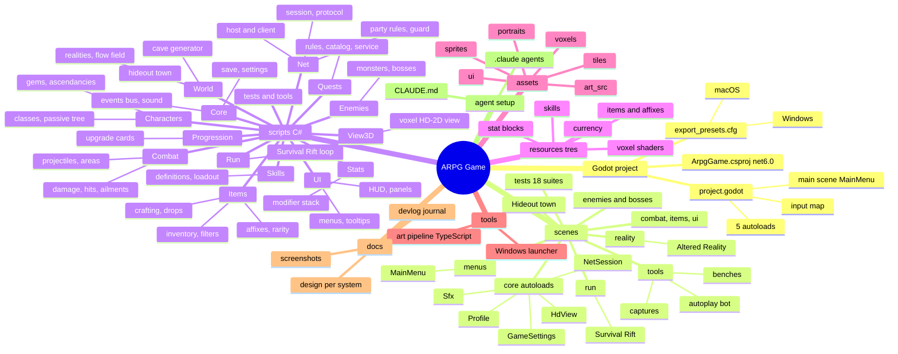
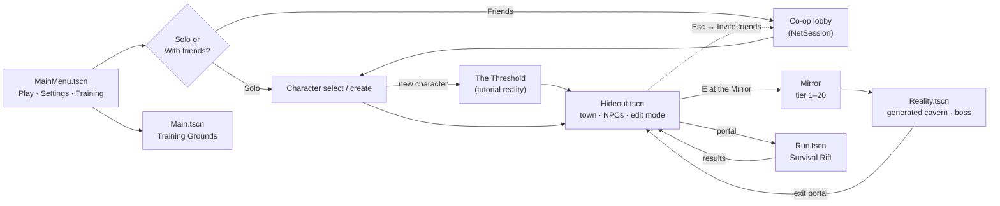
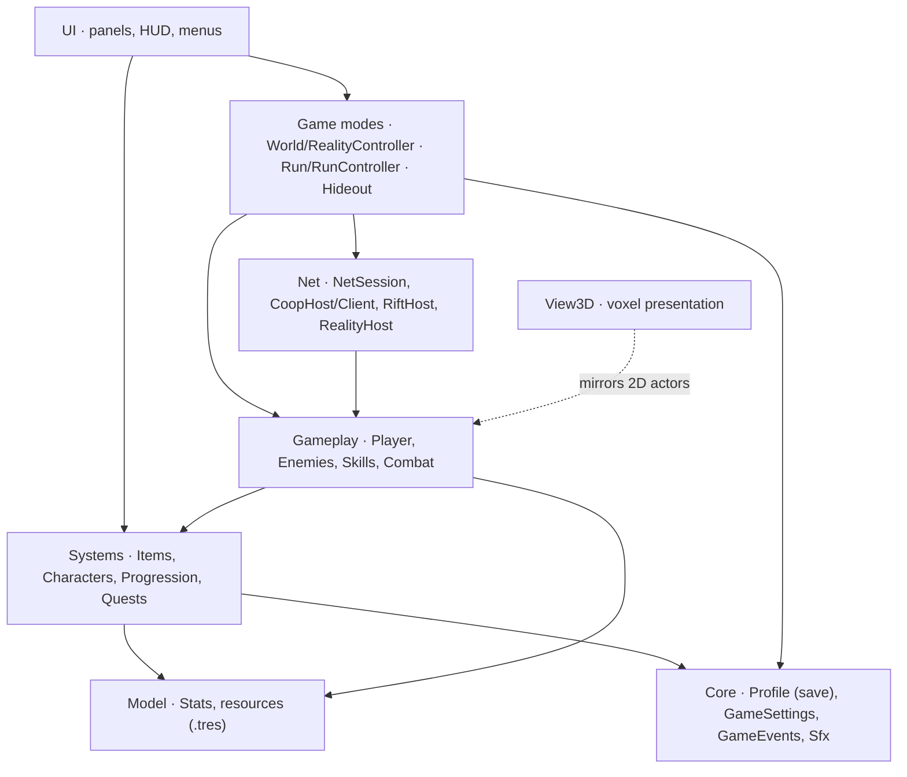

# Project map

How the repository is organised: a mind map of the folders and systems, the flow between scenes, an annotated tree, and a cheat sheet for where to look for each thing. For what the game is and how to run it, see the [README](../README.md).

The diagrams are Mermaid, which GitHub renders directly.

## Mind map



## How the scenes connect



In co-op, opening a reality or the Rift sends a **proposal** that every player answers within 30 s (`RiftProposal`, `RiftProposalPopup`). Players who accept go in together. Players who decline wait in the host's hideout.

## How the code layers depend on each other



## Annotated tree

```
arpg_game/
├── project.godot               main scene, autoloads, input map, rendering settings
├── ArpgGame.csproj / .sln      generated by Godot (net6.0); excludes tools/**
├── global.json                 pins the .NET 6 SDK
├── export_presets.cfg          Windows Desktop + macOS export presets
├── CLAUDE.md                   project guide for agents: engine rules, toolchain traps, scripts
├── README.md                   overview, controls, setup
│
├── scenes/                     .tscn files, by feature
│   ├── menus/MainMenu.tscn     title screen (the main scene)
│   ├── Hideout.tscn            the hideout town
│   ├── reality/Reality.tscn    an Altered Reality (endgame map)
│   ├── run/Run.tscn            the Survival Rift
│   ├── Main.tscn               Training Grounds sandbox
│   ├── Player.tscn             the player character
│   ├── enemies/                monsters and the three bosses (Ember Colossus, Bone Herald, Nereth)
│   ├── combat/ items/ ui/      projectile, target dummy, ground drops, damage numbers
│   ├── core/                   autoloads: GameSettings, Profile, Sfx, HdView, NetSession
│   ├── tests/                  18 headless test scenes (run_all_tests.sh runs them all)
│   └── tools/                  RunCapture, AutoplayBot, CoopBench, RiftBench, ExplosionBench, seeders
│
├── scripts/                    C# sources (about 73k lines); folders mirror the systems
│   ├── Player.cs, PlayerSkillInput.cs, Dodge.cs, Portal.cs, Hideout.cs, Main.cs
│   ├── Characters/             CharacterData, ClassCatalog, PassiveTree, Ascendancy*, GemShop, GemLoot
│   ├── Combat/                 DamagePayload, DamageMitigation, Ailments, Health, Projectile, AreaBurst, HitProfile
│   ├── Skills/                 SkillDefinition (+Projectile/Melee/Area/Orbit), SkillInstance, Loadout, CastContext
│   ├── Stats/                  Stat, StatModifier, StatBlock, ActorStats, ResourcePool (Flat → Increased → More)
│   ├── Items/                  ItemFactory, AffixRoller/Library, Rarity, Inventory, Equipment, FilterChain,
│   │                           GroundLabel(Pool), DropSpawner, LootQueue, Crafting, Wallet, Flasks
│   ├── Enemies/                Enemy base, Chaser/Charger/Ranged/Exploder, BossEnemy, EmberColossus, BoneHerald, Nereth
│   ├── World/                  CaveGenerator, LayoutBuilder/Catalog, FlowField, RealityController, RealityLaunch,
│   │                           MonsterScaling, MirrorJewels, HideoutData/Town/Catalog/Paths, TutorialGuide
│   ├── Run/                    RunController, RunState, RunDirector (spawning), RunRewards, Arena, Pickup
│   ├── Progression/            UpgradeCatalog, OfferRules, RunBuild, SupportGem (Rift upgrade cards)
│   ├── Quests/                 QuestBook (pure rules), QuestCatalog (all the copy), QuestService, QuestModel
│   ├── Net/                    NetSession (+.Party/.Hideout/.Proposals/.Edit), NetTransport, SessionProtocol,
│   │                           CoopHost/CoopClient, RiftHost/Client, RealityHost/Client, PartyRules, NetGuard,
│   │                           JoinCode, PortMapper (UPnP), NetInterpolation
│   ├── UI/                     UiTheme, HUDs (Run/Reality/Hideout), panels (Inventory, Stash, Skills, PassiveTree,
│   │                           Merchant, Artificer, Mirror, Quest*), MainMenu, CharacterSelect, CoopPanel,
│   │                           PauseMenu, PartyOverlay, RiftProposalPopup, Settings, LoadingScreen, tooltips
│   ├── View3D/                 HdView, VoxelStage, VoxelActor, VoxelLibrary, CaveWalls, VoxelDebris
│   ├── Core/                   Profile (+Validate, Quests), GameSettings, GameEvents, Scenes, Sfx, CameraShake
│   ├── tests/                  one C# driver per test scene (+ CoopTestDriver for multi-process tests)
│   ├── tools/                  RunCapture*, AutoplayBot*, CoopBench, RiftBench, ExplosionBench, captures, seeders
│   └── *.sh                    run_headless, run_editor, run_all_tests, autoplay, coop_local, capture helpers
│
├── resources/                  .tres data
│   ├── items/                  AffixLibrary, affixes/, bases/
│   ├── skills/                 Fireball, enemy/, run/ (Rift skills)
│   ├── stats/                  stat blocks (dummies, attributes)
│   ├── currency/               Gold
│   └── shaders/                voxel rock / wall / liquid shaders
│
├── assets/                     game art (generated by tools/art)
│   ├── sprites/                player, enemies, bosses, items, currency, icons, pickups, projectiles, props
│   ├── tiles/                  tilesets: town, town floors, bone crypt, drowned mirror, ashen arena
│   ├── portraits/              illustrated class portraits
│   ├── ui/                     cursors, map icons
│   ├── voxels/                 voxel models for the HD-2D view
│   └── art_src/                editable EasyPixel .epx.json sources of every sprite
│
├── tools/
│   ├── art/                    EasyPixel art pipeline (TypeScript): sprites/, heroes, voxels, launcher art
│   └── launcher/               Windows launcher and updater (.NET Framework 4.8, separate project)
│
├── docs/
│   ├── design/                 one doc per system (endgame, classes, run, items, multiplayer, …)
│   ├── devlog/                 journal.md (raw notes), screenshots/, posts/ (the first six posts)
│   └── PROJECT_MAP.md          this file
│
├── .claude/agents/             designer, godot-expert, multiplayer, performance, security, ui-ux, blogger
└── .github/workflows/          release.yml (publishes on every push to main), labels.yml
```

## Where to look for…

| I want to change… | Start in |
|---|---|
| A skill's behaviour | `scripts/Skills/`, its `.tres` in `resources/skills/`, and hits in `scripts/Combat/` |
| A stat or how modifiers add up | `scripts/Stats/Stat.cs`, `StatModifier.cs` |
| Affixes, item bases, rarity | `scripts/Items/AffixRoller.cs`, `ItemFactory.cs`, `resources/items/` |
| Loot drops and filters | `scripts/Items/DropSpawner.cs`, `DropTables.cs`, `FilterChain.cs`, `LootQueue.cs` |
| Crafting orbs | `scripts/Items/Crafting.cs`, `scripts/UI/CraftingBoard.cs` |
| Classes, the passive tree, ascendancies | `scripts/Characters/` |
| Reality generation and difficulty | `scripts/World/CaveGenerator.cs`, `RealityController.cs`, `MonsterScaling.cs` |
| Survival Rift waves and rewards | `scripts/Run/RunDirector.cs`, `RunController.cs`, `RunRewards.cs` |
| Monsters and bosses | `scripts/Enemies/`, `scenes/enemies/` |
| The hideout town and its NPCs | `scripts/Hideout.cs`, `scripts/World/Hideout*.cs`, `scripts/UI/*Panel.cs` |
| Quests | `scripts/Quests/` (copy in `QuestCatalog.cs`), `scripts/UI/Quest*.cs` |
| Saves | `scripts/Core/Profile*.cs` (`user://profile.json`) |
| Co-op | `scripts/Net/` and [`design/multiplayer.md`](design/multiplayer.md) |
| How it looks (voxels) | `scripts/View3D/`, `assets/voxels/`, `tools/art/voxels.ts` |
| Menus, HUD and panels | `scripts/UI/` (theme in `UiTheme.cs`) |
| Sprites and art | `tools/art/` (then re-export) — see [`design/art-pipeline.md`](design/art-pipeline.md) |
| Tests | `scenes/tests/` + `scripts/tests/`, run with `scripts/run_all_tests.sh` |

## Conventions worth knowing

- **One system, one folder, one design doc.** A new system gets a `scripts/<System>/` folder and a `docs/design/<system>.md` written once it is decided or built.
- **Tests are scenes.** Each prints `CHECK: PASS|FAIL` lines and a final `RESULT:` line. Judge a run by that line, never by the exit code.
- **Autoloads are optional at runtime.** Tests load scenes directly, so code checks that an autoload exists before using it.
- **Every co-op RPC is on channel 0** and goes through `NetGuard`'s size and sanity checks.
- **Tooltips** go through `UiTheme.InstantTooltip`, and **gameplay events** through `GameEvents`.
