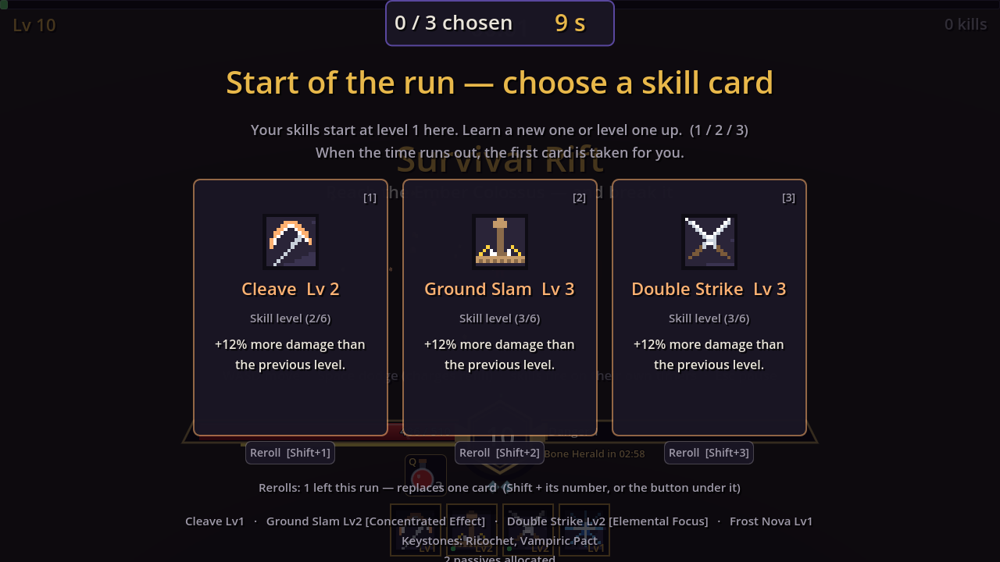
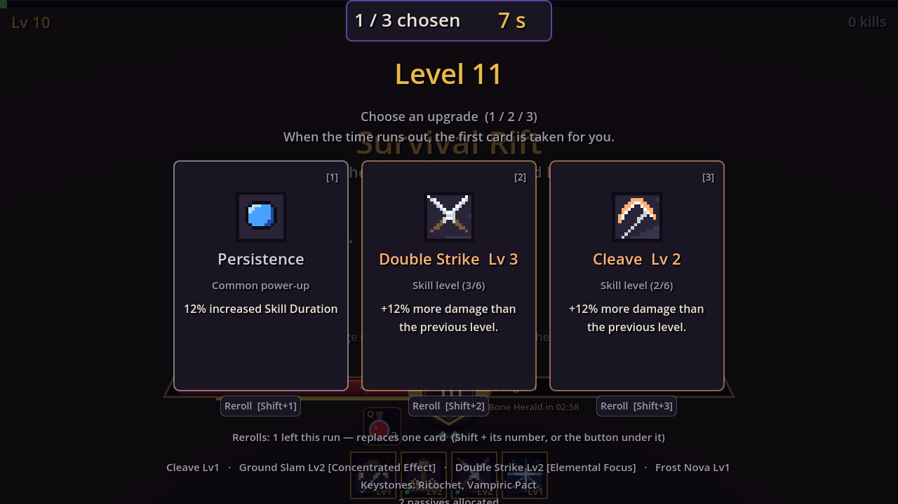
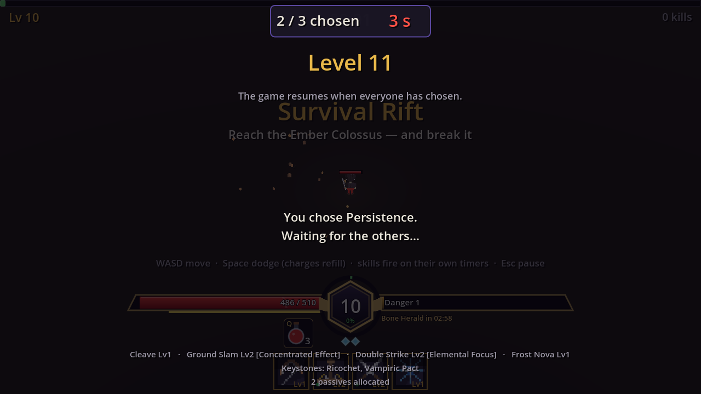

# Menus, hideout, profile, settings, audio

Status: **implemented** (first pass). Owner brief: *"functional menus — start and
basic settings — and pause with Escape mid-run."*

## Flow

```
Main menu ──► Play: character select / create ──► Hideout
    ├──► Settings                                   ├──(Mirror, E)──► Altered Reality ──(exit portal / collapse / abandon)──► Hideout
    └──► Training Grounds (sandbox, Main.tscn)      └──(portal)────► Survival Rift ──► Results ──► Hideout
```

(Updated for the endgame, 2026-10-11: "Quick Run" is gone — the Survival Rift is
entered from the hideout.)

`project.godot`'s main scene is now `scenes/menus/MainMenu.tscn`. Scene changes
go through `Core/Scenes.Go`, which also unpauses and clears the panel stack.

## Main menu

(The title and its three entries were redesigned on 2026-10-29: see "Title screen"
below. Play is now **Start**; Training Grounds left the menu.)

The arena, bosses and enemies drawn behind the title (the camera drifts), the menu,
and a line of lifetime records once there are any (runs, victories, best time, best
level, gold). Keyboard/gamepad focus works on every button.

**Play → Solo / With friends (2026-10-18).** Play opens a two-way choice in place of
the menu: **Solo** (your hideout, your rifts) and **With friends** (host a party or
join one), each with a line saying what it is, and Back (Esc). Solo opens character
select as before. With friends opens it titled "Choose who plays with friends"; the
chosen character goes on to the co-op screen ("Playing as X · Change"). A character
that hasn't played The Threshold is asked first (docs/design/tutorial.md -> "With
friends"). The old "Co-op (Survival Rift)" entry is gone (`--coop-host`/`--coop-join`
still open the co-op screen directly). Focus comes back to the button that opened
each screen (Back from the co-op screen focuses With friends, from the chooser
Play); the menu keeps references to its buttons instead of child indices, which a
notice card above them would shift (the same fix in the pause menu).

**The party-ended notice.** A guest whose party ended out in the world (the host
closed it, the connection dropped) lands here with a gold-bordered card "The party
ended — Ana closed the party." and OK, shown once (`NetSession.MenuNotice`).

## Characters

**Play** opens character select: each character with portrait (class or
ascendancy sprite), level, class, best tier, realities cleared and deaths; Play,
Delete (asks to confirm), New character. Creation: a name and one of three class
cards (sprite, attributes, description, class mechanic, starting gems,
ascendancies). Up to 6 characters.

UX pass (2026-10-16): Esc goes back one step (create → list → main menu), Enter in
the name field creates, "Create & play" is the screen's primary button (and "New
character" when the list is empty), Delete's confirmation reads "Delete — sure?" in
red, and the list scrolls past four characters so the buttons never leave a 720p
screen. The co-op screen's "Create a character" opens this panel straight on
creation; Back there returns to the main menu.

## Hideout

PoE's hideout, minimal: your persistent character with its gear, the inventory and
equipment strip (**I**), three unkillable training dummies (5000 life, 2500 regen)
to try skills on, the debug stat readout as a character sheet, and a **portal** —
walk into it to start a run. Click-to-move works here (LMB), and RMB is Fireball as
in the sandbox.

Endgame additions: the **Mirror of Realities** (E: tier picker with shard counts,
empower for gold, step through, or enter the Survival Rift), the **Altar of
Ascension** (E: choose an ascendancy, spend its points), and the character line at
the top (name, level, class, gold, best tier, unspent points). The debug readout is
hidden here now that the panels exist.

## Character panels (K / P)

Available in the hideout and inside realities, built on `ModalPanel` (pauses the
game, joins the panel stack, Escape or the button closes):

- **Skills (K)**: the 4 loadout slots with their support sockets; click a slot or
  socket, then a gem from the collection. A gem moves if it was socketed elsewhere;
  right-click empties. Only supports that fit the targeted skill are listed.
- **Passive tree (P)**: pan by dragging, zoom with the wheel, LMB allocate, RMB
  refund (gold); hover reads a node.
- **Altar**: see docs/design/classes.md -> "Ascendancies".

## Controls (2026-10-12, four skill keys since 2026-10-29)

| Key | Action |
|---|---|
| WASD | move (Shift sprint, Space dodge, Ctrl force-move) |
| LMB, RMB, Q, E | the four loadout skills, aimed at the cursor (realities, hideout) |
| 1 / 2 | life flask / mana flask |
| F | interact: Mirror, Altar, Stash, stations, the exit portal after a boss; hold F by a downed ally to revive |
| G | pick up the nearest item (hold to keep picking; walks to it if out of reach) |
| Tab (or M) | the big map |
| I / C / K / P | inventory, character sheet, skills, passive tree |
| J | quest log, in the hideout and in realities (not in the Survival Rift; docs/design/quests.md) |
| Esc | close the top panel, else pause |

In the Survival Rift skills auto-cast and auto-aim (no mana). The boss's exit
portal is used with F, never by walking onto it, since loot lands around it.

**Why four skill keys (owner, 2026-10-29).** LMB, RMB, Q and E sit under the hand that
already holds WASD and the mouse: more accessible and easier to play. If something turns
out to be missing a fifth key gets added, not before. That moved what used to live on
those keys: flasks went from Q/R to **1/2** (PoE's flask row), interact from E to **F**
(the usual "F to interact"), and pick-up from F to **G**, next to it. Pick-up stayed a key
of its own instead of sharing F: loot lands around the exit portal, and one key for both
would walk you into the portal, or keep picking up a full bag instead of leaving.
Old saves had six slots (LMB, RMB, 1-4): the first four are kept (1 → Q, 2 → E), and a
skill that sat on the old 3 or 4 moves into a slot left empty, else its gem just goes back
to the collection (`Profile.FromSave`; `LOADOUT-LEGACY-SIX` in EndgameSmokeTest). The
Survival Rift keeps up to six auto-cast skills (no keys there).

**Character sheet (C)**: attributes with what each grants, defences (life, mana,
stamina, armour, resistances, dodge), offence (speeds, critical, area,
projectiles, ailments), utility and records. **Tooltips** on the passive tree float
next to the cursor (`HoverTooltip`) instead of a line under the tree, so long text
never resizes the panel.

## Pause (Escape)

`UI/PauseMenu.cs`, in the run, the hideout and the sandbox. Escape first closes an
open panel (the inventory) — the existing `PanelStack` rule — and only pauses when
there is nothing to close. Two consumers of one key need an order-independent
handshake, so `PanelStack` now records the frame it closed something
(`ClosedThisFrame`) and whether anything is open (`HasOpen`). The pause menu never
opens over a screen that already owns the pause (level-up, results). It shows the
current build in a run, and offers Resume, Settings, Abandon run (→ results, gear
kept) and Quit.

Extra entries are a list with live labels (2026-10-18). The hideout's: **Invite
friends** (hosting: "Party & invite"; a guest: "Party"), **Edit hideout** (hidden for
a guest without permission), and the leave button "Character select" / "Close the
party" (host) / "Leave the party" (guest). In a party the menu doesn't pause.

### Party overlay (hideout) **[IMPLEMENTED 2026-10-18]**

`UI/PartyOverlay.cs`, layer 35, joins `PanelStack` (Esc closes it, not the pause
menu). It holds the co-op screen in its Invite purpose: offline, one card **Open my
hideout to friends** (port, router note) that hosts in place; hosting, the invite
card (address, code, Copy invite, router state, LAN/VPN addresses, Find my public
IP), the four slots with **Allow editing** per friend, and **Stop hosting** (with a
tooltip: everyone else goes back to their main menu, you stay here alone); as a
guest, the slots and **Leave the party**. Close never ends anything.

### Rift proposal popup **[IMPLEMENTED 2026-10-18]**

`UI/RiftProposalPopup.cs`, layer 40, a card at the top of the hideout over a game
that keeps running. **Asked**: "Ana is opening the Survival Rift", what it is (with
the party's loot bonus and monster life for the party), **Join** / **Stay in the
hideout** — the host's second button reads **Decline (cancels it for everyone)**
with "You are the host: the rift runs on your game, so it only opens if you join."
— and a 0:30 countdown that turns red with a tick every second from 5 s, only for
someone who still has to answer. **Waiting** (the proposer, or after answering):
"Waiting for the party — 1/3 joined · 1 staying" and Cancel for the proposer.
**Confirm** (walking into the portal): "Open the Survival Rift for the party?" with
Open it / Not now. Its buttons take no keyboard focus (Space dodges). Outcomes are
toasts under the menu bar ("Ana's rift was cancelled — the host declined", "The
party set off without you…"), and a standing gold line while the party is away:
"Ana's party is in the Survival Rift · 3:12 — wait here, you're asked next time".

## Settings

`Core/GameSettings.cs` (autoload) persisted to `user://settings.cfg`; the panel
(`UI/SettingsPanel.cs`) is shared by the main menu and the pause menu, applies every
change live and saves on close.

Three tabs (2026-10-15 — the single column had grown taller than the screen,
hiding the Gameplay section and Back); each tab scrolls on its own and Back is
always visible.
The panel keeps **one size on every tab** (2026-10-16, owner report: it resized on
each switch). A TabContainer measures only the open tab by default, and the
Display tab's rows are the widest; `UseHiddenTabsForMinSize` makes it measure them
all, and the panel is 720 px wide. RunSmokeTest `SETTINGS-TABS-KEEP-SIZE` switches
through the tabs and compares sizes (it read 600 → 728 → 600 px before the fix).

- **Audio**: master, music, effects volume (Music/SFX buses are created at startup).
- **Display**: **window mode** — Windowed, **Borderless** (a window covering the
  screen; the default) or Fullscreen (exclusive); **window size** for windowed
  (1280×720, 1600×900, 1920×1080, 2560×1440, centred, clamped to the screen);
  V-Sync; Show FPS (the voxel graphics toggle was removed on 2026-10-29: art-pipeline.md). The game lays out at 1280×720 and scales to
  the window (`canvas_items` stretch, `expand` aspect), so 1920×1080 is exactly
  ×1.5. Old settings files: `fullscreen=true` becomes Fullscreen, `false` (the old
  default) becomes Borderless.
- **Ultrawide** (2026-10-15, the owner plays on one): wider than 16:9, the view
  simply widens (`expand`): 21:9 at 1080 lines is a 1707×720 layout, the world
  shows more to the sides, the voxel camera follows, and HUD pieces stay on their
  anchored corners. A toggle keeps 16:9 with side bars instead
  (`FillWideScreens`, `ContentScaleAspect` Keep). Windowed sizes include
  2560×1080, 3440×1440, 3840×1600 (21:9) and 5120×1440 (32:9). Checked at
  2560×1080 across menus, town, panels, realities and the HUD editor; the one
  panel placed at a fixed x (the inventory, at 848 = 1280 − 432) is now anchored
  to the right edge. Screenshots: `ultrawide-inventory.png`, `ultrawide-reality.png`.
- **Gameplay**: overhead bars, screen shake, damage numbers (**Full / Compact / Off**,
  see "Damage numbers" below), admin mode, and the controls reminder. (Auto-aim and auto-cast stay internal: the Survival Rift
  always auto-aims, realities aim with the mouse.)
- **Show FPS** (2026-10-15, also **F3** anywhere): a readout in the top-left corner
  (`UI/FpsOverlay.cs`, a layer under the settings autoload so it survives scene
  changes) with frames per second, the average frame time and the **worst frame of
  the last second**, coloured yellow over 25 ms and red over 50 ms. The worst frame
  is the number to watch for hitches: one 80 ms frame among sixty barely moves the
  FPS figure. Off by default; saved like the rest.
- **Admin mode** (2026-10-15, testing): adds a "Test character" button to character
  creation — maximum level (70) with every passive point free, the introduction
  skipped, gems at level 20, 1 000 000 gold, three shards of every tier with every
  tier counted as cleared (so Arehucaz sells them all), and 50 of every crafting
  orb added to the account (`Profile.CreateTestCharacter`). Off by default.

Screen shake can be turned off without losing information: every shake accompanies
a visible telegraph or flash.

## Level-up and results

- Level-up: three cards (keys 1–3), the build so far underneath. Queued level-ups
  are offered back to back. Card colour: gold great keystone, pale gold lesser
  keystone, ember new skill, green support, rarity colour for power-ups. Keystone
  rows say which tier ("Level 10 — choose a Great Keystone").
- **Per-card reroll (2026-10-17):** a small "Reroll [Shift+N]" button under each
  card replaces only that card; **Shift+1/2/3** does the same from the keyboard
  (progression.md -> "Rerolls"). Two per run, shown under the row ("Rerolls: 1 left
  this run — replaces one card"); with none left the buttons grey out. R (the old
  reroll-everything key) only shows that hint now, so muscle memory doesn't spend a
  charge on the wrong card. Shift+number was chosen over "R then a number" because
  it is one chord with no hidden mode, and Shift is not otherwise used while the
  cards own the keyboard (in co-op dodge/flasks stand down already).
- **The start pick** is the same row: "Choose your first skill" for a skill-less
  character (class skills), "Start of the run — choose a skill card" otherwise
  (with the character's skills, now level 1, in the build line). Rerolls work there
  too.
- **The cards own the keyboard while open** (owner feedback 2026-10-16: a stray key
  made the window vanish — the first card had keyboard focus, so Space, the dodge
  key, or Enter picked it). Every key is swallowed before the GUI and gameplay see
  it; only 1–9 (pick) and Shift+1–9 (reroll that card) act. Cards and reroll
  buttons take no keyboard focus. For the first 0.45 s the row is shown dimmed and
  ignores keys and clicks, so a press already on its way when the cards pop up
  doesn't count. Dodge, flasks and the inventory key also stand down while it is
  open (`LevelUpScreen.BlocksInput`; it mattered when co-op kept running under the
  cards, and still does for tests that drive the cards over a running tree). Tests: RunSmokeTest
  `LEVELUP-*`, RiftProgressionTest `REROLL-UI-*`.
- **Co-op (2026-10-17, multiplayer.md -> "Level-ups"):** the same screen, opened by
  the host's round for every player at once, with the whole game paused. A panel at
  the top shows **"1 / 3 chosen"** and the **countdown** ("7 s"). The countdown is gold,
  turns **red at 5 s**, and ticks every second (a dry click, a brighter one in the
  red). Under the row's hint: "When the time runs out, the first card is taken for
  you." After choosing, the row gives way to "You chose Fireball. Waiting for the
  others…" at the same height, and the hint becomes "The game resumes when everyone
  has chosen." If the timer chose: "Time's up — Fireball was taken for you." Several
  levels at once show "(1 more after this)" in the title, one round each. The start
  pick in co-op is the same panel over the start row. Why the counter at the top: it
  is the first thing a waiting player looks for, and the bottom of the screen already
  holds the reroll line and the build summary.
  Capture: `RunCapture --only=rift` (`coop-*.png`).

  
  
  
  
- Results: victory/defeat, time, level, kills, elites, bosses, gold, the build, and
  **three items — keep one**, shown with the normal item tooltip text. A run too
  short for an item (run.md -> "Minimum for an item") shows no cards and a dim line
  saying why and what it takes. A kept item that finds the bag full says "sent to
  Pending items (your inventory is full) — take it from the stash in the hideout"
  (and, at Pending items' cap, which old item was sold for how much).
- Stash: the last tab is **Pending (n/20)**, ember while something waits; the stash
  opens on it then, and the hideout's arrival banner points at it (items.md ->
  "Pending items").
- Leaving the results before choosing forfeits the item, so the first press of
  "Return to hideout" or "Main menu" turns it into "Leave without an item?" and says
  so above the cards; the second press leaves (2026-10-16). Buttons are sentence
  case like every other menu.

## Profile

`Core/Profile.cs` (autoload). The persistent character: equipped gear, the
inventory grid, gold, records. The live `Player` owns its inventory/equipment while
a scene runs; scenes call `ApplyTo(player)` on spawn and `CaptureFrom(player)`
before leaving. Saved to `user://profile.json` on every capture: items are stored
as base id + rarity + item level + name + rolled base stats + affixes (id, tier,
value) and rebuilt with `EquipmentItem.Restore` — nothing is re-rolled on load. The
run build and run-only bonuses are stripped before capture.

## Cursor **[IMPLEMENTED 2026-10-16]**

The game draws its own cursors, pixel art from `tools/art/sprites/cursors.ts`
in the bronze-and-gold of the UI (`UI/GameCursor.cs`, under the GameSettings
autoload):

- **Arrow**: the default; a bronze gauntlet arrow with a garnet set in it.
- **Hover arrow**: the same arrow, white-hot with a blue gem, over every button
  (any `BaseButton` added to the tree gets the shape automatically).
- **Sword**: over a monster, driven by the target frame's "monster under the
  mouse" check that already ran every frame (bosses included).
- **Gauntlet hand**: over an item on the ground, its sprite or its ground label.
  The hand wins over the sword, because an item lying among monsters is what a
  click acts on.

They are hardware cursors (`Input.SetCustomMouseCursor`): no per-frame cost and
no lag behind the mouse, which a sprite drawn by the game would have. The art is
tiny (13–16 px) and scaled up with nearest filtering to suit the window: 2× up to
1080p, 3× at 1440p and 4× at 4K, re-applied when the window is resized. Custom
cursors are mapped onto Godot shapes the UI doesn't otherwise use (Cross for the
sword, Help for the hand). Headless runs skip all of this.

Rejected: a software cursor (a sprite following the mouse), which lags a frame
behind and disappears while the game hitches; a crosshair for aiming, since
ARPGs keep a pointer and the target frame and telegraphs already show aim.

## Look

`UI/UiTheme.cs` builds one theme in code (deep violet panels, gold for selectable
things, ember for warnings) and the screens are assembled from its helpers rather
than hand-laid `.tscn` files — consistent, resolution-independent, one place to
tune. The window is 1280×720 with `canvas_items` stretch; the default texture
filter is Nearest for the pixel art.

Added 2026-10-16 (co-op UX pass):

- **`UiTheme.PrimaryButton`**: warm bronze fill with a gold border, for the one
  action a screen exists for (Host lobby, Join, Start run, Try again, Create &
  play, Create a character). Everything else stays the plain button.
- **Text fields** are themed (dark glass, gold when focused, dim placeholder) via
  `UiTheme.Field`; `UiTheme.FieldError` turns the border ember for a field with a
  mistake, and the message sits right under the field.
- **`UI/Spinner`**: a drawn turning arc for anything that takes more than a moment
  (no font glyphs needed).
- Rules applied across the menus: every action shows feedback at once; anything
  slow shows what is happening, the elapsed time and a way out; errors appear next
  to where you acted and say what to do; Esc goes back one step (except out of a
  co-op lobby, which would end it for everyone); Enter submits a form.

## Audio

`Core/Sfx.cs` (autoload) synthesises every sound at startup (short envelopes over
sine/square/noise) and three looping music beds (menu, run, boss). There are no
audio assets yet; replacing any sound with a real file is a one-line change.

## Co-op **[REDESIGNED 2026-10-16]**

`UI/CoopPanel.cs`, from the main menu. Owner report: *"when my friend typed the IP
and pressed Connect, absolutely nothing happened"*, and *"does the code do anything,
or would the IP alone be enough?"*. The old screen was one long form (port, Host,
address prefilled with `127.0.0.1:7777`, code, Join, a paragraph of advice, a status
line, the party). Findings, from captures (`coop-before-*.png`):

1. **Without a character both buttons were disabled** and the only hint was a dim
   line under the title. A friend who just installed the game clicks Join and
   nothing at all happens. Blocker.
2. **A dead address said nothing useful for ~30 s.** The form vanished, "Connecting
   to …" sat there with no progress, no elapsed time and no Cancel (only Leave/Back),
   and then the form came back with one orange line. That is ENet's own timeout.
3. **The address field was prefilled with 127.0.0.1:7777**, so a typo-free "it's
   already filled" join went to your own PC.
4. **Nothing explained that both the IP and the code are needed.** The code is
   mandatory (the host checks it before admitting anyone, see multiplayer.md →
   "Security"), the IP alone is never enough.
5. A wrong code, a full party and a run already started all came back as one status
   line in the middle of the panel; the lobby listed only the people present (no
   sense that four fit); copy feedback replaced the status line.

The screen now shows one state at a time:

- **Choose:** two cards. *Host a game* (what you get, the port as a small advanced
  field, **Host lobby**) and *Join a friend* ("you need both: the address finds
  their PC, the code lets you in", **Host's address**, **Join code**, **Join**). The
  address starts empty with an example placeholder. Mistakes are shown under the
  field with an ember border, and focus jumps to the first wrong field. Enter in the
  address moves to the code (or joins if it's filled), Enter in the code joins. A
  one-line footer says which address to use where (same PC, same Wi-Fi, internet,
  VPN).
- **Invite:** the host's **Copy invite** puts `203.0.113.7:7777 K7Q-29M` on the
  clipboard. Pasting it (or a chat line containing it, even with the code typed in
  two halves) into the address field fills both fields and says so
  (`NetTransport.TryParseInvite`).
- **Connecting:** a spinner, "Joining <address>", the three steps (reaching the
  host's PC → checking the join code → joining the party, done ones in green), the
  elapsed seconds, "no answer yet, gives up after 12 s" after 4 s, and **Cancel**
  (Esc). It gives up after `NetSession.ConnectTimeout` (12 s) instead of ~30.
- **Failed:** a title that names the cause (*Couldn't reach the host*, *Wrong join
  code*, *The party is full*, *The run has already started*, *Different game
  versions*, *Your character was refused*, *The host turned the connection away*,
  *The host closed the lobby*) and a "What to check" list for it. For an unreachable
  host: the exact address with port, the host still in their lobby, the router line
  in the host's lobby (UPnP) → forward UDP 7777 or a VPN, the firewall, same PC /
  same Wi-Fi addresses. A wrong code says the address was right. **Try again**
  (primary) and **Change address or code** (fields kept).
- **Lobby (host):** left, *Invite friends*: the address (24 px) and the join code
  (34 px, gold), each with Copy, New code, **Copy invite**, what kind of address it
  is (internet when UPnP opened the port, else a VPN address, else LAN), the router
  state in green/ember, and other LAN/VPN addresses with their own Copy invite.
  Right, *Party n/4*: **four slots**: portrait, name, level and class, Host/You tags;
  free slots read "Free — waiting for a friend · Send them the invite". **Start run
  — n players** is the primary action; Close lobby ends it. The last two security
  lines sit under the slots.
- **Lobby (client):** the same four slots, "In the party — waiting for <host> to
  start the run" with a spinner, Leave.
- **No character:** "You need a character first", why, and **Create a character**,
  which opens character creation directly.

Copy confirmations and host errors appear under the title, not in the slot of the
status line. Esc: Cancel while connecting, back to the form from a failure, Back
from the choice; it does nothing in a lobby (leaving ends it for the host's
friends).

How the screen tells failures apart: `NetSession.Phase` (Connecting, CheckingCode,
Joining, InLobby, with `PhaseSince`/`JoinStarted` for the elapsed time) and
`NetSession.LastEnd` (`SessionEnd`), set where the session ends. The host's refusal
texts are constants in `JoinRefusal` and the client classifies the reason it
receives (both ends run the same build; the protocol number is checked first).

Rejected:
- **A single address field that accepts only `ip:port code`.** Two labelled fields
  teach the model (address + code); the paste shortcut covers the fast path.
- **Showing the failure as a modal.** The failure card replaces the form in place,
  so Try again is where the Join button was.
- **Auto-retry on failure.** It hides the cause and multiplies wrong-code attempts
  against the host's limiter (5 a minute per address).

Tests: `CoopUiSmokeTest` (see multiplayer.md → "Testing"). Captures: `RunCapture
--only=coop` (start, inline errors, host lobby with free slots, friend's lobby,
wrong code, connecting, unreachable) and `--only=menus` (every menu from the title
screen, as a new player and with characters).

Open questions:
- An internet-reachability self-check for the host (would need an outside echo
  service, which we don't run). Relays (multiplayer.md) make it moot.
- Showing the host's own failed-join attempts more prominently than the last two
  security lines.

## UX review 2026-10-18: plan **[IMPLEMENTED 2026-10-18]**

A review of four owner requests from captures of the current build
(`docs/devlog/screenshots/review-*.png`, taken with `RunCapture --only=crafting`,
`town`, `update` and `endgame`). The plans live with their systems; this is the
index and the findings by severity.

| Severity | Screen | What a player would say | Plan |
|---|---|---|---|
| Blocker | Altar of Ascension | "I clicked Become a Samurai to read about it, and now I'm a Samurai forever." One click, permanent, no confirmation. | Two-step confirm (quests.md -> "The altar's confirmation") |
| Confusion | Hideout, after a tier-5 clear | "Nothing told me the altar woke up." | Quest `ascend` with markers everywhere (quests.md) |
| Confusion | Mirror, Jewels tab | "I found a jewel; what is it for?" | Quest `mirror_jewel` (quests.md) |
| Confusion | Arehucaz | "Why does he only sell some tiers?" | Quest `arehucaz_shards` (quests.md) |
| Confusion | Artificer's forge | "What is dust for?" | Quests `forge_disenchant`, `forge_forge` (quests.md) |
| Confusion | Skills panel (K) | "Where do I get more skills?" | Odran's Skill gems tab + a line in K (hideout.md -> "Odran's Skill gems tab") |
| Confusion | Survival Rift, endless phase | "What do I get if I leave now? How do I leave?" | Cash-out offer, reward panel, tiers (run.md -> "Cash-out offer") |
| Polish | Inventory, Crafting tab | "Orb tooltips take ages to show." | Instant themed tooltips everywhere (crafting.md -> "Orb tooltips") |
| Polish | Rift results | Item card text is clipped at five cards. | Drop the "Hold Alt" line in results cards (run.md -> "Reward tiers") |

Status (2026-10-18): the altar's two-click confirm, Odran's Skill gems tab, the
cash-out offer with the reward panel and tiers, the results-card fix and the instant
tooltips are built (the sections they point to say how, and where they deviated). The
six quests and the J log are built too (quests.md -> "Implementation"): `GameEvents`
(`scripts/Core/GameEvents.cs`) is the hook the quest system listens to.

New shared pieces for `UiTheme` / the UI kit, so no screen invents its own:

- `UiTheme.InstantTooltip` (one tooltip look and timing everywhere) **[built]**.
- `ModalPanel.SetQuestStrip` (a quest hint band under any panel's title) **[built]**.
- `QuestToast` (layer 15) and the "!" / "?" marker glyph (`QuestMarker2D` in the
  world, the same drawing, `QuestGlyphs.DrawMarker`, in the HUD and maps) **[built]**.
- `CashOutPanel` reuses the level-up cards' rules: whole-card buttons, number keys,
  a 0.45 s input guard, the cards own the keyboard **[built]**.

Menu bar: a **J · Quests** chip between P and H, with an ember badge for new and
ready quests **[built]**.

## Open questions

- Key rebinding UI (the actions exist in `project.godot`).
- A stash and a vendor in the hideout (gold has no sink yet).
- Controller support pass (focus works; dodge/aim on sticks does not yet).


## In-game HUD: the bottom-centre cluster **[IMPLEMENTED 2026-10-12, REPLACED 2026-10-29 by "HUD: the mirror"]**

Modelled on the owner's reference (AION 2). `UI/PlayerHudBar.cs`, shared by the
reality and Survival Rift HUDs:

- A long red **life bar** on the left and a cyan **mana bar** on the right, slanted
  at their outer ends, both draining towards the centre, with a lighter trail that
  shows recent damage before catching up. Values sit by the inner ends.
- A **hexagonal level badge** where they meet, ringed by an **experience arc**
  (with the percentage under the level).
- Under the bars: stamina (left), class-resource pips (right), the **flasks** as
  bottles with their key (Q, R) and charges, and dodge charges as diamonds under the
  badge. The **skill row** (LMB, RMB, 1-4) is its own control below the cluster.

It replaced bottom-left progress bars and a separate skill row: one cluster at the
bottom centre keeps the eye near the character. Custom-drawn rather than built
from ProgressBars so the bars can be slanted, mirrored and trail.


## HUD layout editor **[IMPLEMENTED 2026-10-12]**

Pause (Esc) → **Edit HUD**. The game stays paused, the pause menu steps aside and
every movable panel gets a labelled frame that can be dragged anywhere on screen
(kept at least half on screen). **Reset layout** puts everything back; **Done** or
Esc saves and returns to the pause menu.

- Panels register with `HudLayout.Register(control, id, label, preview?)`, which
  adds a `HudMovable` node that records the panel's default position once the HUD
  has laid itself out and applies the saved offset. The layout is one offset per id
  in `user://hud_layout.cfg`, in the 1280×720 canvas the UI is authored in (the
  stretch mode scales it to any window).
- Movable now: character name, reality info + minimap, boss life, the life/mana
  cluster, skills, notifications, the introduction guide; in the Survival Rift
  level, timer and kills too. Ids are shared, so moving the life cluster or the boss
  bar in a reality moves it in the Survival Rift as well.
- Panels that are usually hidden show a placeholder while editing (a sample boss
  bar, a sample notification) so they can be placed before they are needed.

- **Resizing** (added on request): drag a frame's corner grip, or use the mouse
  wheel over it, to scale the panel from 50% to 200%. Panels scale around their
  centre (the corner follows the cursor) and are nudged back inside the screen if
  growing pushed them off an edge. The size is saved next to the offset
  (`[scales]` in the same file); Reset puts sizes back to 100% too.

Rejected: per-screen layouts (players expect "my life bar is here" everywhere) and
non-uniform stretching (bars and icons would distort).

## Overhead bars **[IMPLEMENTED 2026-10-12]**

A small life bar (and mana bar, where there is mana) floats over the player so
you can watch it without looking down. `UI/OverheadBars.cs` is a world-space child
of the Player, drawn above the world; the life bar keeps the same damage trail as
the HUD and pulses below 30%. Settings → "Life and mana bars over your character"
turns it off.

## Overlay map **[IMPLEMENTED 2026-10-12]**

**Tab** toggles a large, see-through map over the game in realities, Diablo / Path
of Exile style, centred on the player so it can stay open while fighting: explored
floor as a faint wash, walls as bright outlines, the boss gate, the entrance, the
boss arena (or the exit portal once the boss is down), visible monsters (coloured
by rarity, bosses bigger) and the player as an arrow pointing where they move.
The corner minimap stays. `UI/MapOverlay.cs`; the key comes in through `_Input`
(the overlay is hidden most of the time).
**M** opens it too (2026-10-16), the same key as the hideout's big town map
(docs/design/hideout.md -> "Town map").
In co-op (2026-10-23) the overlay and the corner minimap show the allies as dots in
their party colour (named on the overlay, held at the screen's edge when beyond it), and
the Survival Rift gets a small party minimap of the arena, co-op only
(multiplayer.md -> "Allies on the maps").


## Target frame **[IMPLEMENTED 2026-10-12]**

Replaces the flat boss bar, modelled on AION 2's target frame (`UI/TargetFrame.cs`):

- **Name line:** the monster level in a bronze ring, the name in its rarity colour
  (bosses in ember).
- **The bar:** an ornate frame with arrow-tip caps, a recent-damage trail, phase
  marks at the boss's thresholds (the next one pulses as life closes in), the
  percentage, a rank badge on the right tip (a star for bosses and uniques, a
  diamond for rares) and a central emblem showing the boss's element (flame for
  the Ember Colossus, a skull for the Bone Herald, water for Nereth).
- **Under it:** the monster's modifiers as tags, a **cast bar** that fills until a
  telegraphed attack lands (with the attack's name), and the **ailments** on the
  target (ignite, chill, shock, poison stacks, curse) with their time left.
- **Who it shows:** the boss during its fight; otherwise the monster under the
  mouse (kept for 3 s after the cursor leaves it), or the nearest awake rare or
  unique within ~7 m. So rares get their name, life and modifiers on screen too.

The cast bar needed no per-attack timing: `BossEnemy` records the window of its
pending telegraphs (`Slam`/`Lane`, and the few direct spawns call
`NoteTelegraph`), and the bar runs from the first telegraph to the last impact.
The frame is the "Target / boss life" panel in the HUD editor.

## Hideout HUD **[IMPLEMENTED 2026-10-13]**

The owner found the hideout's explanations unintuitive: a status line top-left, a
two-line wall of key hints along the bottom and a bare "[E] Mirror of Realities"
text. They became pieces that each explain one thing, styled like the rest of the
HUD (dark glass panels, gold accents, the AION-style cluster):

- **Character plate** (top left): class portrait, name, level and class, best tier
  cleared, an XP bar, gold with its coin icon, and a gold pill when there are points
  to spend ("2 passive points to spend ›" opens the tree; "Ascendancy ready at the
  altar ›" walks you there).
- **Menu bar** (top centre): key caps for I, C, K, P, H, ? and Esc with what they do
  underneath. They are buttons too, so the keys are learnt by seeing them; P shows a
  badge with unspent passive points.
- **Town directory** (top right; on the left under the plate since 2026-10-29, the
  top right being the minimap, clock and quests): every station, coloured by its accent, with the
  quarter it's in, the distance and an arrow pointing at it from you. Clicking a row
  walks you there on the navigation mesh; the altar row gets a dot when ascendancy
  points are waiting. Since stations can be moved in edit mode, quarters and
  arrows are computed from where they stand now.
- **E prompt**: a card floating over the station you stand next to: a key cap, the
  station's name in its accent colour and what it does ("Craft", "Open realities",
  "Walk in — endless waves..."). That station's own world label hides while the
  card shows.
- **Life, mana, flasks and skills**: the same cluster and skill row as in realities,
  so the training dummies are a real place to try skills.
- **Town guide** ("Your hideout"): opens by itself on an account's first visit and
  from ? / F1 or the menu bar afterwards. A card per station (picture, what it's
  for, which quarter it's in now, a "Show me" button that walks you there) and the
  controls that matter in town.
- A "Hideout" banner fades in on arrival (with "1 new quest · J opens your quests" when
  quests wait).
- **Quest tracker** (in the top-right corner under the minimap and clock since
  2026-10-29) and the J chip: quests.md.

All new panels are movable in Edit HUD (`character`, `hideout_menu`, `town`,
`vitals`, `skills`, `quests`). The whole HUD hides while the town editor is open.

## Feedback **[IMPLEMENTED 2026-10-13]**

Esc → **Send feedback** opens a form inside the pause menu: kind (**Bug**, **Idea**,
**Feature request**), a one-line title, a description, an optional second field
(steps to reproduce for bugs, "why would it help?" for requests) and a checkbox to
include game info (version from `version.txt` next to the executable, OS and GPU,
window size and voxel view, where the player is, character level and class —
nothing personal). It's shown before sending.

**Open on GitHub** opens the repository's new-issue page in the browser with the
matching **issue form** (`.github/ISSUE_TEMPLATE/bug_report.yml`, `idea.yml`,
`feature_request.yml`) and every field filled in through URL parameters; the player
only presses Submit. The forms apply the labels `bug`, `idea` and `enhancement`
(labels passed in the URL are ignored for non-collaborators, form labels are not),
and `.github/workflows/labels.yml` makes sure those labels exist. **Copy text** puts
the same report on the clipboard as Markdown. Very long reports are trimmed to keep
the URL under GitHub's limit.

Why not create the issue directly from the game: that needs a GitHub token inside the
client, which anyone can extract from a .NET build and use to spam the repo. The
planned next step is a relay (most likely a Discord integration: a webhook into a
forum channel with tags, behind a small relay that holds the secret), which would
let players send feedback without a GitHub account. The form stays the same; only
`Feedback`'s sending step changes.

## HUD and side panels **[IMPLEMENTED 2026-10-13]**

The owner caught the hideout HUD painting over the open inventory (town directory,
menu bar and the mana end of the life/mana cluster all drew on top of it). Two fixes:

- The inventory draws **above every HUD** (layer 12; realities and the Survival Rift
  draw their HUD at 10, the hideout at 4), still under modal panels and the tooltip.
- An open inventory is a **blocker** (`HudLayout.AddBlocker`). Each movable HUD panel
  says what it does when one opens over it (`HudAvoid`): the menu bar and the boss /
  target frame **slide** sideways out from under it; the town directory and the
  reality info and minimap **fade** out; the life/mana cluster **stays** and the
  panel covers its right end, as in Path of Exile. Everything slides back when the
  inventory closes; the shift is temporary and never saved into the HUD layout.

## Loading screen (2026-10-14)

Entering a reality, the Survival Rift or the hideout goes through a loading screen
(`LoadingScreen`, scripts/UI/LoadingScreen.cs, from `Scenes.Go`): a dark screen with
a title ("The Mirror opens" / "A new reality takes shape…"), a walking ring of dots,
shown *before* the scene change starts so the frozen frame of a heavy load — a
reality generating its cavern and building the voxel world — is never seen. It
lives on the tree root, waits for the new scene to run a few frames, holds at least
0.45 s so it never flickers, and fades out in 0.35 s. The main menu and the sandbox
load directly.

## Damage numbers **[IMPLEMENTED 2026-10-24]**

Owner's reference: a 10 s clip of a combat MMO hitting a training scarecrow. What it
does well, and what we took: numbers don't scatter around the target, they **stack in a
column** beside it; each hit can carry a **tag line in caps** above the number; **big
hits are huge** with a golden horizontal streak, small hits are compact lines; the
**skill's icon** sits next to the number. Before, every hit was a 20 px gold label
rising 24 px from a random spot over the target for 0.6 s, the same for a crit, a
tick or an ally's hit, and in the town it drew *under* the dummies' sprites.

Screenshots: `damage-numbers-before.png` / `damage-numbers-after.png` (town dummies),
`damage-numbers-before-horde.png` / `damage-numbers-horde.png` (Survival Rift).
Capture: `RunCapture -- --only=damage` (`--damage-prefix=before` for a baseline).

**The column.** One per target, anchored just right of its head (`Enemy.NumberOffset`;
dummies a little higher), following it while it lives and staying put when it dies.
The newest line is at the bottom; older ones are pushed up and the oldest fades out at
the top. A column holds 6 lines and at most 250 px (about four big crits); pushed-out
lines slide above the stack while they fade, never through it. Lines last 1.0 s (big
1.35 s) and fade over the last 0.3 s. Sizes are in **screen pixels** whatever the
camera zoom (the layer scales by 1/zoom), so the town's close camera and the Rift's
wide one read the same.

**Tags.** Only qualities the game already resolves per hit: **CRITICAL**
(`DamagePayload.IsCrit`), and the ailments that hit actually applied: **IGNITE**,
**SHOCK**, **FREEZE**, and **CHILL** when it newly chills (every cold hit chills, so
tagging each refresh would be noise). `Ailments.LastHitApplied` records them; the
number is built from `Health.HitPresented`, a presentation-only event raised after
every gameplay listener, so the roll is already known. No damage-type tag: the colour
says it, and a "FIRE" on every fireball hit would bury the tags that matter. No block
tag on monsters (they have none); a block or evasion by the player says **AVOIDED**.

**Size by importance.** Big (40 px slanted bold, a 0.16 s punch from 1.8×, a golden
streak that flashes and settles over 0.7 s): a crit, a hit of ≥ 8 % of a boss's or
unique's life or ≥ 30 % of a rare's, or 2.5× the recent average of your hits (an
exponential average over your own hits). Normal: 22 px. In Compact, and for a trash
monster's crit in a crowd, a crit is a 24–28 px gold line with no streak. At most 5
flashes start per 0.3 s (2 in a crowd); later ones are medium.

**Icon.** The skill's own icon (`SkillDefinition.Icon`, the one the skill bar shows),
carried as `DamagePayload.Skill` from `HitProfile` (presentation only: no rule reads
it). Hits with no skill (an explosion, thorns) have none.

**Colours** (`UiTheme`): physical warm gold, fire orange, cold ice blue, lightning
lavender (yellow was too close to the gold), poison green for its ticks, crits a
brighter orange-gold, damage taken red. Tags take their element's colour, CRITICAL
gold. Text is the default font emboldened with a dark outline, so it reads on the
dark caves and on the bright town floor.

**Who dealt it.**
- *Your hits:* everything above.
- *Another player's hits:* **no number, for anyone** (owner decision, 2026-10-24). The
  first version drew a co-op ally's hits dimmed on the host; that style is gone. Each
  player sees only their own hits (and the damage they take); a hit someone else dealt
  is skipped in `DamageNumberLayer.ShowHit`, and clients are only sent their own.
- *Damage over time and explosions* (`Health.ApplyResolvedDamage`): one small 16 px
  line per target in the ailment's colour that **sums its ticks** for up to 3 s,
  instead of a number every 0.5 s.
- *Damage you take:* red, 22 px (28 px for ≥ 10 % of your life), floating up just
  left of your character and never in a column, so incoming and outgoing never mix.
  Hits within 0.12 s sum. Only the local player's (an ally's shows on their screen).

**Hordes.** The Rift kills dozens at once, so the presentation degrades on purpose:
- More than 6 columns alive (or 90 lines) is a *crowd*: columns hold 3 lines, small
  lines are 19 px, trash crits lose the streak (elites and bosses keep it).
- Rapid same-kind hits on one target (orbit blades, multistrike, a projectile
  volley) merge into the newest line and show the sum (within 0.12 s, 0.35 s in a
  crowd, for at most 0.4 s / 0.9 s).
- At most 24 new lines start per frame and 120 live at once; past that, only crits
  and big hits get a line, and nothing past 144.
- One `DamageNumberLayer` per scene (a child of the current scene at z 90, so above
  every sprite and y-sorted prop) owns every line. One `_Process` moves them all; a
  line is one `Node2D` that draws itself (`_Draw`: icon, streak, outlined text) and
  redraws only while its streak animates. Finished lines hide and are reused (24
  pre-made, up to 160 kept); columns are pooled too.

Measured with `ExplosionBench` (60 Slimes killed in one frame, headless, median of 3):
the kill call's "hit + damage number" share went from 4.1 ms to 0.7 ms in a reality
and from 4.1 to 0.8 ms in the Rift; the whole kill call from 9.6 to 5.8 ms and from
11.4 to 8.1 ms (docs/design/performance.md).

**Co-op.** The host sends a client's own hits as before, plus one byte of qualities
(crit, type, ignite/chill/shock/freeze applied, heavy) and the skill's loadout slot,
which the client turns back into its own icon (protocol 8). A client's line is the
same as the host's would be.

**Setting.** Settings → Gameplay → Damage numbers: **Full** (all of the above),
**Compact** (numbers only: no tags, no icons, no streak, 3-line columns, crits a
gold medium line) or **Off**. Old settings files' on/off flag maps to Full/Off.

Tests (`StatsSmokeTest`, through the real `Health.TakeDamage` path on a dummy):
`DMGNUM-ONE-COLUMN-PER-TARGET`, `DMGNUM-RAPID-HITS-MERGE`, `DMGNUM-CRIT-TAG-AND-BIG`,
`DMGNUM-COLUMN-CAPS`, `DMGNUM-TICKS-SUM`, `DMGNUM-INCOMING-NOT-IN-COLUMN`,
`DMGNUM-POOLED-NODES-REUSED`, `DMGNUM-COMPACT`, `DMGNUM-OFF`.

*Rejected.*
- **Numbers scattered around the target** (the old random offset, most ARPGs): with
  several skills hitting one boss they overlap into noise; the column is readable at
  a glance and shows the rhythm of a rotation.
- **One label scene per hit** (the old way): a Label per number costs theme lookups
  and a Control per hit; one self-drawn node is cheaper and pools the same.
- **Hiding numbers past a hard cap** (rejected in performance.md for the old pool):
  merging keeps the information (the sum) while cutting lines; only the overflow past
  the per-frame budget is dropped, and never a crit.
- **A damage-type tag** and **"overkill"/"kill" tags**: in a horde every hit kills.
- **Icons on the right of the number** (as in the clip): on the left they line up
  in a column, so the eye scans icons and numbers separately.

*Open questions.*
- ~~Should clients see allies' numbers?~~ Closed (2026-10-24): nobody sees them. The
  host's dimmed ally style was removed; `DMGNUM-ALLY-HIT-NO-LINE` checks it.
- A client's own damage taken shows no red number (clients never resolve damage; the
  host would have to send it). Owner's call.
- Overlap between neighbouring columns in a dense pack is accepted (the crowd rules
  keep it short); a smarter layout (nudging columns apart) could come later.
- Needs a human playtest: readability at 1080p/1440p and ultrawide, Compact in the
  Rift at high density, and co-op at internet latency.

## UI from the owner's sketch **[IMPLEMENTED 2026-10-29]**

The owner drew the title screen and the in-game HUD by hand
([sketches/2026-10-29-ui-screens.pdf](sketches/2026-10-29-ui-screens.pdf)): six pages, a
title, its menu, the vitals and skills, the top-right corner and the loot feed. The
background of the title stays the drifting arena for now (a proper one comes later).

### Title screen

`UI/MainMenu.cs` + `UI/BrushMenuOption.cs`. Two steps:

1. **Press any key to continue** under the title, pulsing gently. Any key, mouse button
   or gamepad button goes on. Skipped when the menu has something to say at once (the
   "party ended" notice) or is opened by the co-op flags (`--coop-host`, `--coop-join`)
   or `--skip-title`; screens opened straight from code (tests, captures) drop it too.
2. Three entries, text only: **Start** (the old Play: Solo / With friends), **Settings**,
   **Quit**. Arrow keys move, Enter/Space or a click chooses; hovering selects, so mouse
   and keyboard share one highlight. The selected one turns white and gets a **blurred
   brush stroke** under it that sweeps in from the left (a few stacked translucent bands
   tapered at both ends, plus dry-brush streaks; ember gold since our background is
   dark, where the sketch's ink was black on white). The prompt sits where the menu
   will be, so the title doesn't jump when it opens.

Training Grounds (the sandbox, `scenes/Main.tscn`) is no longer on the menu: the sketch
has three entries. The scene is still there for development.

### HUD: the mirror

`UI/PlayerHudBar.cs` (vitals) and `SkillBar` in `UI/HudWidgets.cs`, the same in realities,
the hideout and the Survival Rift.

- **An oval mirror** rising out of the bottom edge: only its **upper half** shows (the
  owner's correction after the first build, which drew the whole oval and took too much
  screen). Split down the middle: **life** fills the left half and **mana** the right,
  both rising from the screen edge like liquid (a gentle wave on
  the surface, the lighter "recent damage" trail kept from the old bars). The current
  value (no maximum) sits inside each half, only while the mouse is over the mirror or
  the character panel (C) is open (owner, 2026-10-29; the maximum is in the panel). In the Rift, with no mana, the right half carries the
  danger gauge and its words sit over the right-hand skills.
- **The rim is the experience bar**: a purple band that fills from the bottom left, up
  and over the top, down to the bottom right, cut into ten by black notches so the
  percentage reads at a glance. The level sits on a small gem at the top of the rim.
- Around it: dodge charges over the gem, energy shield as a pale band inside the life
  half, stamina over the left skills, the class resource (Rage, Combo...) over the right.
- **Skills**: LMB and RMB left of the mirror, Q and E right of it. Every slot shows, an
  empty one too, so the keys are learnt; LMB/RMB carry a little mouse with that button
  lit, Q/E a key cap. The flasks (1, 2) are at the outer ends of the bar.

HUD-editor ids are unchanged (`vitals`, `skills`). Rejected: keeping flasks under the
mirror (they would cover its bottom, where the liquid is lowest and matters most).

### HUD: top-right corner

`UI/HudCorner.cs`: a **square minimap** held 18 px off the top and right edges (196 px,
smaller than the sketch's), the **local time** (HH:mm, the computer's clock) under it,
and under that, a little apart, the **quest tracker** when a quest is open. Opening the
big map (Tab) hides the minimap; the clock and quests move up. In the hideout the minimap
is the town map, and the town directory moved to the left under the character plate; in
realities the reality's name, tier, monster level, portals and modifiers moved to the top
left under the character's name; in the Survival Rift (no quests there, and no minimap
solo) the corner is the clock, and the kill count moved under the timer. One HUD-editor
panel, `corner` ("Minimap, clock & quests").

### Loot feed

`UI/LootFeed.cs`. On the left, a little above mid-height: one line per pickup, the item's
icon in a small frame and its name (gold "+137", stacks "×2"), **sliding in from the left
edge, staying four seconds and sliding back out to the left**; the lines under a leaving
one close up. A repeat of a line that is still showing (more gold) adds to its count and
starts its timer again; at most six lines.

Anything can go in: `LootFeed.Report(new LootEntry(key, icon, name, colour, count))`
(a static bus like `GameEvents`; with no view listening it costs nothing). Today gold and
crafting currency report (`LootFeed.Gold`, `LootFeed.Currency`; in realities, the Rift and
a co-op client's Rift), and their old text toasts are gone. `LootFeed.Item` is ready for
gear if the owner wants it there too. HUD-editor id `loot_feed`.

### Open questions

- The title's background (the owner will make one).
- Whether shards, jewels and skill gems (still text toasts top left) and gear should move
  into the loot feed as well.
- A fifth skill key, if four turn out to be too few.

### Hideout HUD after the owner's second pass (2026-10-29)

- The **character plate** (portrait, name, level, class, best tier, XP, gold, the points
  pill) left the HUD: it is now the head of the **character panel (C)**.
- The **town directory** shows only while the big town map is open (M / Tab), as the
  map's legend: smaller (196 px rows), top-aligned just right of the drawn map
  (`TownMap.MapArea`). The big map's veil covers the whole HUD (vitals, skills, menu
  bar); only the legend sits over it. Not movable in Edit HUD (it follows the map).
- The **quest tracker** is as wide as the minimap's frame (`QuestTracker.PanelWidth`).
- The **menu bar** (I, C, K, P, J, H, ?, Esc) moved to the bottom right, 12 px off the
  edges, as bare key caps a touch shorter than the flask boxes; what each does is its
  tooltip, and J keeps its badge.

- **No "New quest" card** any more (owner, 2026-10-29): a quest that unlocks plays its
  `quest_new` sound and appears in the tracker (top right) and the quest log (J), nothing
  else. The "quest complete" and reward cards stay (`QuestToast`, docs/design/quests.md).

### Sizes after the owner's third pass (2026-10-30)

- **Stamina** left the HUD's bottom cluster: it is a thin yellow bar under the mana bar
  over the character (`OverheadBars`; red while exhausted). With the overhead bars turned
  off in Settings it doesn't show at all.
- **Skill slots** are the size the flask boxes were (46 px; 36 px for the Rift's six
  auto-cast skills), and the **flasks** shrank in proportion (38 px), with smaller key
  caps, mouse icons, levels and support pips.
- The **menu bar** (bottom right) is smaller again: 26 px key caps.
