# Devlog journal (raw notes)

Append-only. One entry per notable session: date, what changed, why, screenshot filenames if captured.
The game-dev-blogger agent reads this to draft polished posts under `posts/`.

---

## 2026-09-07 — Project setup

- Set up `CLAUDE.md`, three agents (godot-expert, game-designer, game-dev-blogger), and headless-run tooling before any actual game code exists.
- Decided: no upfront GDD — design docs get written per-system in `docs/design/` once decided/implemented, not planned wholesale up front.
- Godot 4.1.1 found under `~/Downloads/Godot.app` (not installed to `/Applications` yet, not on PATH).

## 2026-09-07 — First player movement

- Implemented WASD + hold-right-click-to-move (PoE-style) on a `CharacterBody2D` with `NavigationAgent2D`. WASD always overrides path-follow, no explicit mode enum — see `docs/design/movement.md`.
- Built a small PoE-style stat modifier system (`scripts/Stats/`: `Stat`, `StatModifier`, `PlayerStats`) so movement speed reads from a `Flat`/`Increased`/`More` stack instead of a hardcoded constant — sets up equipment/talents to hook in later without a rewrite. See `docs/design/stats.md`.
- Version snag: `NavigationServer2D.MapGetIterationId()` (used in current official docs/examples) doesn't exist in this project's pinned Godot 4.1.1 C# API — added in a later 4.x release. Used `MapIsActive()` instead as the sync guard; documented the tradeoff in `docs/design/movement.md`.
- Verified: headless compile clean, project boots with no script errors. Not yet verified: actual WASD/mouse feel in the editor (headless can't drive input) — manual playtest still needed.

## 2026-09-07 — Two silent toolchain traps, and making the interrupt feel right

Movement "didn't work" in the editor despite passing every headless check. Two separate environment problems, both of which fail *silently*:

- **Opened the project with the non-mono Godot** (`~/Downloads/Godot.app`) instead of `Godot_mono.app`. It loads the project with no error and renders everything fine, but ignores every C# script — so the placeholder art drew and nothing moved. Worse, it **strips `script = ExtResource(...)` lines from any scene it re-saves**, because it can't resolve the C# type. That's why `Main.tscn` kept losing its script attachment between sessions; I'd been restoring it by hand thinking the editor was just stale.
- **Then the mono editor failed with "Failed to load .NET runtime ... hostfxr".** Launching from Finder gives an app a minimal environment with no shell `PATH`, and the SDK here lives at `~/.dotnet` — a location Godot doesn't probe (it looks in `/usr/local/share/dotnet`). `run_headless.sh` had been papering over this all along by exporting `DOTNET_ROOT`/`PATH` itself. Added `scripts/run_editor.sh` to do the same for the GUI, and it refuses to launch a non-mono binary so the first trap can't recur.

Both are now documented in CLAUDE.md. The lesson worth keeping: when headless passes and the editor fails, suspect the environment, not the code — and check *which binary* is actually running.

- **Design change: WASD now cancels a click-to-move destination instead of pausing it.** Original behaviour skipped the nav branch while WASD was held, so releasing WASD resumed walking to a destination the player had deliberately steered away from — it read as the character ignoring you. Godot 4.1's `NavigationAgent2D` has no explicit cancel, so the idiom is retargeting the agent to its own current position, which marks navigation finished. Guarded behind `!IsNavigationFinished()` so it fires once per interrupt rather than forcing a repath every frame.
- Built `scripts/tests/MovementSmokeTest.cs` — a real headless functional test that drives input actions and asserts on positions. Caught a subtlety worth remembering: `Input.ActionPress()` works on an action with **zero bound keys**, so a movement test can pass while real keyboard input does nothing. The test now asserts on `InputMap.ActionGetEvents()` too.
- Verified the cancel fix by deliberately reverting it and re-running: 43.33px of resumed movement with the bug, 0.00px with the fix. A test that has never been seen to fail isn't evidence.
- Added `scripts/capture_devlog_screenshot.sh` + `scenes/tools/MovementCapture.tscn` to generate devlog imagery from a real windowed run, drawing the player's trail colour-coded by input mode. Static shots of a red dot say nothing about movement; trails do. Must run windowed — `--headless` uses the dummy renderer and captures an empty image.
- Screenshots: `screenshots/movement-trail.png` (both input modes), `screenshots/movement-cancel.png` (WASD interrupting a path).

## 2026-09-07 — Skills system design (three passes) and the first combat slice

Three design passes on `docs/design/skills.md` before writing any code, each one reversing something from the last. Worth recording *what* got reversed, because the reversals were the useful part:

- **Pass 2 → 3: attack/cast speed went back to being derived from tags.** Pass 2 specified an explicit `SpeedStat` field on the definition and rejected tag-derivation. Wrong: the tag is the contract the player reads. If a tooltip says `Spell` and the player buys cast speed, cast speed must work — a separate field means two independent notions of "is this a spell" that can silently disagree, and no UI would ever surface it. Cost of the reversal: `Attack`/`Spell` are now **structural** tags (re-tagging changes behaviour), so tags split into structural vs descriptive.
- **Pass 3 found a real gap by tracing one example.** "Projectiles split in two on hit" is not a `StatModifier` — there's no actor stat called "split", the Flat/Increased/More formula is meaningless for it, and writing the number does nothing unless an executor reads it. That produced **seam 6, `CastModifier`**: a second modifier kind that targets the per-cast parameter block instead of a stat, is order-*dependent* (so it carries a `Priority`), and is applied in a named pipeline stage that runs over an empty list from day one. The design argument: players remember behaviour transforms and forget numeric ones. Every build identity in this genre is a behaviour transform.
- **Cooldowns moved into the first slice** (owner override), with `CooldownRecovery` as a *rate divisor* rather than a subtraction — "-X% cooldown" hits 100% and breaks. Cooldown starts on cast start, not cast end, because on-end secretly makes cast speed into cooldown reduction. Charges are deferred but the runtime state is `(charges, rechargeTimer)` from day one, because the bare-float version would later force a simultaneous change to the cast gate, the debug readout, the hotbar UI and the save file.
- **RMB stopped being `move_to`.** LMB now defaults to a built-in `Move` occupant of the loadout slot, RMB is a free skill slot, and `force_move` (Space) is the escape hatch. This modified already-shipped movement code; `docs/design/movement.md` was corrected. What makes it safe here is that WASD is a first-class always-overriding movement mode — the worst case (skills on both mouse buttons, no force_move) is "you play twin-stick", which is fine.

Then built Milestone 1: entity-agnostic `ActorStats` (renamed from `PlayerStats`), `Life`/`Mana`/damage-carrier/`AttackSpeed`/`CastSpeed`/`CooldownRecovery`, `GetModifiers(query)`, a damage *payload object* rather than a float, `SkillDefinition`/`ProjectileSkillDefinition`/`SkillInstance`, a six-slot loadout, the skill user with cost payment and per-skill timers, the projectile executor, `Fireball.tres`, an inert target dummy, and a debug readout with floating damage numbers.

The projectile executor is written as a **capability set with everything off** — count, spread, pierce, splits, chains, homing, size, speed, range, on-hit-explode all exist as parameters; only `count=1, pierce=0` is implemented. Adding fork later should be a branch in one file with an input that already exists, rather than a simultaneous change to the param block, the modifier type and the UI.

- Verified: clean compile, `SkillsSmokeTest` passes 7/7 (input drives cast, cost paid, cooldown gates a repeat cast, insufficient mana blocks and spends nothing, cooldown recovers, projectile kills the dummy), `MovementSmokeTest` passes 7/7 including three new cases for the input rebinding (LMB defaults to Move, a skill equipped over LMB disables click-to-move, force_move bypasses it).
- **New toolchain note:** `MovementSmokeTest` now segfaults during engine *teardown*, after `RESULT: PASS` is printed — same family as the already-documented NavigationServer shutdown hang, and like that one it says nothing about whether the test passed. Read the captured stdout, not the exit status. Piping to a terminal hides this: the pipe never flushes because the process never exits cleanly, so it looks like a hang with no output. Redirect to a file instead. Not proven pre-existing.
- Follow-up: put four dummies into `Main.tscn` (the playable scene) at 30/105/210/420 life — deliberately varied, because at 35 damage a uniform 30-life dummy one-shots and you learn nothing about how damage accumulates. The 30 stays as the "does it die at all" case. Per-instance `BaseMaxLife` overrides rather than changing the dummy's default, so `SkillsSmokeTest`'s one-shot kill assertion is untouched.

## 2026-09-07 — First two projectile capabilities: count/spread and fork

Wired up two of the inert capabilities the M1 executor was authored with, which was the first real test of whether "author the whole parameter list, implement none of it" actually pays off. It did: **`Count`/`SpreadDegrees` was a change to one method** (`GenerateProjectileSpawnRequests`), because the caller already consumed a `List<ProjectileSpawnRequest>` rather than a single projectile.

- **Renamed `Splits` -> `Forks`.** A *fork* happens on hit; a *split* happens at cast. The design doc's phrasing was "splits in two on hit", which is a fork. Renaming frees "split" for the at-cast case, which is what `Count` already does — the two capabilities were competing for one word.
- **The design doc was wrong about fork, and implementing it is what found that.** The doc says "chain and fork are both Redirect with a decremented counter". True for chain (one projectile, one new direction). False for fork, which is 1 -> 2 and has no single direction to return. `OnHitOutcomeKind` gained a fourth member, `Fork`. Worth noting the seam still did its job — on-hit resolution being an explicit inspectable value is exactly what made adding a fourth kind trivial; only the prose about it was wrong.
- **Spread has two regimes**: below 360 it's a cone divided by `Count - 1` so the outermost projectiles sit on the cone edges; at 360+ it's a nova around the caster divided by `Count`, so the first and last don't overlap. `Count > 1` with `Spread = 0` deliberately stacks them into a "slug" rather than being auto-corrected — Hell Clock's Blunderbuss relic is exactly that effect, and silently fanning a spread the author didn't ask for is worse than an odd-looking one.
- Fork children inherit the parent's travelled distance (one shared range budget, so forking trades reach for coverage) and its already-hit set (or a child instantly re-hits the target its parent just forked off). The already-hit set was justified for pierce back in M1; this is the second thing it turned out to be load-bearing for.
- Fork spawning is deferred: it runs inside an `Area2D` overlap signal, i.e. mid-physics-step. But only the *tree insertion* is deferred — the child is initialized synchronously, while the parent is still alive, since the parent has already called `QueueFree()` by then.

**The lesson of the session, and it's an old one recurring in a convincing disguise.** The first version of the "fork must not cascade" test counted live projectiles in empty space — and it **passed with the bug deliberately reintroduced**. Fork children fly apart at ±30° and never hit anything again, so nothing could ever fork twice regardless of whether the counter was inherited decremented. The test was structurally incapable of failing. Fixed by placing a second dummy on a child's flight path: correct leaves 1 projectile, buggy leaves 3, and re-breaking it now genuinely reports FAIL. `MovementSmokeTest` earned this same lesson two sessions ago with `Input.ActionPress` on an unbound action; the shape of the mistake is identical — asserting on something the bug can't influence.

- New: `scripts/tests/ProjectileCapabilitiesTest.cs` + scene, 5/5 PASS. `SkillsSmokeTest` still 7/7.
- `Fireball.tres` now has `Count = 5, SpreadDegrees = 30, Forks = 2` as visible placeholder values.
- Built `scripts/tools/SkillCapture.cs` + `scripts/capture_skill_screenshots.sh` to produce devlog imagery for the capabilities, following the `MovementCapture` pattern: three scripted phases (pierce, fork, spread), each drawing every projectile's full flight path as a `Line2D` and marking which dummies took a hit. Trails are colour-coded by order of first sighting, which is what makes the fork's parent-vs-children Y readable. Screenshots: `skills-pierce.png`, `skills-fork.png`, `skills-spread.png`. Projectile speed is dropped to 260 (from 600) in the capture only, so a trail has visible length.
- **Two capture bugs worth recording, both of which produced plausible-looking wrong images.**
  - The pierce shot captured at frame 131 while the projectile needed ~171 frames to reach the fourth dummy, so the image showed three hits and a trail stopping short. It looked exactly like an off-by-one in the pierce counter, and it was purely a screenshot-timing bug. Phase durations now outlast the actual flight time.
  - Recolouring a hit dummy via its `Visual` polygon's `Color` silently does nothing: `TargetDummy` runs its own 0.1s white hit-flash that *restores the base colour* when it expires, overwriting the change a few frames later. Used `Modulate` instead, a property `TargetDummy` never touches.
- The capture tool polls the scene for live `Projectile` nodes rather than having `Projectile` emit position signals, so nothing in `scripts/Combat` or `scripts/Skills` knows the capture tool exists.

## 2026-09-08 — Items & loot design, milestone-1 drop pipeline (currency only)

Wrote `docs/design/items.md` before any item code existed, driven by one constraint stated up front: an in-game item filter is planned (not built yet), and a filter can only ever act on fields it can see at drop time. That single rule shaped almost every decision in the doc, so the design pass and the implementation are being recorded together.

Design highlights (full rationale is in the doc, not repeated here):

- **Rarity cut from seven tiers to five.** An earlier pass added Junk/grey and Uncommon/green; both cut on the test "does the player do something different when they see this colour" — Junk and Common both meant "ignore", Uncommon and Magic both meant "one or two affixes." Junk can come back if a salvage sink is ever built to give it a job.
- **Majestic and Set are siblings, not a ladder.** Majestic = solo power (one item, one build-defining effect). Set = commitment power (weak alone, strong at 4 pieces, deliberately underwhelming in isolation — that's the design paying for the 4-piece payoff, not a bug). An item is never both, or a 4-piece set carrying four majestic effects becomes the only build in the game.
- **`ItemDescriptor` is the filter's whole vocabulary, fixed now, populated later.** It has fields with zero producers in milestone 1 — `SetId`, `MajesticEffectId`, `AffixTiers`, `SocketCount` — on purpose. If a field isn't in the descriptor at drop time, no filter, ever, can act on it, so the vocabulary had to be settled before a single item exists to fill it in.
- **Rarity colour comes out of the filter, never read off the enum by the label.** `Roll → ItemDescriptor → FilterChain.Evaluate → DisplayStyle → label`. A built-in default `FilterChain` assigns rarity colours (and a currency colour); a future player-authored filter just prepends its own rules ahead of the defaults. This is the one idea the whole system is built around — see the post.
- **Filters control display, never behaviour.** A hidden gold pile is still auto-collected on walk-over. The alternative — hiding something also un-collects it — makes filters a trap that silently costs loot for reasons the player can't see.
- **No unidentified items.** A mutable post-drop descriptor would force re-evaluating the filter after the fact and would hide from it exactly the fields players most want to filter on (affix tiers, rarity). Cutting identify removes the whole problem instead of solving it.
- **Currency built generically from day one.** `CurrencyDefinition` is a `Resource` (`Id`, `DisplayName`, `Color`, `AutoPickup`, `StackFormat`); `Gold.tres` is instance 1 of N, not a special case. `AutoPickup` is per-currency, not a global rule, because a future crafting currency might need manual pickup or stash routing and retrofitting that after gold has hardwired walk-over collection would be a rewrite.
- **`IDroppable` is deliberately narrow**: `ItemDescriptor Descriptor { get; }` plus `void OnPickup(Player player)`. Currency, equipment, and flask orbs will share the drop/spawn/label/filter path and diverge only at `OnPickup` — currency isn't forced through a grid-inventory abstraction it has no use for.

Implemented milestone 1 of the build order (drop pipeline + currency, no equipment yet, on purpose — currency alone is enough to prove the seam): `ItemDescriptor`, `IDroppable`, `Rarity`, `ItemClass`, `ItemTags`, `CurrencyDefinition` + `Gold.tres`, `CurrencyId` (a string-backed struct, not an enum, so a second currency is a new `.tres` not a recompile), `Wallet` (sibling node to `Player`, `Dictionary<CurrencyId, long>`, `BalanceChanged` signal nothing consumes yet), `FilterChain`/`FilterRule`/`DisplayStyle` (first-match-wins, all `DisplayStyle` fields nullable so "unset" is distinct from "off"), `BuiltInDefaultRules` (currency rule ordered *before* the rarity rules, since every descriptor defaults to `Rarity.Common` including currency's meaningless one), `CurrencyDrop` (the `IDroppable` for gold piles, `Area2D`-based walk-over pickup), `GroundLabelPool` (pooled `CanvasLayer` labels, world→screen projection, bucketed vertical stacking so a pack's worth of drops don't overlap).

Verified: clean build (0 errors, 0 warnings). New `scripts/tests/ItemsSmokeTest.cs`, 10/10 PASS headless — descriptor round-trip through every field including the no-producer-yet ones, filter first-match-wins against two overlapping rules, an empty chain falling back to `DisplayStyle.Baseline`, the built-in currency rule resolving ahead of the rarity rules, per-currency wallet balances (`silver` and `gold` tracked independently), and the load-bearing one: a drop with a user rule that resolves `Hidden = true` is still collected for real through `Area2D.BodyEntered` physics, proving "filters control display, never behaviour" end to end rather than by convention.

Initially skipped screenshots — nothing rendered yet worth a still. That changed once dummies dropped gold (see the follow-up below); three captures added afterwards. Next: milestone 2 (equipment, base items, Temper/Sigil rolling, grid inventory).

Follow-up the same session: dummies now actually drop gold. Added `DropSpawner`, a component node (sibling to `Health`/`Stats`, same composition convention) that listens to `Health.Died` and spawns a configured drop. Deliberately *not* code inside `TargetDummy` — a combat entity has no business knowing what a currency is, and any future enemy scene gets drops by adding the node with no script change. It is explicitly not the drop table either: a single-entry stand-in so the pipeline is playable before weighted tables + `DropContext` are designed.

One real trap it was built around: `TargetDummy.OnDied` calls `QueueFree()` on itself, so a drop parented to the dying entity would be deleted along with it. The spawner adds into `GetTree().CurrentScene` instead, and reads the parent's `GlobalPosition` while it's still valid (`QueueFree` defers to end-of-frame, so handler order doesn't matter). `SPAWNED-DROP-OUTLIVES-KILLER` in the new `DropSpawnerSmokeTest` exists specifically to catch that regression.

`AddChild` before `Initialize`, not after: `_Ready` fires on `AddChild` with `Currency` still null, which `CurrencyDrop.RegisterLabel` treats as "no label yet"; `Initialize` then computes the one real descriptor and registers the label. The drop is never observed carrying the placeholder descriptor — which is what "immutable after drop" actually requires in practice.

Wired into `Main.tscn`: a `GroundLabelPool` node at the scene root (the fallback lookup `CurrencyDrop` does when no explicit path is set), and per-dummy gold ranges scaling with life — 30-life dummy 5–15, then 20–40, 50–90, 120–200 — which also exercises the label pool's stacking. Verified: `DropSpawnerSmokeTest` 8/8 PASS, `ItemsSmokeTest` still 10/10 PASS, `Main.tscn` loads clean headless.

Screenshots: added `scripts/tools/DropCapture.cs` + `scenes/tools/DropCapture.tscn` + `scripts/capture_drop_screenshots.sh`, same shape as the existing SkillCapture tooling (windowed, never `--headless` — the dummy renderer captures an empty image). Three phases: dummies killed and dropping real rolled piles; a row with a prepended user rule hiding piles under 25; the same row after the player walks through it, wallet reading 243 = 40 + 18 + 65 + 120 with the hidden pile included. The last two are the pair that *shows* "filters control display, never behaviour" instead of asserting it.

Two real bugs surfaced only by building the capture tool, both worth remembering:

- **Labels were occluded by their own drops.** `GroundLabelPool` positioned each label starting at the item's projected X, so the pile sprite drew over the leading characters — a "115 Gold" pile read as "5 Gold" on screen. Labels are now centred (`GetMinimumSize().X * 0.5f`; `Size` is a frame behind on first draw) and `WorldOffset` moved from -18 to -30. Ten green tests said nothing about this, because none of the assertions were about pixels. A rendering bug needs an eye on a rendered frame.
- **`ResetPhase` threw on already-freed nodes.** Copied the structure from `SkillCapture`, whose dummies *survive* its captures (BaseDamage = 1). This tool kills them on purpose, so its node list held references `TargetDummy.OnDied` had already `QueueFree`'d, and `QueueFree` on a freed node throws `ObjectDisposedException` — out of an `async void` continuation, where it's swallowed silently and simply stalls the phase machine. Symptom was one screenshot saving and the run then hanging with no error printed at all. Guarded with `IsInstanceValid`.
- Also: phase 3 deliberately skips `ResetPhase` (it needs phase 2's piles standing to walk into them), which meant its new headline drew directly on top of the old one. Headers are tracked separately and swapped explicitly now.

## 2026-09-09 — Stat system second pass: a registry, mitigation, and modifiable life

Retroactive entry — this landed the session before the affix work below and never got its own note at the time, so recording it now before it's forgotten.

`docs/design/items.md` forced the issue: affixes need somewhere to attach, and the stat system had five stats, none of which was Maximum Life. A 4-affix budget split 2 Temper / 2 Sigil would have rolled near-duplicates on almost every Rare. The first pass on `docs/design/stats.md` had predicted a keyed registry would be "relevant well before fifteen"; this pass landed at eighteen.

- `ActorStats` becomes a `Dictionary<StatId, Stat>` registry behind thin named accessors (`stats.Armour.Value` etc. stay exactly as readable as before) — the registry is what `GetModifiers(query)` needs, since a stat identifier has to be passable as a value and named C# properties can't be.
- Base values move out of one `[Export] float` per stat into a `StatBlock` resource (an array of `(StatId, float)` entries): Godot 4.1 can't export a dictionary keyed by an enum, and eighteen loose floats on one node was already unworkable. `DefaultBase`'s switch throws on an unhandled id, so a stat added without a default fails loudly at `_Ready` instead of silently reading zero.
- **`StatId` values are pinned explicitly**, not left to implicit ordinals. A `StatBlock .tres` serialises the enum as its integer (`Id = 5`, not `Id = "MaxLife"`), so inserting or deleting a member would silently rebind every authored StatBlock to a different stat — a dummy's "105 maximum life" becomes "105 life regeneration," with no error and no crash. Append-only, forever; a removed stat leaves a harmless retired number rather than a filled gap.
- Life/Mana maximums become real modifiable `Stat`s instead of plain floats on `ResourcePool`, which is what makes "+40 to Maximum Life" — probably the single most common affix in the genre — expressible at all. `Current` is preserved absolutely across a Max change and clamped with a floor of 1: preserving the *percentage* instead would turn a gear-swap macro into a free heal, and the floor means dying from unequipping a hat is a bug report, not a mechanic.
- Damage gains types — Physical, Fire, Cold, Lightning; Chaos deliberately excluded, since with no Energy Shield it would be a fifth colour with no mechanical identity — and `DamagePayload` carries a per-type breakdown instead of one float, because mitigation has to be decided by the target, not baked in at the source.
- Mitigation lands in `Health.TakeDamage`: Armour via PoE's `armour / (armour + 10 * damage)` (the only formula that stays sane without a hard cap), elemental resistances capped at 75% with overcap tracked rather than discarded and floored at −100%, penetration as the uncapped counterplay. Crit rolls and applies *before* mitigation, which is what makes armour meaningfully worse against a crit build.
- Evasion/accuracy, leech, ailments, and Energy Shield are all explicitly deferred, with the reasons recorded in the doc rather than silently dropped.

Verified: `StatsSmokeTest` covers the parts that are easy to get subtly wrong — penetration is absorbed by overcap before it touches effective resistance, crit multiplies before mitigation rather than after, and the MaxLife clamp floors at exactly 1 with `IsDead` still false.

## 2026-09-09 — The affix system: Temper, Sigil, and a tier gate that gated nothing

`docs/design/affixes.md` is the design pass `items.md` needed a home for: two pools, 28 affixes, three attributes, and the six-step roll procedure. Two pools — **Temper** (leading name word) and **Sigil** (trailing clause) — rather than "prefix/suffix," and the terminology isn't the interesting part: the whole reason the split exists is the 4-affix budget capping at **2 Temper + 2 Sigil**, which is what stops a Rare from rolling four flavours of the same stat.

- Authoring shape: one `AffixDefinition.tres` per affix — id, pool, target `StatId`, `ModifierType`, condition tags, `MinIlvl`, T1/T7 value ranges, an optional per-tier override array, a weight, an allowed-item-class list. **Adding an affix that targets an existing stat is now genuinely a `.tres` file and nothing else** — `AffixRoller` has exactly one hardcoded per-affix branch (`IsAllResistances`, for "of Resilience"), and it's called out in the code precisely because it's the one deliberate exception to that rule.
- **A tier-gate bug that a passing test didn't catch.** Tiers 2–6 interpolate between the authored T1 and T7 value ranges — and, it turns out, their *gate* has to interpolate too. The first version gated every tier with a uniform per-tier step (a flat 17 item levels). `AffixSmokeTest` asserted `MaxReachableTier(122) == 7` and it passed — the assertion was checking the code against itself. With a fixed step, tier 7 for any affix gates at `MinIlvl + 102`, so every affix introduced above item level 18 could never reach its own top tier inside the 1–120 item level range: Titanic, seeded at `MinIlvl` 30, gated tier 7 at 132 — twelve levels past the maximum item level in the game, forever unreachable. The test was correct about the code and wrong about the game. Fixed by interpolating the gate itself from `MinIlvl` to 120 (`MinIlvlForTier`), so a late-unlocking affix climbs its tiers faster and every top roll is reachable by construction.
- Condition semantics: `StatModifier` gained a second tag field, `ConditionAny`, next to the existing all-of `Condition` — "increased Fire Spell Damage" needs Fire **and** Spell, "increased Elemental Damage" needs Fire **or** Cold **or** Lightning, and both are ordinary affixes. This is also the session `ActorStats.GetModifiers` started actually filtering on `query.Tags` — it had ignored the tags entirely since the method was first written, dormant rather than broken, because nothing had constructed a conditional modifier yet to notice the gap.
- "of Resilience" writes three resistances at once from a single affix — the only multi-stat entry in the pool. Rolling "without replacement by stat" has to know that picking it claims Fire, Cold, *and* Lightning Resistance simultaneously, not just the one stat its `Stat` field names representatively. `AffixSmokeTest`'s `RESILIENCE-EXCLUSIVE-WHEN-PRESENT` checks the exclusion; `SINGLE-RESISTANCES-CAN-CO-OCCUR` is a positive control proving two of the three single-element resistances *can* still land on the same item — without it, the exclusion could quietly degrade into a blanket "one resistance affix, period" bug and nothing would notice, since the first check alone can't tell the two apart.
- Thorns needed a recursion guard: reflected damage is stamped so it never itself reflects. Without it, two thorns-carrying entities trading hits recurse and hang the game outright, not just misbehave.
- Nine base items, one per equipment slot, each its own `.tres` with intrinsic stats (Iron Wand's 3–6 Spell damage, Oak Buckler's flat 12 Armour); belt, amulet, and ring carry no base stats on purpose — pure affix carriers, genre-standard.
- Two affixes carry a slot restriction where an unrestricted roll would be nonsense, not just weak: Plated (flat Armour) to the five armour slots, of Swiftness (movement speed) to Boots only.

Verified: `AffixSmokeTest` loads the real seeded `AffixLibrary.tres` and base `.tres` files rather than constructing affixes in code, so it's proving the seeded data round-trips, not just the roller's logic in isolation — the Temper/Sigil cap held over 100 Rare rolls, affix counts correct per rarity, no item ever rolls the same stat twice, the resilience exclusion and its positive control, tier gating (the fixed version), item-class gating for Plated/Swiftness, conditional filtering (both all-of and any-of), attribute derivations, Thorns' recursion guard, and one full `EquipmentItem` roll end to end.

## 2026-09-09 — Equipping, and attributes that did nothing until you picked something up

Milestone 2b: an `Equipment` component, sibling to `ActorStats`/`Health`/`SkillUser` the same composition-over-configuration way everything else here is built, owning the nine `EquipmentSlot`s. Slot values are pinned explicitly for the same reason `StatId` is — any enum that could reach a save file or an authored `.tres` has the same silent-rebind hazard on insert.

- `TryEquip`/`Unequip` apply and strip a rolled item's base stats and affixes as ordinary `StatModifier`s tagged with the item instance as `Source`, so unequip is just `RemoveModifiersFromSource` — no per-modifier bookkeeping anywhere, reusing the method `stats.md` added specifically for this.
- Order of operations is the actual point of the milestone: the displaced item's modifiers come off, the new item's modifiers go on, and only *then* does `RecomputeAttributeDerivations` run — so an item granting +20 Strength feeds its derived Life/Armour bonus in the very same call, not a frame later.
- **A second bug in the same shape as the tier-gate one, and caught the same way.** `RecomputeAttributeDerivations` was deliberately wired to run only from equip/unequip, specifically to avoid disturbing already-calibrated test numbers. That was backwards — it bent the game to fit the tests. In play, a fresh player spawned with 50 life instead of 70 (base Strength 10 granting nothing until the first equip, then applying permanently), and two otherwise-identical actors carried different stats purely depending on whether either had ever equipped anything, ever. Fixed by calling the recompute from `ActorStats._Ready` too, before the resource pools are constructed — they seed `Current` off `Max`'s value, so deriving afterward would spawn every actor at partial life. The derived state is the correct state; the tests were what had drifted, so they got updated, not the game: target dummies now carry an explicit `NoAttributes` StatBlock so their authored life totals stay exactly what their names claim, and three assertions were inverted rather than deleted, with detail strings explaining what changed, so they keep acting as tripwires instead of quietly vanishing.
- Auto-equip-on-pickup is a named, temporary bridge: walking over a drop equips it into the first free matching slot because there's no grid inventory or equipment panel yet. If every valid slot is full, the item is left exactly where it is, still pickable later. Marked in code as scaffolding the milestone-2c inventory removes outright, not a design decision to preserve.
- `DebugReadout` now shows life, armour, and the three attributes, so equipping something is visible while actually playing, not only in test output.
- Also: none of the hand-authored `.tres` files carried a `uid://` identifier, since they were written by hand rather than through the editor. Opened the project once to let Godot assign them (and fix `Player.tscn`'s `load_steps`, short by one after `Equipment` was added) — checked carefully afterward that no `script = ExtResource(...)` lines got stripped, per the standing non-mono-editor trap in `CLAUDE.md`.

Verified: `EquipSmokeTest` — equip raises exactly the expected stats and unequip reverts them exactly; unequipping a large Maximum Life roll clamps current life without ever killing; slot validation rejects a mismatched `ItemClass`; a Ring occupies either ring slot; equipping into an occupied slot returns the displaced item rather than destroying it; repeated equip/unequip cycles don't accumulate; a Strength-granting item's derived Life/Armour lands in the same `TryEquip` call; a Fire-conditioned affix applies only to a matching-tagged query; auto-equip fills a free slot and leaves an item unequipped, rather than displacing anything, when none is free.

Screenshots: none yet. There's no equipment-specific capture tool built (the existing three devlog screenshots are all currency drops from the previous session), and equipment's effect is currently only visible through `DebugReadout`'s numbers or the test output — a real capture would need a windowed run showing a drop, a pickup, and the stat readout changing.

## 2026-09-10 — The grid inventory ships, and playtesting finds everything the model couldn't see

Milestone 2c: `docs/design/items.md` gets an "Inventory interaction" section, then the grid itself — a 12x5 `Inventory` component (60 cells, matches PoE's dimensions on purpose: big enough not to nag between packs, small enough that clearing it is a real decision), plus the nine-slot equipment strip. The strip ships in the same milestone rather than being deferred, because milestone 2b could equip but never unequip — a grid with nowhere to drag an item back out of is a feature the player can't fully use, half a loop shipped as if it were the whole thing.

- Every placement/collision/free-space check in `Inventory` reasons about a boolean occupancy mask (`ItemShape.MaskFor`) built from an item's width/height, never about rectangle arithmetic directly. Every item shipping today is a rectangle, so the mask buys literally nothing right now — the entire point is that it buys something *later*: a non-rectangular item becomes a different mask generator, not an algorithm rewrite of `Inventory` itself. Paying for a seam before anything needs it, same shape as the projectile executor's all-capabilities-off design back in the skills milestone.
- Swap safety was the actual design constraint, not a footnote: right-click equip (or a slot-to-grid drag) can displace an already-equipped item, and the displaced item always lands in the exact grid cell the incoming item just vacated — which is provably always free and always the right size, since today every slot has exactly one authored base. A full grid can't equip-and-strand an item; unequipping into a full grid fails safely instead, leaving the item equipped and the grid untouched.
- Auto-equip-on-pickup (the milestone-2b bridge) is retired outright now that there's a real screen to equip through.

Then a capture tool (extending the `DropCapture`/`SkillCapture` pattern) went to get the first UI screenshot, and immediately found the sentence that ended up anchoring the whole rest of this entry: **`InventorySmokeTest` has 34 assertions, and every single one exercises the `Inventory` model — none of them render anything.** A grid that computed every placement correctly and drew nothing to screen would pass all 34. It caught one real thing on the way (`EquipmentItem` is an `Area2D`; `new EquipmentItem()` produces a detached node and `Initialize` throws — items in the capture tool have to come from `EquipmentDrop.tscn` and be added to the tree first, the same path `OnPickup` already uses), but the deeper point only showed up once a human actually looked at a rendered frame: the tooltip did not appear. At all. Ever.

Six real bugs came out of playing the thing after that, none of them caught by a test, because every test that existed was checking the model, and the model was always right:

- **Tooltips never appeared, anywhere — ground items or in-grid.** Three independent sources drive one shared `ItemTooltipControl` (the grid, the strip, and ground-item hover), and the grid and strip poll hover every single frame. Each called `Hide()` unconditionally on a miss, so whichever ran last in a frame won — and a miss is almost always what's happening, since "cursor is currently over an item" is the rare case, not the common one. With the inventory closed, the grid still ran and hid the tooltip on every frame, so a ground hover couldn't survive one frame. With it open, the grid and strip undid each other. Fixed with ownership, not call order: `Show` records who asked (`_owner = requester`), and `Clear` only actually hides if the caller passing in is the one currently holding it. A fourth hover source later can't silently kill the feature the same way again.
- **A second, fully independent reason the tooltip was invisible even when the ownership fix should have made it appear**: every `CanvasLayer` in the scene defaults to layer 0, so draw order falls back to tree position — and in `Main.tscn`, `ItemTooltipControl` is declared *before* the `Player` instance that owns the inventory UI. At layer 0, the inventory panel simply drew on top of it. `ItemTooltipControl` now hardcodes `Layer = 100` in its own `_Ready`, so no future scene reordering can reintroduce this by accident.
- **The tooltip survived pickup** — clicking an item up left its tooltip on screen describing something now sitting in the bag. Tooltip release is normally driven by `MouseExited`, and that signal never fires here: the item is detached from the tree in the same frame the click lands, so the cursor never "leaves" it in any way Godot considers an exit. Fixed by moving the release into `ReleaseLabel`, the one chokepoint both pickup and `_ExitTree` already pass through, since the ground label and the tooltip claim are lost for exactly the same reason.
- **Dragging an item in the grid also moved the character underneath it.** A `Control` with `MouseFilter.Stop` swallows a click before `_UnhandledInput` ever sees it, but the global `Input` singleton keeps reporting the button held regardless — that's a raw hardware snapshot, unaffected by GUI consumption. `Player` was polling `Input.IsActionPressed` directly for path-follow, so it had no way to distinguish "holding LMB over the world" from "dragging an item over the inventory panel." Fixed with `MouseActionGate`: it only *raises* its latch from an event that survives to `_UnhandledInput` (i.e., the GUI didn't eat it), and only *lowers* it by polling the raw input going false, which is always safe to trust for a release.
- **Walking over gear picked it up automatically**, filling a 60-cell grid with vendor trash within two packs and removing the entire "is this worth carrying" decision the limited grid exists to pose — this was flagged explicitly as a design bug, not a preference, and matches `docs/design/items.md`'s existing "auto-collect only currency" language almost word for word once it was actually playtested against a full grid. Equipment pickup is now click-only (ground label or sprite, D2/PoE-style), and this put real pressure on the standing "filters control display, never behaviour" rule: an item whose label is hidden by a filter has nothing obvious to click. Resolved by keeping the sprite clickable even when the label is hidden — the two click paths are entirely independent (label via `GroundLabel.OnClicked`, sprite via `Area2D.InputEvent`), so this fell out for free rather than needing new plumbing.
- **Items were pickable from clear across the arena.** A click now only completes a pickup within ~110px (`PickupRadiusPx`, roughly three character widths) — `IsWithinPickupReach` is exposed publicly so the rule is testable without reaching through a private click handler. The first version just refused an out-of-range click, which was flagged in the design doc, in the same commit, as "the weakest part of this decision" — every ARPG in this lineage walks you there instead. Fixed the same day: an out-of-range click now sets a pending-pickup intent on the *player* (not the item — only one such intent can be outstanding, and a second click replaces the first) and walks over; it resolves on proximity rather than "navigation finished," since the nav path's endpoint is the item's centre and reach is satisfied well before that. Any deliberate WASD/other movement cancels the pending pickup outright — getting yanked back to a forgotten item is worse than the click having silently done nothing.

Also landed this session, lower-stakes: `Z` toggles all ground labels (resolves the old `[PROPOSED]` hold-to-show question — a toggle beats a held key once there's enough loot on screen to be worth reading), and Left Alt reveals labels a filter hid. These are deliberately different questions — `Z` is "am I reading the floor right now," Alt is "what is my filter keeping from me" — and Alt is specifically the release valve that makes writing an aggressive filter safe: a filter you can't see through is one you stop trusting.

Screenshots: `inventory.png` (the 12x5 grid + nine-slot strip), `inventory-tooltip.png` (a Rare's tooltip with affix tiers, after the ownership + layer fixes), `pickup-manual.png` (walked over a gold pile and two items — gold collected, both items still sitting on the ground with labels, proving manual pickup end to end).

Unfinished, honestly: item names truncate in grid cells (a 2x3 slot isn't wide enough for most display names), there's no sort button yet (`docs/design/items.md`'s milestone 2e, next up — the occupancy mask exists partly to make this cheap when it lands), no stash, no tooltip comparison against currently-equipped gear, and affix values are still uncalibrated since there's no character leveling system to calibrate them against. Set bonuses and Majestic effects remain paper-only.

## 2026-10-11 — Overnight: it becomes a game (survivor run + ARPG character)

The brief: Vampire Survivors structure with Path of Exile progression — enter an arena, survive escalating waves and bosses, level up and pick upgrades that change the build, earn gear at the end of runs; plus menus, Escape pause, a dodge with charges, functional enemies, a boss with complicated but well-marked mechanics, and art made with EasyPixel. Done on a branch so it can be dropped or pivoted.

- **Art through EasyPixel's core, not its window.** The cloud session can't drive the Electron app over MCP, but `packages/core` is DOM-free, so `tools/art` runs the same `draw_grid` → document → Godot exporter path from Node. Every sprite is a set of text rows plus a legend; `sym()` mirrors halves, `patch()`/`shift()`/`recolor()` derive animation frames. Each sprite's `.epx.json` is saved in `assets/art_src/` so it can be opened and edited in the app. Player, five enemies, two bosses, projectiles, gems, icons, a training dummy and the arena tileset.
- **Seam 6 finally pays out.** Support gems are the first real `CastModifier` subclasses: "+2 projectiles", "fork", "convert to cold", "repeat once" all write into the per-cast context and never touch the shared `.tres`. Keystones use the same mechanism caster-wide; Blood Magic is literally seam 1 (rewrite the per-cast cost list from Mana to Life). The Bone Caster enemy casts a `ProjectileSkillDefinition` through its own `SkillUser` — "one definition serves both sides" was true in theory since the skills milestone and is now true in the game.
- **One telegraph language for everything.** `AreaBurst` (circles/donuts) and `LineStrike` (lanes) fill from the centre and land exactly when the fill completes; hostile ones are always red. Player Frost Nova/Meteor and every boss slam are the same runtime. Bosses name every attack under their bar and shout the must-react ones ("GET OUT!" / "GET CLOSE!").
- **Two bosses.** The Bone Herald (mid-run) teaches the vocabulary: spiral gaps, circles on your position, blink. The Ember Colossus has three phases: slam + aftershock ring, molten rain that leads your movement, a lane-telegraphed charge, fire fans; then the in/out Inferno Ring and summons; then an enrage with rotating flame beams and orb rings.
- **Dodge with charges.** 2 charges, 2.4 s refill each, 0.3 s invulnerability; both numbers are stats, so passives and a keystone can build around them. Space moved from `force_move` (now Shift) to dodge.
- **An autoplay bot did the balance pass.** Its first attempt never got past the first level-up: card picks were sent as key events, which never arrived in a headless run, so the game sat paused with the clock frozen (the bot now calls `LevelUpScreen.ChooseIndex`). Once it played, "damage by source" logging turned tuning from guessing into reading: Bone Casters did most of the damage (30 of them alive = artillery), so ranged enemies are capped; then brute charges and bat swarms, so the bot learned to read brute lanes and dodge out of crowds the way a person would; then the Herald sat at 100 % for ninety seconds because auto-aim shot the adds in front of it, so auto-aim now prefers a boss in range. Final batch with random card picks: 2 wins in 6, the rest dying between 3:30 and 5:00 — reaches the Herald almost always, beats the Colossus sometimes.
- **The anchor trap.** UI built in code came out crammed into the top-left: `SetAnchorsPreset` without `keepOffsets` recomputes offsets to keep the control's *current* (zero) size. Full-rect controls need `SetAnchorsAndOffsetsPreset`.
- **Two environment traps worth remembering**, both now in CLAUDE.md: `pkill -f "Godot_v4"` kills the shell that runs it (its own command line matches), and the editor re-saves the main scene's script with tabs on `--editor --quit`.

Verified: all ten headless tests pass, including the new `RunSmokeTest` (dodge charges/invulnerability/recharge, chill/shock/ignite, supports, offers and keystones, XP curve, area/chain hits, contact damage, boss phase change, item save/restore). Screenshots: `menu-main.png`, `menu-settings.png`, `hideout.png`, `run-skill-pick.png`, `run-early.png`, `run-midgame.png`, `run-levelup.png`, `run-pause.png`, `boss-herald.png`, `boss-herald-circles.png`, `boss-colossus.png`, `boss-colossus-slam.png`, `boss-colossus-inferno.png`, `boss-colossus-beams.png`, `run-results.png`.

Unfinished, honestly: no human has played it yet — every balance number comes from a bot that dodges perfectly at 0.22 s and picks cards at random. Gold has no sink. Only one arena. Audio is synthesised placeholder. Click-to-pick-up an out-of-reach item doesn't walk you there inside a run (no navigation mesh in the arena).

## 2026-10-11 (later) — Pivot: PoE-style endgame, no campaign

Owner direction: the core loop becomes Path of Exile's map endgame. Mirror Shards (tiers 1–20) open Altered Realities — hand-designed layouts with randomised details — full of normal/magic/rare packs and occasional purple "unique-rare" mini-bosses, always ending in a boss that drops loot and more shards (same tier, or one or two higher). Three base classes: Warrior (→ Barbarian, Paladin, Samurai), a Dex starter proposed as "Rogue" (→ Assassin, Ninja) and a mage proposed as "Arcanist" (→ Ascendant, Warlock, Sage).

Nothing coded yet: `docs/design/endgame.md` and `docs/design/classes.md` hold the structure, proposed numbers (drop table, tier scaling, rarity multipliers), a six-milestone plan, and the open questions that need an answer before milestone 4 — mainly whether character level and build become persistent (recommended) instead of the survivor run's per-run cards. Almost everything already built carries over; what changes is the wave timeline → placed packs in a layout, and where builds are made.

## 2026-10-11 (night) — All six endgame milestones

Owner: "go ahead with all of them" — the recommendations in endgame.md/classes.md became the decisions (3 portals, 1 from tier 15; persistent character with a shared tree and gems; Survival Rift kept; violet unique-rares; Arcanist and Rogue; tier 1 always free; gold respecs).

- **Layouts are room graphs, not ASCII.** The first layout was drawn as a text grid, like the sprites — and came out disconnected in two places. Rooms with fixed positions plus corridors between them (some grouped as alternatives, one built per reality) are connected by construction and still recognisable places; packs, pillars and pools land randomly inside rooms. The smoke test rasterises every layout with 40 seeds and BFS-checks that the boss and every pack are reachable.
- **A flow field instead of the NavigationServer.** One BFS from the player every 0.25 s; every monster steps toward the lower neighbour. It can't fail to find a path that exists, costs one search for the whole map, the boss gate is just "these cells are unwalkable", and it avoids the NavigationServer shutdown hang entirely.
- **The test that "hung" was the game working.** EndgameSmokeTest froze right after killing the boss. Low CPU, main loop idle, no exception. The exit portal spawns under the boss and the test had parked the player right there, so the reality *finished* and changed scene to the hideout — freeing the test node mid-await. Also learned the hard way that `_ = RunAll()` swallows exceptions; the test now wraps itself in try/catch and mirrors every line to `user://test_results/`, which `run_all_tests.sh` now reads (stdout is block-buffered).
- **Persistent characters.** Profile v2 holds up to six characters (v1 saves migrate). Level 1–70, a 92-node passive tree with three class starts, nine themed branches with the old keystones at the tips, gold refunds that refuse to orphan nodes. Skills and supports are gems in a 4-slot loadout; skill gems level with their kills; duplicate drops melt into gem XP.
- **Classes and ascendancies.** Melee arrived (`MeleeSkillDefinition`: arcs, multi-strikes, delayed lines). Combo / Rage / Arcane Charges as class resources. Eight ascendancies × eight nodes, chosen at an altar after the tier-5 boss; behaviour nodes hook into a new `DamageHooks` registry and global hit/kill events.
- **Content.** EasyPixel tilesets for the Bone Crypt (cold stone, bones, ichor) and the Drowned Mirror (wet stone, deep water), three monsters (Crypt Skeleton, Drowned Thrall, Siren) and Nereth, the Drowned Reflection: tidal lanes with a gap, a whirlpool whose eye erupts, an orb spiral, mirror images firing lane crosses from three sources, and Rising Tide — the first inverse telegraph, where everything floods except three lit circles. Shard modifiers ("Empower" at the Mirror for gold) trade difficulty for quantity/rarity.
- **Bot findings, again.** The bot got a reality mode (BFS pathing to monsters/pickups, a fresh gearless character, tier+1 per clear). It found: Colossus/Nereth fights took 6–8 min vs ~2 for the Herald (reality boss life evened out); melee starters did a quarter to half of Fireball+Echo's damage at far more risk (melee skills buffed ~65 %); and auto-aim happily shot the monster behind a wall — or the sleeping boss behind its gate — instead of the one in the open (auto-aim now needs grid line of sight in realities). After: Warrior 6/6 clears to tier 7, Rogue 4/6 to tier 5, Arcanist to ~tier 9–13 before gear would be needed.

Verified: 11/11 headless tests pass, including the new EndgameSmokeTest (layout connectivity, shard table, tier scaling, rarity multipliers, passive allocate/refund, gem XP and pickups, character save round-trip, class build, the live reality: packs, gate, boss kill, exit portal; plus the Crypt and Drowned bosses waking and telegraphing). Screenshots: `menu-characters.png`, `menu-create.png`, `hideout.png`, `mirror-panel.png`, `panel-skills.png`, `panel-passives.png`, `panel-ascendancy.png`, `reality-{ashen,crypt,drowned}-{start,pack,boss,cleared}.png`, `boss-nereth-mirror.png`, `boss-nereth-tide.png`.

Unfinished, honestly: still no human playtest. The bot never equips gear, so tier 10+ numbers are a floor, and it kites at range near-perfectly. No boss-specific uniques yet; shard modifiers live at the Mirror rather than on shard items; melee skills ignore weapon type; the UI is English-only.

## 2026-10-12 — Owner feedback batch and the voxel HD-2D view

The owner played the Windows build and left a list for the night.

- **Passive tree tooltip.** Long node text used to grow the label under the tree and resize the whole panel; nodes now get a floating `HoverTooltip` (top-level, mouse-transparent, clamped to the screen) with the node name, kind, its lines and what clicking will do.
- **Tooltips through a closed inventory.** The grid and the equipment strip polled `Visible`, which is their own flag — still true while the panel around them is hidden. `IsVisibleInTree()` fixes it.
- **Whole numbers.** Affix and base-stat rolls with a range reaching 1 now roll integers; tooltips print whole numbers and finally list the base's own stats.
- **Bindings.** The loadout grew to six slots bound to LMB, RMB, 1-4; in realities and the hideout each button fires only its slot at the cursor (an empty LMB keeps click-to-move). The Survival Rift auto-casts everything auto-aimed and has no mana at all (the bar is hidden). The bot and the capture tool get a `ForceAutoCast` switch since they have no mouse.
- **Smaller ones.** "Inventory full" floats above the player; the boss's exit portal needs E; Shift sprints on a stamina bar (two new stats); C opens a character sheet.
- **Paper doll and stash.** The equipment strip became a body silhouette (weapon left arm, offhand right, gloves and boots under the hands, a new Pants slot under the torso). An account-wide stash lives in a chest in the hideout, with tabs that cost 150 gold and double. Inventory grids needed per-instance sizes for 12×10 tabs.
- **Voxels.** EasyPixel 0.2 exports voxels, and the owner wanted them as the main graphics with an HD-2D look and the same camera. Porting gameplay to 3D would have been weeks; instead the 2D simulation stays and a voxel world renders under the canvas. The trick is the camera: orthographic, pitched 40°, with the whole 3D world stretched in depth by 1/sin(pitch), so the ground plane lands exactly where the 2D world was drawn. Every telegraph, label and damage number keeps lining up without touching gameplay code. `voxels.ts` turns each sprite frame into an inflated voxel figure (one node per frame in a .glb) and each tileset into slabs and brick walls. Monsters now burst into cubes of their own colours, heavy hits kick up floor and chip walls, walls dither away in front of the player, and Forward+ adds shadows, lava lights, glow and tilt-shift blur.
- **Seeing Forward+ in the cloud.** The usual Xvfb captures run the Compatibility renderer, which in 4.1 has no shadows, glow or DOF — the first voxel screenshots looked flat for that reason alone. Installing `mesa-vulkan-drivers` and running with lavapipe (`--rendering-driver vulkan`) renders the real thing, slowly.

Verified: 11/11 headless tests pass (EndgameSmokeTest gained integer rolls, stash tab prices, the 6-slot loadout and sprint/stamina through simulated input). Screenshots: `panel-inventory.png`, `panel-stash.png`, `panel-character.png`, `panel-skills.png`, `voxel-*.png`, and the reality/boss shots re-taken in voxels.

Unfinished, honestly: the voxel view is a presentation layer — pickups, telegraphs and UI are still flat 2D on top; walls only shed chips (no per-voxel destruction yet); the camera is orthographic, not Octopath's perspective; nobody has played the voxel build on a real GPU yet.

## 2026-10-12 — Anime characters at double resolution

The owner found the sprites too small and wanted more definition with a Japanese anime look, plus character portraits. Characters went from 16×24 to 32×48 at half the scale, so nothing in gameplay moved. Drawing at that size row by row would be miserable, so a tiny painter (`tools/art/paint.ts`) paints shapes and an outline pass, and one parametric chibi in `anime.ts` produces all eleven classes and ascendancies from a "look" (hair, armour, weapon, extras, palette). The same look paints a 64×64 bust, now framed on character select, the creation cards and the Ascendancy altar. The first portrait pass hid the eyes under the bangs, and the fix was simply drawing the face after the hair. The hideout and realities zoom in by 1.5 to show the detail off; the Survival Rift stays wide.

Upright voxel figures now also cancel the stage's depth stretch and lean back 30° from the camera, most of the way to an HD-2D billboard; before that the camera mostly saw the tops of heads. Screenshots: `anime-characters.png`, `menu-characters.png`, `menu-create.png`, `voxel-hideout.png`, `reality-ashen-boss.png`. 11/11 tests pass.

Unfinished: monsters, bosses and tiles are still 1× art, waiting on the owner's verdict on the style.

## 2026-10-12 — Renamed, and releases with a launcher

The repo went public, so the project dropped the "Path to Exile" name everywhere (assembly, namespaces, solution, presets, title, docs) for the placeholder "ARPG Game" / `ArpgGame`; a small migration copies saves from the old user folder. Builds are now published by a GitHub Actions workflow on every `v*` tag, and a tiny .NET Framework launcher installs and updates the game from the latest release (design and the rejected Drive/R2/Dropbox/itch options in `distribution.md`). The updater logic was exercised against a local HTTP server: fresh install, no-op, update, all clean.

## 2026-10-12 — Tooltip comparison, launcher fixes, calmer deaths

Owner feedback from the first real launcher and voxel play session. The launcher hit a 404: the PR merge had just published a release whose files were still uploading, and `releases/latest/download` points at it in that window — it now asks the releases API for the newest release that already has its zip (falling back to the direct links), wraps its status text and shows the real network error. Item tooltips compare against what you wear in that slot (green +, red −) and clamp to the screen. The wall dither used a distance test that faded walls you only stood next to; it now tests occlusion in view space. Ordinary monsters crumble instead of exploding; bosses keep the full burst. Screenshots: `voxel-wall-side-ashen.png`, `voxel-wall-front-ashen.png`.

## 2026-10-12 — The Threshold and launcher 2.0

New characters no longer appear in the hideout with no idea what to do: they start in The Threshold, an introduction reality reusing the real reality controller in a tutorial mode (fixed small packs, softer monsters, 99 portals) with a guide panel that advances one objective at a time only when the player has done it — move, dodge, kill the yard's pack, pick up and equip a gifted item (the tooltip comparison gets taught there), clear the cache, kill the guardian, go home. Existing characters skip it (no flag in the save means done). EndgameSmokeTest drives all eight steps.

The launcher became a borderless, custom-drawn window over pixel-art key art generated from the game's sprites: a first draft had a literal "VS" over a rift of light, which the owner found too on the nose, so it became a fight — warrior and rogue mid-swing into the horde, casters charging spells on rune circles behind, the Colossus looming. The drawing code is pure System.Drawing so previews render on Linux through libgdiplus. Screenshots: `tutorial-start.png`, `tutorial-loot.png`, `launcher-ready.png`, `launcher-downloading.png`.

## 2026-10-12 — Illustrated launcher heroes and four-way characters

The owner wanted the launcher figures "like real characters, really moving". Up-scaled 32×48 sprites can't do that, so `tools/art/rig.ts` paints figures from joints (shaded tapered limbs, a torso, an anime head in three-quarter view, flowing hair, capes, weapons in hand) and `heroes.ts` poses them: the warrior lunging into a slash, the rogue leaping onto a bat, the Arcanist casting with her staff high, the Sage reading her tome, a demon brute rearing back. The low-res monsters behind became glowing silhouettes, which reads as depth instead of a clash of detail levels.

Characters now face four ways: each sheet has front, back and profile views of the same poses, and the player faces where it moves (or aims, standing still). Screenshots: `facing-up.png`, `facing-left.png`, `facing-down.png`.

## 2026-10-12 — Flasks and an AION-style HUD

Flasks finally exist, as items.md had planned: Q drinks the life flask and R the mana flask (3 charges each, recovery over 1.4 s, a charge back every 30 s), and the red orbs monsters drop now refill charges instead of healing directly; they stay on the ground while the flasks are full. The owner sent a screenshot of AION 2's HUD as reference, so the vitals became one bottom-centre cluster: life and mana bars meeting at a hexagonal level badge with an XP ring, the flasks as bottles showing their charges, dodge diamonds and the skill row under it. The first draft spammed "triangulation failed" — the bottle's liquid polygon had repeated points along its surface — fixed by drawing it as a proper circular segment. Screenshot: `hud-aion.png`.

## 2026-10-12 — A movable HUD and the overlay map

The HUD is now the player's to arrange: Esc → Edit HUD frames every movable panel (life/mana cluster, skills, boss bar, reality info and minimap, character, notifications, the introduction guide; level/timer/kills in the Survival Rift) and lets them be dragged anywhere; the offsets are saved per panel id, shared across screens. Tab opens a big see-through map centred on the player, like Diablo and PoE, with wall outlines, markers and visible monsters. Testing the Tab key headless taught something: the headless display server has no window to deliver input events, so `Input.ParseInputEvent` never reaches nodes there — the test toggles the overlay directly and lets it draw. Screenshots: `map-overlay.png`, `hud-editor.png`.

## 2026-10-12 — Resizable HUD panels and overhead bars

Two follow-ups from the owner: the HUD editor now resizes panels too (corner grip or mouse wheel, 50–200%, scaled around their centre and nudged back on screen if they grow past an edge, saved beside the offsets), and a small life/mana bar floats over the character so you don't have to look down mid-fight (toggle in Settings). Screenshots: `hud-editor.png` (cluster at 80%, info at 125%), `overhead-bars.png`.

## 2026-10-12 — An AION-style target frame

The boss bar became a target frame after the owner's AION 2 reference: level and rarity-coloured name over an ornate bar with phase marks, a damage trail, an element emblem and a rank star, then modifier tags, a cast bar and the target's ailments. It follows the boss in its fight and otherwise the monster under the mouse or the nearest awake rare, so rares finally show their modifiers. The cast bar's timing comes for free: bosses record the window of their pending telegraphs. The first test run "failed" because it counted Nereth's bullets as telegraphs — bullets aren't charged attacks, so the test now waits for a real wind-up. Screenshot: `target-frame-boss.png`.

## 2026-10-13 — Crafting orbs, a merchant and the Artificer's forge

The owner asked for PoE-style crafting ("invent something, we'll improve it tomorrow"), a merchant, disenchanting into a material per rarity, and forging a piece with a chosen stat. First pass, all in `docs/design/crafting.md`: nine original orbs that map onto PoE's (Kindling Shard ≈ transmute, Flux ≈ alteration, Graft ≈ augment, Crown ≈ regal, Tempest ≈ chaos, Ascendant ≈ exalt, Sundering ≈ annul, Ash ≈ scour, Tuning ≈ divine) dropping from monsters and bosses as wallet counters rather than grid items. The hideout gained Odran the Trader (right-click to sell, a buyback shelf so misclicks are free, cheap shards for gold) and the Artificer's Bench: pick up an orb and click an item (Shift keeps it in hand, valid targets light up), disenchant gear into grey/azure/gilded/prismatic dust, or forge a new item from a base and a modifier of your choice; the chosen modifier is marked crafted, and better dust buys a better tier and a rare result. Forge item level follows the highest reality tier cleared.

The tooltip was reorganised the PoE way: no tiers by default, Alt shows tier, pool, modifier name and range in small dim text, the comparison with your gear moved into its own panel beside it, and the panel got an opaque background with a rarity-coloured border — the old default was translucent, which the first capture made obvious with the merchant's title showing through. The capture also caught a tooltip that outlived its grid when the bench switched tabs; grids now clear their tooltip on exit. Screenshots: `hideout-stations.png`, `panel-merchant.png`, `craft-orbs.png`, `craft-tooltip-alt.png`, `craft-forge.png`, `craft-disenchant.png`.

## 2026-10-13 — The hideout becomes a town

The owner wanted a city instead of an empty room: the Mirror and the merchant on a central plaza, the forge in a smithy, an edit mode to move things around, and a shop for floor tiles and decorations. The hideout is now a walled 50×36-cell town drawn as a text map: a mosaic plaza with the Mirror, Odran's striped stall and Ysolde's furnishings; a smithy with the Artificer's hearth and anvil; a training yard; the Survival Rift at the north gate; and across a canal with three bridges, a marble temple with the altar, a garden with a well and a carpeted vault for the stash. A new `town` tileset (cobbles, canal, sandstone walls, mosaic) and `town_floors` (marble, planks, grass, carpet) plus sixteen new props (forge, stall, chest, braziers, lamps, banners, trees, a well, a statue...) all go through the voxel pipeline. Click-to-move gets a real navigation mesh (one quad per walkable cell sharing corners) so paths go through doors.

Everything standing in town is a prop the player can drag around in edit mode (H): stations included, decorations can be stored, bought floor tiles are painted cell by cell (right button refunds), and painted cells rebuild their voxel terrain once painting pauses (`VoxelStage.RebuildTerrain`). Ysolde sells floor packs and decorations; the layout, storage, orbs and dust are now account-wide in the profile. Orbs moved out of the bench into a Crafting tab of the inventory (I), and the owner's "lock one modifier, more expensive every time on the same item" became the Artificer's Seal: it protects one modifier from the next orb and then breaks, for 40 gold doubling per seal on that item plus dust. A capture first looked like the edit gizmo wasn't drawing: it was, under the top bar and too faint; footprints are bolder now. Screenshots: `town-overview.png`, `town-plaza.png`, `town-smithy.png`, `town-south.png`, `town-gate.png`, `town-shop.png`, `town-edit-move.png`, `town-edit-floors.png`, `town-edit-decor.png`, `craft-orbs.png`, `craft-seal.png`.

## 2026-10-13 — Item and currency art

The owner pointed out that items were still coloured boxes with a name. Every base now has a pixel-art icon drawn at 16 px per inventory cell, so it fills its grid footprint at 2x (the axe is 2x3 cells of axe): bone dagger, rusted sword with rust flecks, iron axe, crystal-tipped wand, copper ring and amulet, leather cap, ringmail vest with a link pattern, linen trousers, oak buckler, boots, gloves and a rope belt. The crafting currencies got 16x16 icons: crystal shards for the cheap ones, symbol-marked orbs for the rest, dust piles, a wax seal and coins. They're drawn in the grids (over a dim rarity backdrop), the paper doll, drag previews, on the ground (tilted, with a shadow), in the Crafting tab, Odran's wares, the bench and the forge's base list. The first capture showed grid icons at 1x: the cell rect is shrunk by a pixel for the border, which floored the 2x scale to 1x, so icons now draw over the whole cell. A test fails if a new base comes without art. The pixel helper used by the town props moved to `tools/art/pix.ts`. Screenshots: `items-inventory.png`, `items-ground.png`, `craft-orbs.png`, `panel-merchant.png`, `craft-forge.png`.

## 2026-10-13 — A hideout HUD that explains itself

The owner found the hideout's explanations unintuitive and old-fashioned: a status line, a two-line wall of key hints and a bare "[E] Mirror" label. They became a character plate (portrait, level, XP, gold with its coin, a gold pill when points are waiting), a menu bar of key caps that are also buttons (I, C, K, P with a points badge, H, ?, Esc), a town directory listing every station with its quarter, distance and an arrow — click one and you walk there — and an E card floating over the station you're next to, saying what it does. The life/mana cluster and skill row from the realities are there too, and a "Your hideout" guide opens on the account's first visit (and from ? or F1) with a card per station, each with a "Show me" button. Testing the prompt taught one more headless lesson: physics frames outnumber process frames there, so a HUD that updates in `_Process` needs the test to wait on `ProcessFrame`, not `PhysicsFrame`. Screenshots: `hideout-guide.png`, `hideout-hud.png`, `hideout-prompt-forge.png`.

## 2026-10-13 — Feedback from inside the game

Esc → Send feedback: a bug / idea / feature-request form that opens the project's GitHub new-issue page with the matching issue form and every field filled in, so the right label is applied and the player just presses Submit. Creating issues straight from the client was ruled out: it would mean shipping a GitHub token anyone could pull out of the build. Labels come from issue forms rather than the URL (URL labels are ignored for non-collaborators), and a small workflow creates the labels. A Discord relay is the likely next step. Screenshot: `feedback-panel.png`.

## 2026-10-13 — The HUD makes room for the inventory

The owner sent a screenshot of the new hideout HUD drawn over the open inventory. The inventory now sits above every HUD layer, and HUD panels in its way either slide aside (menu bar, target frame) or fade (town directory, reality info) until it closes. The first version slid back with a lerp that never quite reached zero: a test that waits for the panels to return caught it, so the slide now moves at a constant speed and lands exactly. Screenshot: `items-inventory.png`.

## 2026-10-14 — The Rift fights back, Arehucaz, Mirror jewels and real water

A long list of owner feedback after playing, worked through in one go.

**Survival Rift.** Skills no longer fire every frame their use time allows: each has an auto-cast interval (`1.5 × use time + cooldown`, at least 0.5 s), shortened by cast/attack speed and a new card, *Quickening* (+12 % auto-cast speed). The skill bar's sweep shows the timer. Difficulty now hangs off a **danger level** that rises every minute: enemy life and damage compound (×5.5 life at 7:00, ×16 at 15:00), spawn rate and the alive cap climb, elites come more often and start mixing into ordinary spawns, and the Bone Herald returns at 5:30. Killing the Colossus no longer ends the run: a portal home opens and the **endless phase** starts — bosses every two minutes, and the reward keeps growing (gold, orbs, item cards, items kept) until you step through. Two rare power-ups: the **Cataclysm** (everything on screen dies) and the **Lodestone** (every gem on the map flies to you). Crafting orbs drop in the Rift now. The life-only HUD got a right-hand **danger gauge** instead of an empty half, and the controls hint moved off the life bar. The autoplay bot (3 runs): 5:03, a 7:52 win with three bosses, 4:16 — harder than before, still winnable. A bug the captures caught: the portal opened under the player, who left without choosing; it now arms only once you step away. Screenshots: `rift-hud.png`, `rift-powerups.png`, `rift-results.png`.

**Realities.** Grey packs grow ×2.4 from tier 1 to 20, plus a growing chance of a second pack at each spot (≈ ×4 grey monsters); magic and rares grow gently. Bosses always drop a shard now (the 25 % "nothing" is gone). Liquids got a real surface: an instanced quad per tile with a world-space fbm wave shader, caustic ridges and foam along the shore — water in the Drowned Mirror and the hideout canal, glowing lava in the Ashen Halls, green ooze in the crypt. Screenshots: `town-canal.png`, `reality-liquid-water.png`.

**Arehucaz.** A hooded dealer with violet eyes and a lantern of cold fire, in the alley by the north gate. He sells shards of tiers you have cleared, five at a time; the cloth refills after ten cleared realities or for 10,000 gold. Screenshots: `town-arehucaz.png`, `arehucaz-panel.png`.

**Mirror jewels.** The Mirror has a Jewels tab: a 70-socket tree (the Heart, six branches — quantity, rarity, shards, density, gold, crafting/experience — and three bridges). Bosses drop jewels; the first 40 from anyone, then only tier 12+ and 17+ bosses. Jewels can be moved freely as long as the tree stays connected. Screenshot: `mirror-jewels.png`.

**Not done on purpose:** the cascade drop (one item exploding into several) is written up in a GitHub issue for the owner to decide first.

## 2026-10-14 — Caverns: cellular-automata maps (experiment)

The owner wanted maps that feel joined-up and alive rather than rooms linked by corridors, and liked cellular automata. Every Mirror reality is now a generated cavern; the room layouts are kept (the tutorial still uses one) for later. Pure CA gives either scattered caves or a blob, so it's steered: a winding path from the entrance to the boss is drawn first, cells are seeded open by their distance to it (with a noise-wobbled radius, and only *mostly* open inside so rock outcrops and loops survive), five smoothing passes do the rest. Then the path is re-carved, a round boss arena is cut behind a wall ring with one opening (the gate), unreachable bits are filled and one-cell pinches widened. Three styles: the Ashen Depths (lava rivers), the Bone Warrens (narrow, climbing, pillars, ooze pools) and the Drowned Grotto (lagoons and causeways).

Each shard is one map: the seed comes from the character, the tier and how many shards of that tier they've opened, and the Mirror draws a preview of it. The test sweep (60 seeds per style) caught three real problems on the way: an arena cut off by its own wall ring when the last stretch of path was shorter than the ring, one-cell "hairlines" from a gap-widening pass that chained through cells it had just opened, and lagoon maps with too little floor for twelve spaced packs.

Lava got the water treatment: dark crust plates drifting over molten cracks, popping bubbles, flickering light. Caverns get uneven rock heights and glowing clusters along the walls. Screenshots: `cave-*.png`, `layout-*.png`.

Later the same day: the owner didn't want the map visible before entering, so the per-shard seed and the Mirror preview are gone — every entry rolls a new cavern, behind a new loading screen. And "the lava and water are squares": the shoreline now comes from a blurred mask of the liquid tiles cut at one half in the shader, so banks curve. Two cheaper attempts (rounding each tile from its neighbours, a per-tile marching-squares field) still showed the map's two-tile steps. Screenshots: `cave-*-liquid.png`, `town-canal.png`, `loading-screen.png`.

## 2026-10-14 — Cascade drops

The owner approved the cascade from issue #13. Item rarity now rolls from the rarest tier down — each tier its own chance, a hit stops, Common is the fallback — with one table per source (normal/magic/rare/unique-rare monster, reality boss, Rift elite/boss, Rift reward) in `DropTables.cs`, mirrored in items.md. Every rarity bonus (shard modifiers, jewels, tier, Rift minutes) is one multiplier on every tier, capped at 95 %. Crafting orbs cascade too, with chances that reproduce the old weights. Majestic sits in the boss tables at 0 % until those items exist. The old formula lived in three copies; now there is one roll. Worth watching: a ×2 bonus pushes Magic to its cap and Commons nearly disappear.

## 2026-10-14 — Spawning: fields, budgets and a director

After researching spawn techniques with and without noise, the owner picked the recommended mix. Realities: pack spots by Bridson Poisson-disk sampling, kept with a chance from a noise density field (chambers hotter than passages), with quotas per walking-distance zone so the whole cave is used; each pack spends a budget (tier × heat × zone × modifiers) on monsters by cost; six noise "territories" give regions a resident species; members stand on a golden-angle spiral. The Rift: a director with intensity waves from 1D noise, a breather when the player is hurt, a cost budget, spawns on the edges of the real view rectangle (never on screen, even beside an arena wall) and a leash that brings stragglers back. A first wave field with two octaves crossed its mean 50 times in 15 minutes — jittery, not waves — so it's one octave at a lower frequency now (25 crossings).

## 2026-10-15 — Monster scaling by time to kill

Owner: "with little effort I deal too much damage to them." Measured first: against a fresh character, a typical one out-damaged monster life by ×6 at tier 1, ×25 at tier 5 and ×130 at tier 10. The single biggest reason was flat "+X damage", which could roll on all eleven gear slots and is added to a skill's small base (Fireball 22 → ~146 with a tier-10 set).

Three changes, all approved after a round of research (PoE's monster level table and added damage effectiveness, D4/Last Epoch level-based mitigation, the design rule that whichever curve grows faster eventually wins):

- **Gear.** Flat added damage only rolls on weapons, rings and the amulet. Skills take it at an *added damage effectiveness*: Spark 50 %, Fireball 100 %, Meteor 150 %.
- **Monster level drives monster stats.** `MonsterScaling` holds an expected-damage table for a *reference character* at each monster level, and life = time to kill × that damage. The targets are normal 0.4 s, magic 1.5 s, rare 5 s, unique 10 s and boss 45 s. Resistances rise to 30 % at level 85 and armour to 15 % of the reference hit. Each theme resists its own element.
- **The bot plays the reference character** (`--gear=typical --level=auto`): gems at the right level, supports, ascendancy and a fresh rare set for the tier. It logs time to kill per rarity, so the table is calibrated rather than guessed.

The first table, derived from a paper model, was wrong at both ends: too soft at tier 1 (boss in 19 s) and far too hard from tier 10 (boss 125 s, collapses at 15 and 20). The model hadn't caught that once gems and supports max out around tier 10, only gear keeps the player's damage growing. Two rescaling passes later the Arcanist sits on the targets at tiers 5–20 (rare 5–9 s, boss 39–64 s). Another surprise was armour: with PoE's formula, a target of "25 % against the reference hit" cost melee's smaller hits ~40 %, so the target dropped to 15 %. The Warrior bot is still clearly slower than the Arcanist, a separate class/bot gap.

## 2026-10-15 — Cave walls as one rock

The owner noticed the cavern walls never joined up: each wall cell was the tileset's brick block with its own random height, so curves (the boss arena's ring above all) were staircases of cubes. Caverns now get one rock mesh. Marching squares over the cell centres keeps straight walls on the cell edge (where the collision is) while cutting convex corners on the diagonal and filling inside ones. Heights come from a continuous noise field, so neighbours share their edges, and a world-space rock shader on the 1/8 m voxel grid uses each theme's own wall palette. Filling every non-floor cell of the map with rock also removed the black pits that empty cells left inside the rock. Room layouts keep their bricks. Screenshots: `cave-*-gate.png`, `cave-*-overview.png`.

## 2026-10-15 — Mass deaths: the frame drop when exploding packs die

The owner reported a big frame drop when lots of exploding enemies die at once. Before changing anything we built a benchmark, `scenes/tools/ExplosionBench.tscn`. It drops 60 monsters on the player in a reality or the Rift (volatile pack, plain deaths, a Chain Reaction cascade, or volatile imps detonating together), kills them in one frame, and logs every frame of the next 2.5 s. Headless runs measure the simulation; Forward+ runs on lavapipe under Xvfb measure the voxel view.

The biggest cost turned out to be the voxel crumbles, not the explosions. Every death read its voxel model back from the GPU (`SurfaceGetArrays`) to pick cube colours, and made its own shadow-casting MultiMesh: 124 ms of CPU in the kill call with the voxel view on, and +183 draw calls. The cube shapes are now cached per mesh, a frame's crumbles share one MultiMesh, and debris uploads its buffer in one call. That brought the kill call to 18 ms and the extra draws to +4.

Headless, damage numbers were the next biggest cost, so they are pooled now. Overlapping blast puffs are capped at 6 per frame, and the per-kill Chain Reaction check no longer allocates. A 60-pack's kill frame went from ~37 to ~27 ms headless. Nothing about gameplay changed. Staggering volatile blasts, one chain hop per frame and a loot spawn queue are written up as proposals in `docs/design/performance.md`.

## 2026-10-15 — Mass deaths, second pass: ripples, staggered blasts, a loot queue

The owner approved all four proposals from the first pass. Chain Reaction and Decay explosions now wait one frame per hop, so a cascade ripples through a pack instead of going off at once. Volatile blasts land 1.0 s ± 0.1 s after the death. Blasts close together draw one merged telegraph per cluster (about 5 outlines for a 60-pack instead of 60 discs, `perf-volatile-merged-telegraph.png`). The player takes at most one volatile hit every 0.25 s; before, 60 overlapping blasts were 60 hits in one frame, which meant instant death. Monster drops in realities and the Rift (experience gems included) are rolled on the kill frame but spawn from a queue, at most 2 items or 8 pickups a frame.

Measured against the previous commit in the same session (headless, 60 Slimes, median of 3): the chain-reaction kill frame went from 28 to 7 ms and its worst frame from 25 to 16 ms. The Rift volatile kill frame went from 29 to 20 ms, and the kill call fell by 5–6 ms wherever loot drops. A new `RunSmokeTest` check pins the volatile rule: 8 blasts, 1 hit. Numbers and reasoning are in `docs/design/performance.md`.

## 2026-10-15 — The passive tree grows up

The owner, at level 30, was reaching several branches at once: the old tree had 92 nodes for 69 points. The new one has 339. An inner ring of attribute and utility nodes leads out to 24 "wheels", each with four themed small nodes looped around a notable that hangs off the far side. Travel nodes (+4 attribute) run between the wheels, and twelve keystones sit on the outer edge. The nearest notable costs about nine points, so at level 30 a character has three or four.

Related themes sit near each other but never together: projectile damage in the middle ring, speed and pierce outside it, Ricochet beyond. Six new mechanics came with it: life leech, mana on kill, freeze chance, elemental and physical damage taken, and four keystones (Avatar of Frost, Ricochet, Juggernaut, Prismatic Bulwark).

The panel now previews the cheapest path to whatever you hover, with its cost, and allocates the whole path on click. It also has search, fit/centre buttons, and a free Reset tree. Refunds are free while the tree is play-tested, and characters saved with the old tree silently get their points back.

Also new: an admin mode setting that adds a max-level test character (gold, shards, orbs) to character creation. Screenshots: `panel-passives.png`, `panel-passives-search-path.png`.

## 2026-10-15 — Co-op Survival Rift (up to four players)

Friends can now play the Survival Rift together. One player hosts from the main menu (Co-op → Host, port 7777) and up to three others join by IP. It works over Tailscale, Radmin VPN or ZeroTier, or with a forwarded UDP port. Everyone brings their own saved character and keeps their own loot.

How it works: the host runs the game as offline. A watcher node sends each client 20 Hz quantised snapshots (players, plus the monsters near that player), and once per physics frame a batch of events. The events cover monsters appearing and dying, projectiles, telegraphs and swings to replay locally, that player's own drops, level-ups and gear. Clients predict their own movement and reconcile against the host. They draw everything else 100 ms in the past, between snapshots. Loot is instanced: every kill rolls drops for every player, and each client sees only its own. Nobody pauses. A player choosing cards is warded, a fallen player is downed until an ally stands next to them for 3 s, and the run is lost when everyone is down. Party scaling lives in one table (`Net/PartyRules.cs`), and everything is written up in `docs/design/multiplayer.md`.

Two bugs only showed up in the real two-process test (`CoopSmokeTest`: a host and two client processes on localhost, 27 checks):
- Godot 4.1.1 sends any RPC on a transfer channel above 0 *unreliably*, whatever its transfer mode says, so "reliable" messages were silently lost under load. Everything is on channel 0 now.
- Client reconciliation applied the same error twice when two snapshots acknowledged the same input, and the player flew off to −48 billion.

Measured with a party of four at a late wave (`CoopBench`): about 40 KB/s per client and under 1 ms of host CPU for replication. A Cataclysm killing 366 monsters costs nothing noticeable on the wire. The first party table doubled the monster count and the host's physics with it, so the enemy cap now grows slowly and the extra pressure comes from monster life instead.

Try it on one PC with `scripts/coop_local.sh`. Screenshots: `coop-lobby.png`, `coop-rift.png`.

## 2026-10-16 — Co-op without a VPN: UPnP, join codes, host limits

The owner wanted friends to be able to join by IP without installing a VPN, and safely. Hosting now asks the router to open UDP 7777 by UPnP. The mapping has a 2 h lease, renewed while hosting. It is removed on Leave, when the run ends and on quit, and a crash leaves it to the lease. The lobby then shows "Friends join with: <public-ip>:7777" with a Copy button, and the PC's LAN/VPN addresses. When the router won't do it (no UPnP, or CG-NAT, where the router's own internet address is private), the lobby says so in plain words and suggests forwarding the port or a VPN. Hosting keeps working for LAN and VPN either way. Router calls run on one background worker, strictly in order, so a slow discovery never freezes the menu and a Leave during discovery still removes the mapping.

Every lobby has a 6-character join code (`K7Q-29M`, no look-alike characters). It travels in Godot's authentication step, so the engine drops everything else a peer sends until the code is accepted. Five wrong codes in a minute and that address is ignored for a minute. The host also caps the size of every client message, gives each peer a message budget (150/s, burst 300), and sanity-checks the character it receives (level range, finite numbers, list and string sizes). A failed check kicks or refuses the peer, with the reason shown on both sides. Characters are still trusted beyond that, by decision.

Two engine details found on the way. In 4.1.1, `complete_auth` sends its confirmation to whichever peer was targeted last, so the host sends its "ok" with `send_auth` right before it. ENet's plain disconnect throws away the outgoing queue, so a refusal reason would never arrive; refusals now use `peer_disconnect_later`.

`CoopSmokeTest` grew from 27 to 43 checks. The attacks (wrong code, flood, oversized hello, a level-999 character, the rate limit) come from extra sessions in the same process, each on its own `SceneMultiplayer` branch. UPnP is tested with a recording fake router and with no router at all, the real cloud case. A real router still needs a manual test with friends. Design: `docs/design/multiplayer.md` → "Security".

## 2026-10-16 — Co-op security review: attacking our own host (and our own client)

A security pass over the co-op code, with real attacks against local instances. A new suite, `SecuritySmokeTest` (17 checks), plays the stranger, the broken friend and the hostile host. It uses raw ENet peers that speak no Godot protocol, extra sessions in the same process, and a second Godot process as the victim client.

The worst finding wasn't on the network side. `Profile.Save` opened (and so emptied) `profile.json` *before* serialising, and .NET's JSON writer throws on NaN or infinity. A host sending an infinite run clock made the client's best time infinite, and the save at the end of the run left an empty file: every character, the stash, the orbs, gone. Saving now serialises first, refuses to write on failure, and replaces the file atomically. The client also clamps every number a host sends before it can reach the save: run clock, kills, gold, experience. A finite but absurd clock (10¹⁰ s) would instead have rolled a hundred million reward orbs and hung the game.

Also fixed on the client: the host's lobby list is sanitised (50 junk members used to mean 50 spawned players), monster spawns may only instantiate monster scenes, node creation from host events is capped, a NaN snapshot clock is ignored (it made every position NaN), and the host can no longer delete the client's own player.

On the host side, slots were the weak point. ENet was created with exactly three client slots, so three strangers holding code-less connections locked every friend out. Now there are 32 slots, the party size is enforced by the lobby, at most 4 connections per address can wait for a code, the wait is 5 s, and a timeout counts as a failed attempt. The failure limiter keys IPv6 by /64, can't be reset by rotating addresses, and has a global ceiling (120 failures a minute) so many addresses don't multiply the guessing rate. Refused peers that never acknowledge the answer are dropped after 2 s instead of ENet's ~30 s. The session now refuses to host if it can't install the join-code callback, instead of quietly admitting everyone. UPnP: a lobby closed during discovery maps nothing (so quitting never waits for a discovery), a refused lease is retried with none, and a failed renewal shows the fallback advice.

Accepted and documented: the engine reassembles even a stranger's auth packet (up to 32 MB) before our size check, and prints an error per pre-auth junk packet. A host can still give a friend rewards within sane bounds. Someone with many addresses can keep friends from joining (nobody already in is affected). Relays fix the last two. Design: `docs/design/multiplayer.md` → "Security".

## 2026-10-16 — The launcher asks where to install

The launcher used to install silently into `%LOCALAPPDATA%\ArpgGame`. Now on first run it stops on an "Install to: …" step showing the free space on that drive, a Change… folder picker and INSTALL; nothing downloads until you confirm. The choice lives in `%LOCALAPPDATA%\ArpgGame\launcher.cfg`, so the game can be anywhere. Existing installs in the old folder are picked up without asking. Pointing Change… at a folder that already has the game adopts it (handy after moving it). Picking a busy folder like `D:\Games` installs into an `ArpgGame` subfolder instead of spilling files. A folder you can't write to (Program Files without admin) is caught before the download, with the reason in red. Saves are unaffected: they live in Godot's user folder.

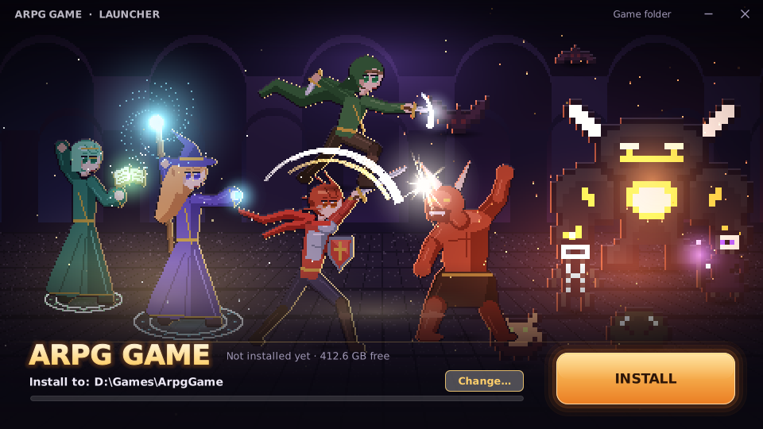
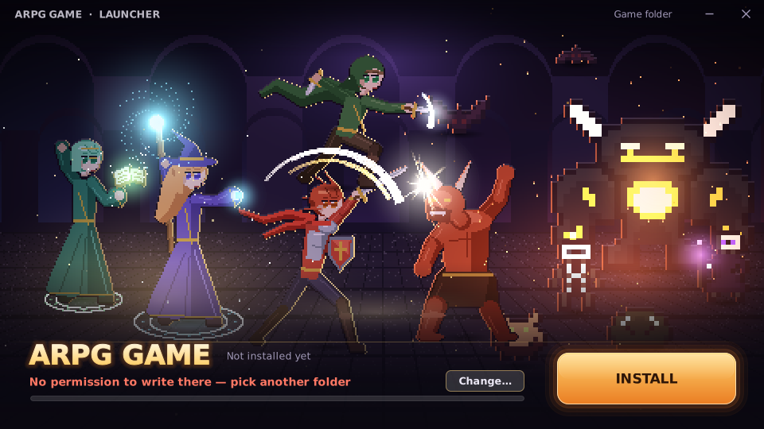

## 2026-10-16 — Facing the cursor, our own cursors, and F to loot

Three small owner requests. **Facing:** the character now faces the cursor while walking too, not just when standing (walking used to face the direction of travel). Dashes still face where they go, and co-op puppets face where they move because their aim isn't replicated. **Cursors:** four pixel-art cursors made with the EasyPixel pipeline (`tools/art/sprites/cursors.ts`) in the UI's bronze and gold: an arrow with a garnet, a white-hot arrow over buttons, a sword over monsters (reusing the target frame's "monster under the mouse" check) and a gauntlet hand over items on the ground. They are hardware cursors, scaled 2×/3×/4× with the window, so they cost nothing and never lag behind the mouse. **F to loot:** F picks up the nearest item as if clicked (it walks there if it's out of reach), and holding F empties a pile. Design: `menus.md` → "Cursor", `items.md` → "F picks up".

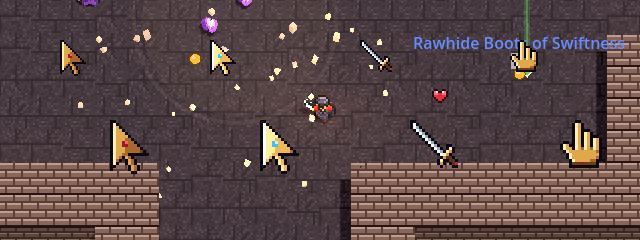

## 2026-10-16 — Level-up cards no longer vanish on a stray key

Owner report: in the Survival Rift a stray key made the level-up cards disappear. The cause was that the first card had keyboard focus, so Space (dodge) or Enter "clicked" it and the run continued with an upgrade you never chose. Now the level-up screen owns the keyboard while it's open. It swallows every key in `_Input`, before the GUI or gameplay, and acts only on 1–9 and R. Cards no longer take focus, and the row is dimmed and unclickable for 0.45 s after it appears, so a press already in flight doesn't count. In co-op, where the run isn't paused, dodge, flasks and the inventory key also stand down. A side lesson for headless tests: `Input.ParseInputEvent` delivers nothing headless, so the first version of the test passed for nothing. `Viewport.PushInput` does deliver, and the test now also asserts that the screen saw every press.

## 2026-10-16 — Town walks that don't get stuck, and a town map

Owner report: clicking a station in the town directory walked you there, but the walk often pushed into something and got stuck. The navigation mesh was built from floor cells only, so the stalls, the forge and the decorations standing on those cells didn't exist for it, and its edges hugged the walls. The owner asked whether the path could be computed beforehand, and the answer was yes. The fix reuses the realities' monster technique: a distance field per station, built over a 16 px grid whose blocked cells come straight from physics queries with the player's own circle (plus the portal's mouth, since walking into it would send you to the Rift). The fields are rebuilt whenever the editor closes. The player follows the field downhill and straightens the line with a shape cast. The grid is offset half a cell so that one-tile doors have a free cell down their middle; without that offset every door in town is closed. Only station walks use this; normal click-to-move is untouched. A test walks from the plaza to all eight stations and around a well dropped in the way.

Also new: a minimap on top of the town directory, showing the whole town with stations, you and the active route. M (or Tab) opens a full-screen town map. Each station has its own 16×16 pixel-art icon (mirror, coin purse, shard, plant, anvil, chest, orb, rift) in a badge ringed with its colour, and clicking one closes the map and starts the walk.

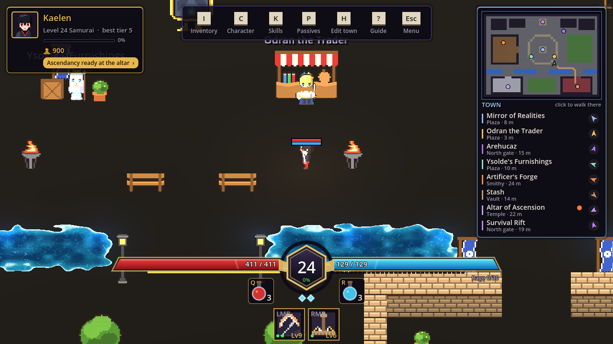
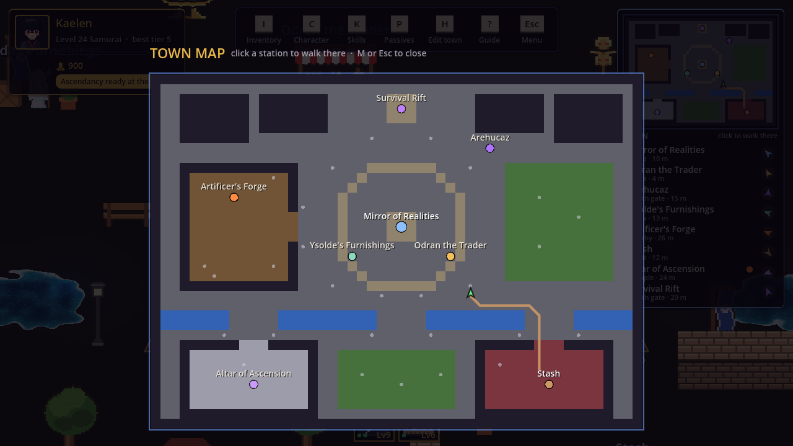
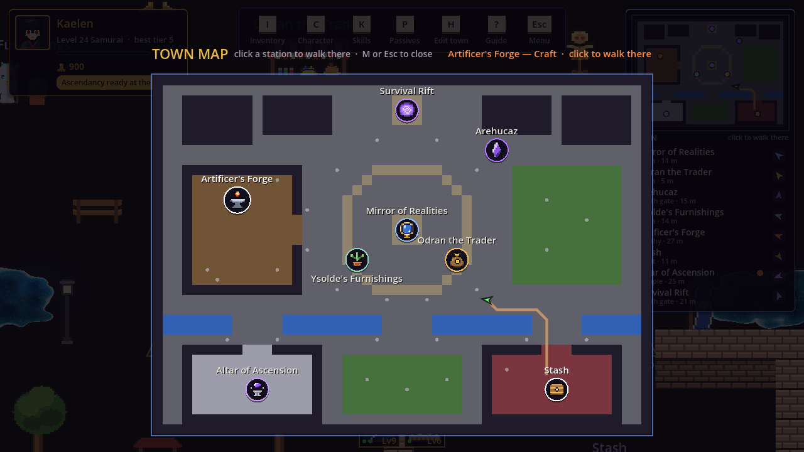

## 2026-10-16 — Co-op you can actually join, and a pass over the menus

Owner report: *"I tried to play with a friend: he typed the IP, pressed Connect, and absolutely nothing happened."* Plus two questions: could the lobby show the free slots, so it's obvious four people fit, and does the join code do anything, or would the IP be enough?

The code is not optional: the host checks it before admitting anyone, so the IP finds the PC and the code lets you in. The old screen never said that. Walking through it as a first-time joiner found the likely culprits for "nothing happened". **Without a character, Join was simply disabled**, and the only hint was a dim line under the title, so a friend who had just installed the game could click as much as he liked. **A dead address** (no UPnP, CG-NAT, firewall) hid the form behind "Connecting…" for ENet's ~30 s, with no progress, no elapsed time and no Cancel, and then came back with a single orange line. On top of that, the address field came prefilled with `127.0.0.1:7777`.

The redesign shows one state at a time. You start by picking *Host a game* or *Join a friend*. The join card says you need both the address and the code; mistakes appear under the field with an ember border, and Enter submits. The host's lobby shows the address and the code in big type, a **Copy invite** button (`203.0.113.7:7777 K7Q-29M`; pasting it into the address field fills both fields), the router state in green or ember, and **four party slots**, with the free ones reading "Free — waiting for a friend". While joining you see a spinner, the step you're on (reaching the PC → checking the code → joining), the seconds so far and Cancel. It now gives up after **12 s**: ENet gets a fixed deadline on the connect request, the session has its own watchdog, and once the host answers the timeouts go back to ENet's defaults. When a join fails, the card names the cause (*Couldn't reach the host*, *Wrong join code*, *The party is full*, *The run has already started*, *Different game versions*) with a checklist and Try again. No character? The screen says so and offers *Create a character*, which opens creation directly.

To tell those cases apart, `NetSession` now exposes the join phase and why the last session ended. The host's refusal texts became constants that the client classifies. What the host checks, and how often, is unchanged.

Menus pass: character select and create now take Esc (back one step) and Enter (create). The list scrolls past four characters, and the delete confirmation is red. Results asks before you leave without taking your item. The main menu backdrop is a little darker behind the title. `UiTheme` gained a primary button, themed text fields with an error state, and a drawn spinner.

Tests: new `CoopUiSmokeTest` (14 suites, all green). It drives real co-op panels for the host and in-process friends and checks the inline errors, the invite round trip, four slots with three free, wrong code, full party, the host closing, a dead address failing in 12 s, and Cancel. Captures: `RunCapture --only=coop` and `--only=menus`.

Before:

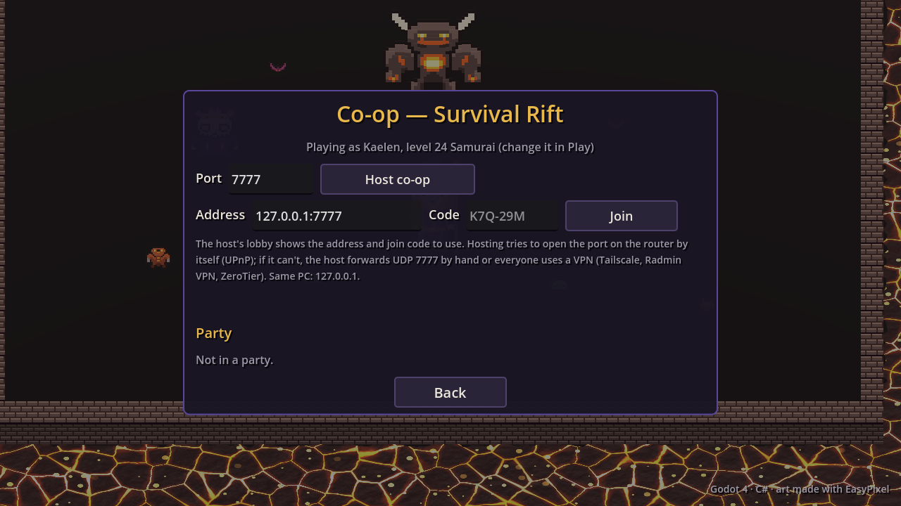
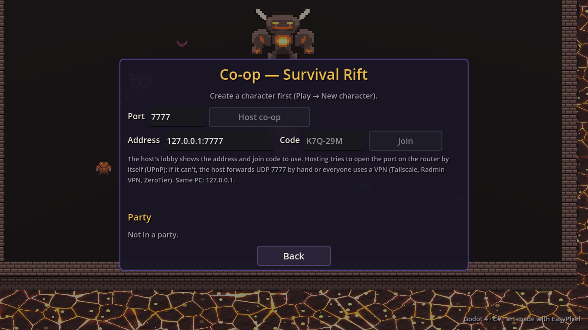
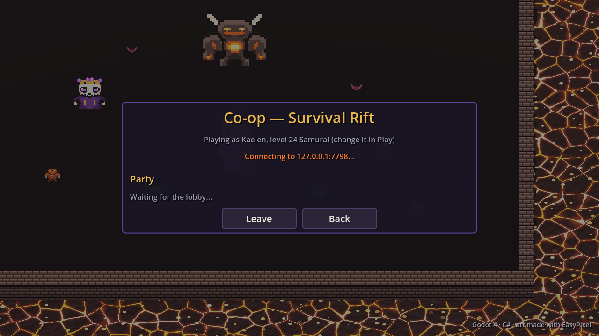
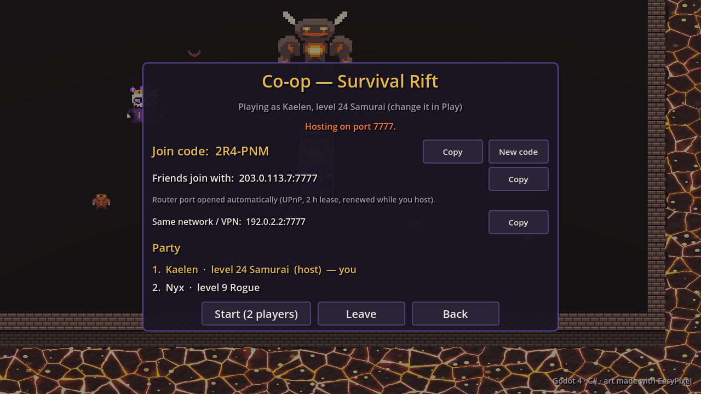

After:

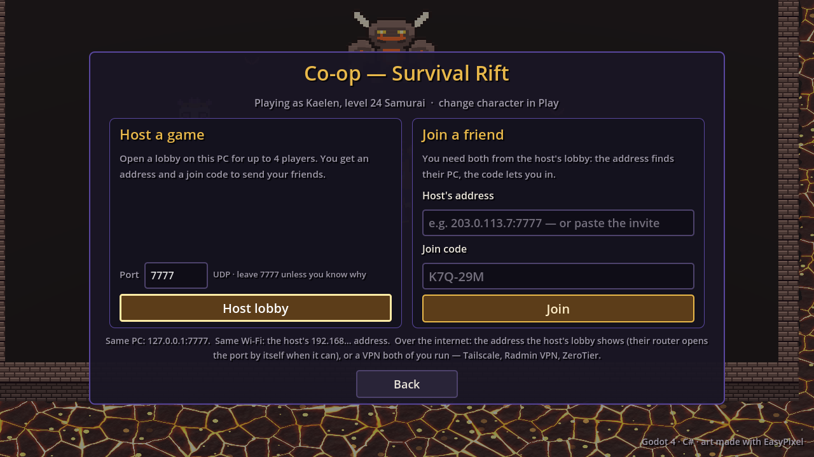
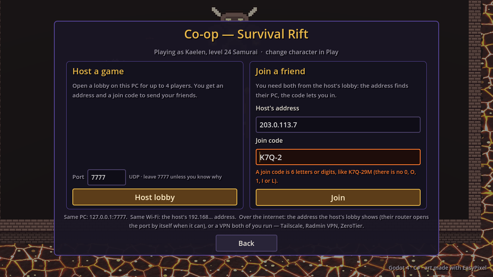
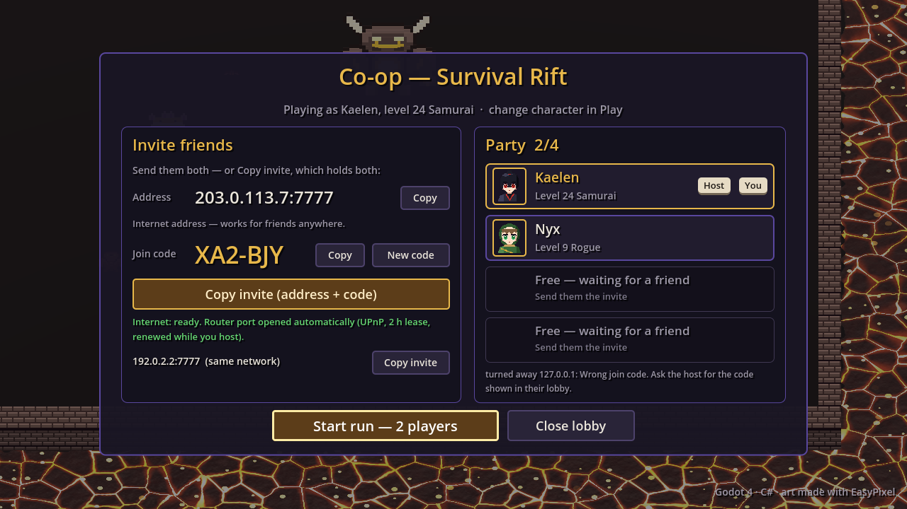
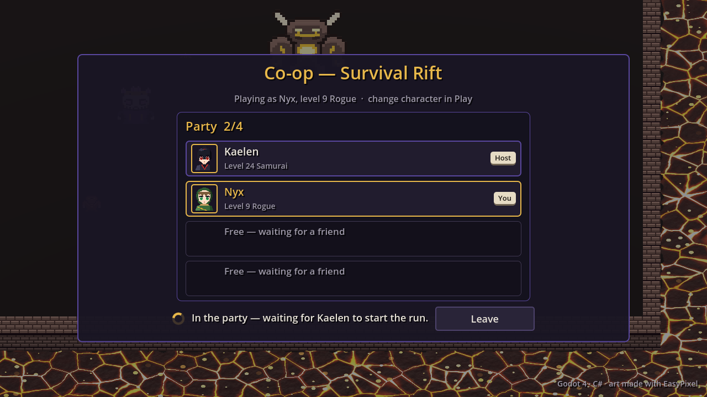
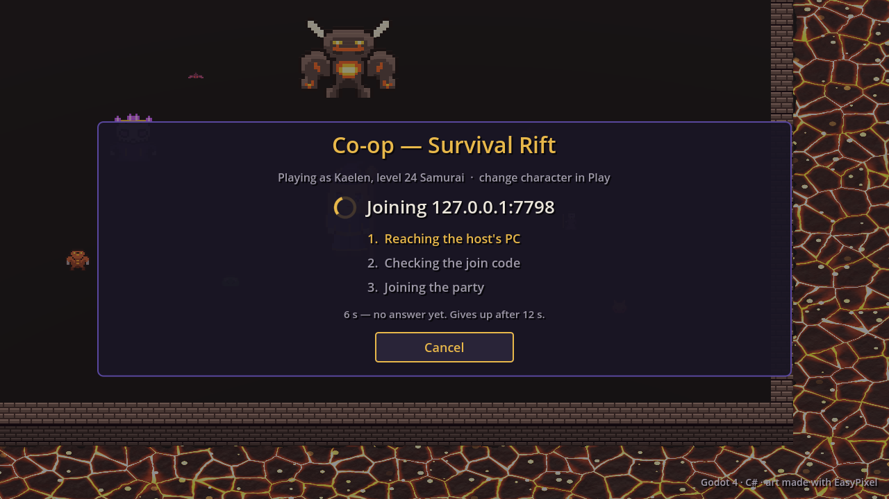
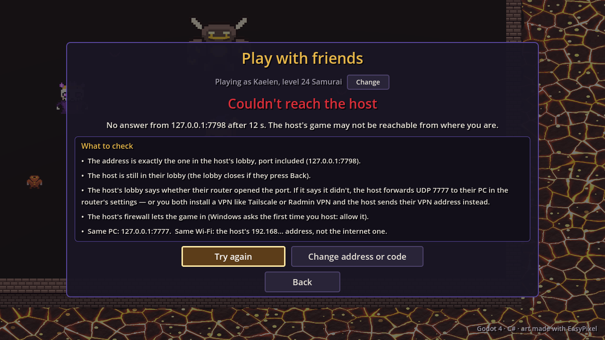
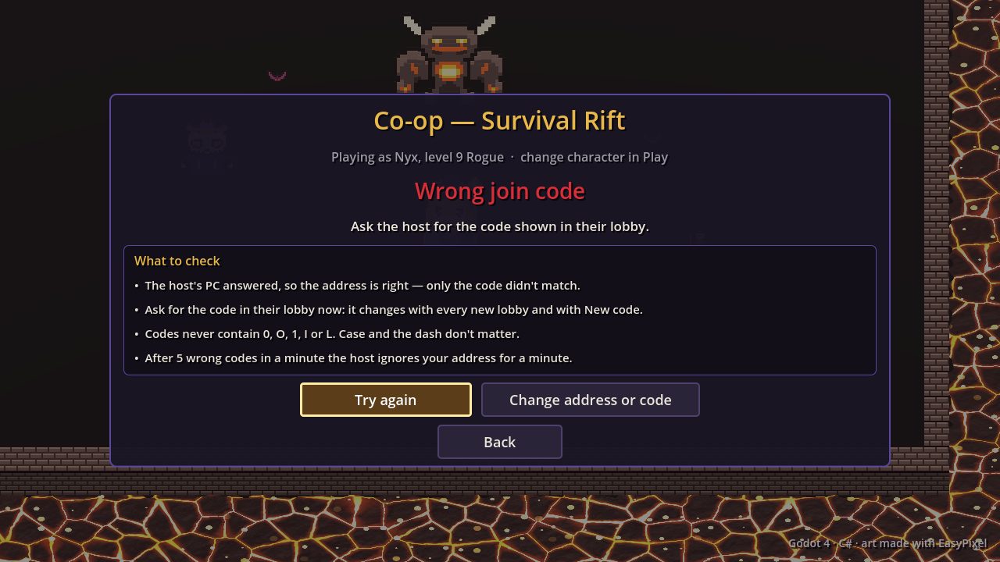
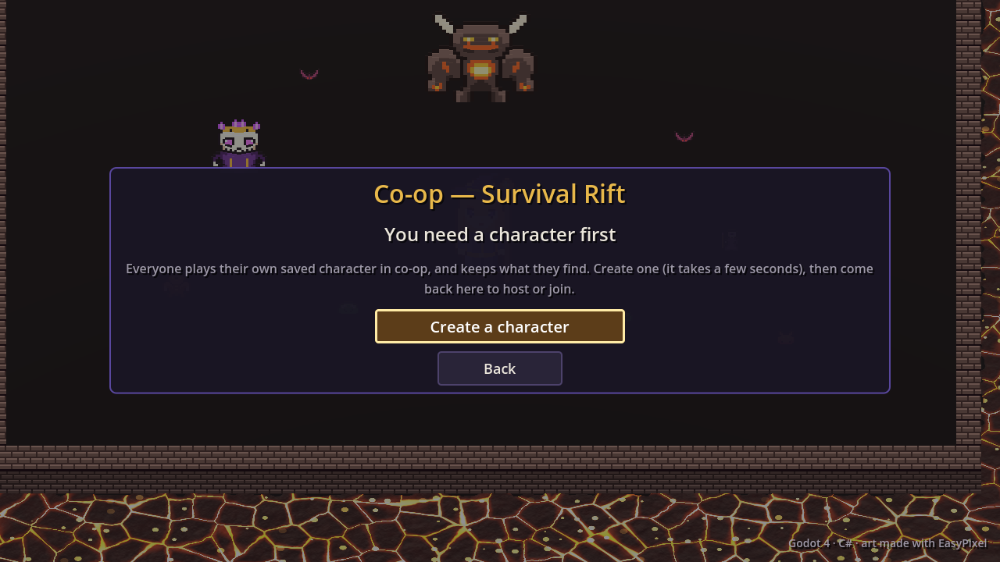

## 2026-10-16 — Settings panel keeps its size across tabs

Owner report: the settings panel changed size every time you switched tabs. A TabContainer sizes itself to the open tab only, and the Display tab's long toggle ("Use the whole screen on ultrawide…") is wider than anything on Audio or Gameplay, so the centred panel went 600 → 728 → 600 px. Now `UseHiddenTabsForMinSize` measures every tab and the panel is 720 px wide. RunSmokeTest `SETTINGS-TABS-KEEP-SIZE` reproduces the old jump when the fix is reverted.

## 2026-10-16 — The lobby stops offering the LAN address as "the" address

Owner report: with the router not answering UPnP, the lobby's big Address (and Copy invite) was the PC's 192.168 address, which only works on the same Wi-Fi. The fallback now says so in orange ("Local network only — not your internet address"), and the lobby offers **Find my public IP**. It asks api.ipify.org only when pressed, and the result is labelled as working once UDP 7777 is forwarded. A VPN address still wins when one is present. CoopUiSmokeTest `HOST-LAN-ADDRESS-LABELLED`; capture `coop-host-lobby-no-router.png`.

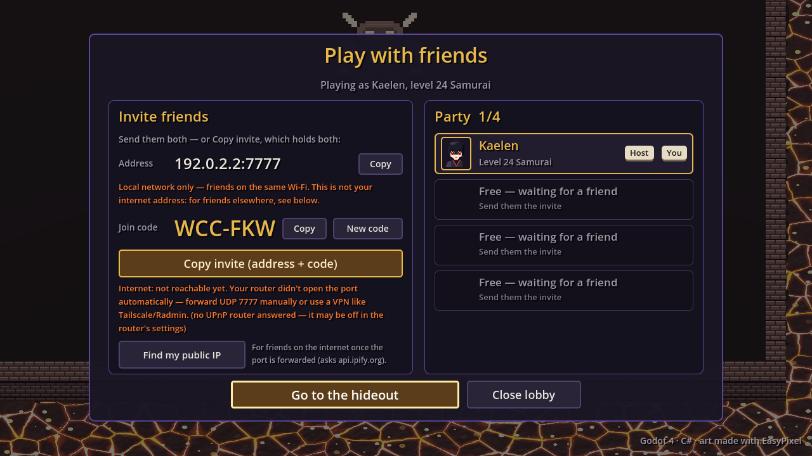

## 2026-10-17 — Survival Rift: keystone cadence, per-card rerolls, the character in the Rift, Pending items

Owner requests, everything except the co-op level-up flow:

- **Start pick, always (solo).** A character with skills keeps them, but at **level 1 with no supports** (the gems keep their levels); the pick offers a new class skill or a level for one it brought. A skill-less character gets three skills **of its class** (`ClassDefinition.RiftSkills`), its starting skill always among them. Later new-skill cards favour the class ×3. Bug found on the way: a character level-up mid-Rift called `Rebuild()`, which re-equipped the loadout and wiped the run's skills, levels and supports — `CharacterBuild.RunOwnsSkills` stops that.
- **Keystone cadence:** lesser keystones at 5, 15, 25…, great ones at 10, 20, 30…, nothing elsewhere. Eight lesser (Ricochet, Juggernaut, Prismatic Bulwark, Iron Will + new Scavenger, Overclock, Shield Conduit, Wind Runner), seven great. Blood Magic is tree-only (no costs in the Rift).
- **Offer composition** in one table (`OfferRules`): ordinary levels roll a category per card — skill 35, power-up 50, support 15 — with at least one skill card guaranteed. Measured: 57 % skills, 32 % power-ups, 11 % supports. New power-ups: Might (+10 % damage), Melee Damage, Ferocity (attack speed), Aegis (**energy shield**, a new stat: takes hits before life, recharges after 2 s), Bloodthirst (leech). Mana cards removed — dead in the Rift.
- **Per-card reroll:** a button under each card or Shift+1/2/3 replaces only that card; still two per run; never a card already on screen.
- **Minimum for an item:** 60 s or 30 kills; the results screen says why there is none.
- **Pending items:** a reward that finds the bag full goes to an account-wide overflow (20 max, oldest sold to Odran at the cap), shown as the stash's Pending tab and announced by the hideout banner.
- **Tree and ascendancy in the Rift:** they already applied through `CharacterBuild` (own modifier source); what was missing was protection from double counting — tree keystones are no longer offered as cards, a tree Avatar's element counts for card gates.

Autoplay (`--class=warrior --level=20`, 3 runs each, Colossus kill time / damage taken):

| | Victories | Colossus down at | Damage taken |
|---|---|---|---|
| tree off | 3/3 | 9:23, 9:35, 8:31 | 360, 482, 347 |
| tree on | 3/3 | 11:26, 10:07, 9:35 | 449, 204, 522 |
| tree + Barbarian (4 nodes) | 3/3 | 8:40, 8:04, 14:41 | 55, 57, 162 |

The ascendancy shows clearly (damage taken down ~5×); the bot's random tree (notables first, then random) is noise against random cards. A level-20 character wins every time: the Rift does not scale with character level — an open question for the owner.

Tests: new `RiftProgressionTest` (15 suites, all green). Capture: `RunCapture --only=rift`.

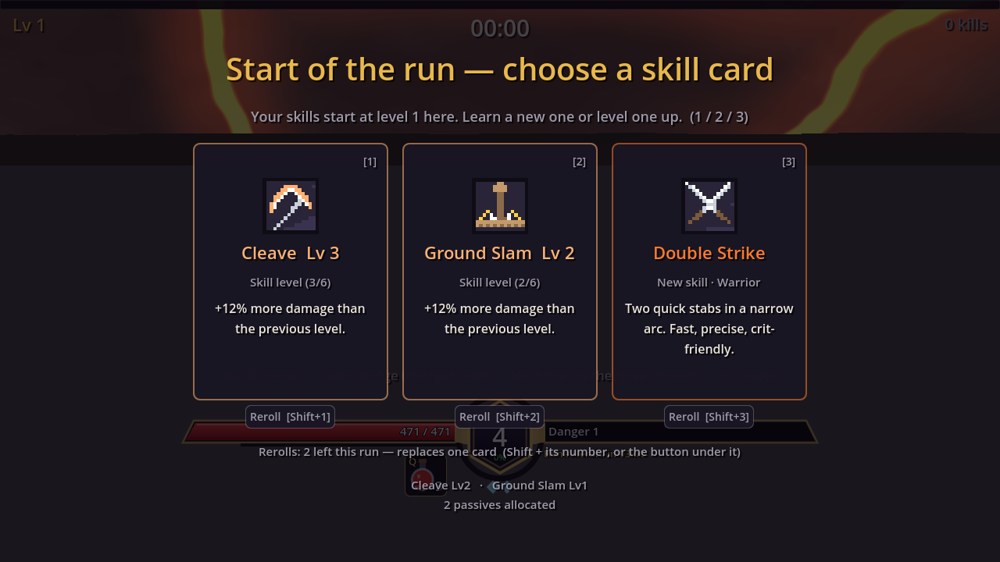

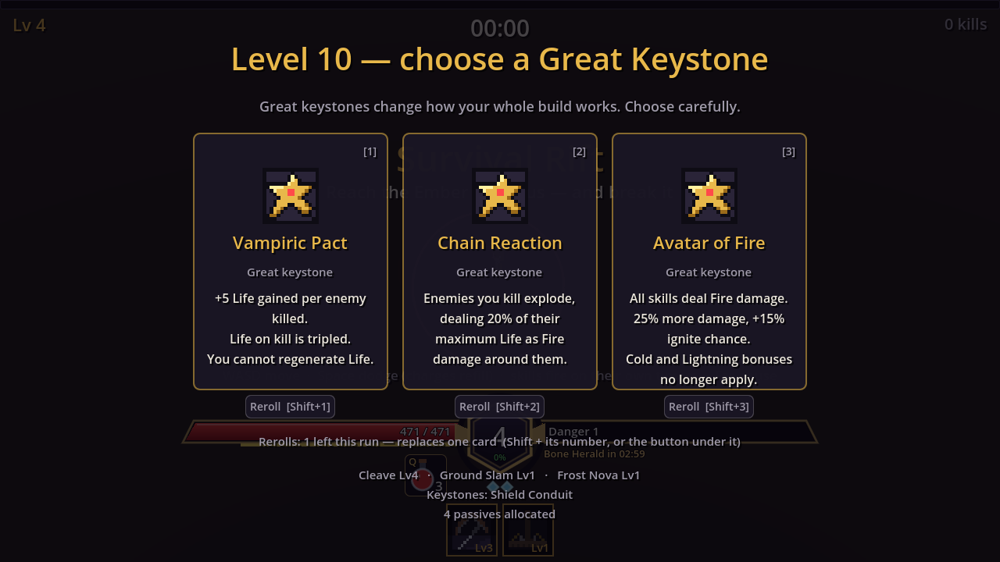
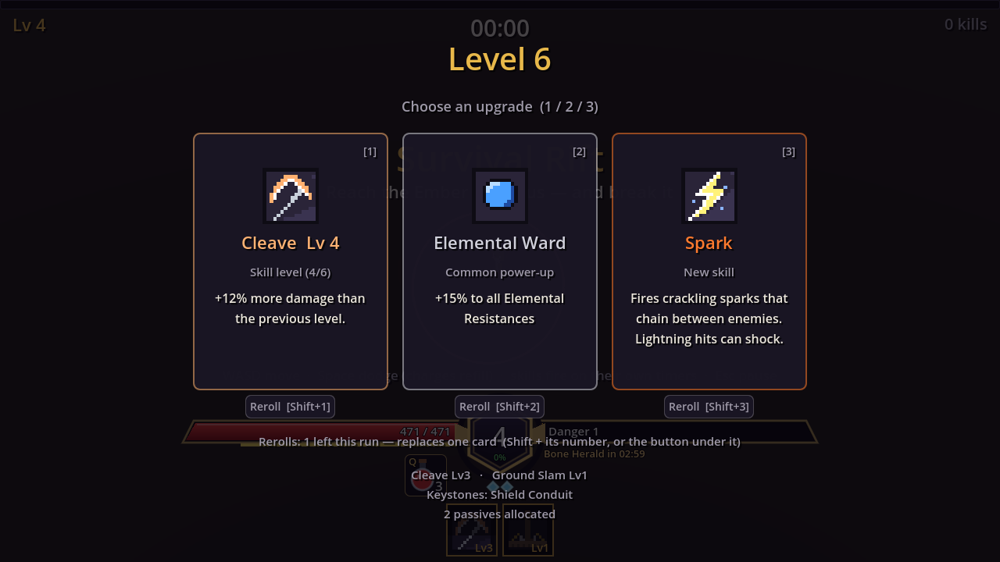

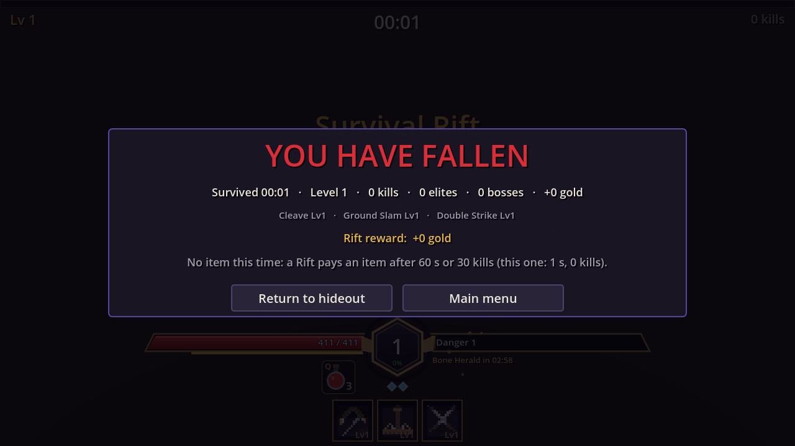
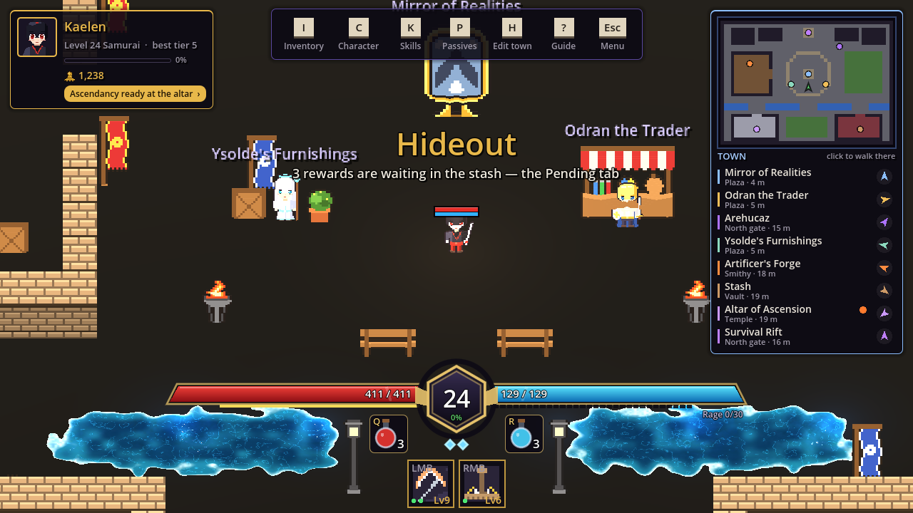
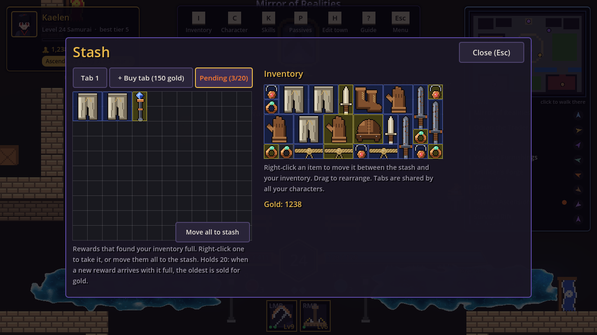

## 2026-10-17 — Co-op level-ups: one bar, everyone stops, everyone picks

The owner's co-op requests for the Survival Rift, all in:

- **One party bar.** Everyone's gems fill the same experience bar, so the whole party levels together. It needs the solo amount × the party size. Each player's gems are worth 1/spawn-rate of a solo gem, and a party kills about spawn-rate times as much, so without the scaling four players would level four times as fast, and pause four times as often. With it, a co-op run gets the same twenty-odd level-ups as a solo one.
- **The whole game pauses for everyone.** A level is a *round*: the host pauses its scene tree, the same pause as offline, so monsters, projectiles, telegraphs, DoTs, spawns, cooldowns and the run clock all stop. Every client pauses its own tree when the round reaches it. `NetSession`, `RiftHost` and `RiftClient` run with `ProcessMode.Always`, so the network keeps talking through the pause. We kept one authoritative "round" state broadcast by the host rather than each machine pausing on its own.
- **Individual picks, then resume.** Each player gets their own row, rolled on their own machine. A client's pick isn't applied locally. The host checks it, applies it to its copy of the build, and answers "applied X". Only then does the client apply it, so a pick and the timer crossing on the wire can't leave the two copies of a build disagreeing. The round closes when everyone still in the party has picked. A burst of levels is rounds back to back, still paused.
- **"1 / 3 chosen"** and the **countdown** sit at the top of the card screen. The countdown turns red at 5 s, with a tick every second (two new procedural sounds, `tick` and `tick_urgent`). After choosing: "You chose X. Waiting for the others…".
- **10 s on the host's clock.** The deadline travels as a host-clock time, and clients convert it with the offset they already keep for interpolation. At the deadline the host takes the first card of the row each missing player was shown (clients report their row on open and after each reroll).
- **Start pick for everyone** in co-op, every run. It's round one, held before the director starts.
- Disconnect mid-round: that player drops out of the total, and the round closes if everyone left has chosen. Downed players pick too. Solo is unchanged.

Security: rows and picks are validated on the host (the open round only, once, the card must be on the reported row, a well-formed key, must apply to the build; at most 6 rows per round, 9 cards, 64-character keys). A client can't hold the game past the deadline. Protocol bumped to 3. The hostile-host test now also throws junk rounds and junk "applied" keys at a client.

Tests: CoopSmokeTest grew from 43 to 68 checks, with real client processes over ENet. The host and the clients pause and show the start pick before anything acts. The counter replicates. On the host, an awake slime doesn't move, nobody takes damage, the clock stops and a telegraph waits for 1.5 s. Clients see the same freeze. The run waits for the last pick, the timer takes beta's first card after 10.0 s on both sides, a two-level burst is two rounds, five bad picks are refused, and a client leaving mid-round resumes the game. All 15 suites green. CoopBench now auto-picks rounds (32 KB/s per client, host replication 0.6 ms, as before).

Found on the way: the passive card key has four parts (`p:id:rarity:scales`). The first key validator rejected it, so a rogue's rows were refused and the timer picked for them. The test caught it. `run.md` gave the XP curve's quadratic term as 0.45; the code has always been 0.55. The doc now matches the code.

Needs a real two-PC test: the feel of the pause and resume over real latency, and the countdown against the host's.

## 2026-10-17 — Owner answers: denser Rift, resume grace, quiet tick

The owner's answers to last night's questions:
- **Density.** The Rift already scaled with time (enemy life and damage per minute); the owner wanted the crowd and the swarms to grow with it too.
  - The spawn rate and alive cap gain a quadratic term (cap at most 400): 5.9/s instead of 5.2/s at three minutes, 12.4/s instead of 9.2/s at six.
  - Swarms come every 60 s, shrinking to 30 s, grow by one enemy every 20 s, and from 4:00 bring a second, wider ring of another kind.
  - Bot, level-20 warrior, 3 runs: 3/3 wins, peak ~260 alive at 5:30, 1,770–2,840 kills, damage taken 362 / 1,523 / 453.
- **Resume grace.** After a card round everyone gets 1 s of invulnerability, chosen over a 3-2-1. The host grants it in co-op, and solo gets it too.
- **Quiet tick.** The countdown ticks only for players still choosing.
- **Kept as is:** the co-op pace (to be playtested first), the 10 s limit for keystone rounds, no character supports in the Rift, and nothing for reality floor drops.

## 2026-10-18 — UX review and plan: quests, Odran's gems, the Rift's cash-out, orb tooltips

A planning session, no game code. The owner asked for four things, and a UI/UX pass turned them into buildable plans for the implementer, from fresh captures of the current build (`RunCapture --only=crafting`, `town`, `update`, `endgame`).

- **Orb tooltips** (crafting.md -> "Orb tooltips"). The delay is Godot's built-in tooltip: the orb buttons set `TooltipText`, which waits `gui/timers/tooltip_delay_sec` (0.5 s, starting over when the mouse moves) and isn't themed. Item tooltips are ours and show on the first hover frame. Plan: `UiTheme.InstantTooltip` on the existing `HoverTooltip`, applied to every `TooltipText` in the UI, plus a test that no native tooltip is left.
- **Odran's Skill gems tab** (hideout.md). Every skill and support, unlocked by character level (skills 50 gold × level, supports 20 + 40 × level), locked rows shown greyed with their level, filters for tags, class and "fits my skills". One copy per skill, up to six per support, gems at level 1 into the skills collection (gems aren't bag items here). Three new skills on existing archetypes fill gaps: Frost Shards (cold projectile), Storm Strike (lightning attack for the Rogue), Glacial Hammer (cold slam for the Warrior).
- **The Rift's cash-out** (run.md). The Colossus kill now asks: two equal cards, take the reward now or keep going, with the reward spelled out. The portal and Esc open the same panel later instead of ending the run outright. A reward panel on the HUD shows the tier and the next one. Tiers I–IV are today's steps, named; V and up add guaranteed Rare cards, then Ascendant Orbs. Dying keeps today's rule (you keep what you had); a riskier "last tier only" rule is ready as an owner question. Co-op: a 15 s party round on the level-up machinery, and the party leaves only if everyone votes to.
- **Quests and a quest log on J** (quests.md, new). Six tutorial quests (Odran, two at the forge, Arehucaz, the first jewel, ascendancy), "!" / grey "?" / gold "?" markers in the world, the E prompt, the directory row, the minimap and the big map, an explanation dialogue before the station opens, auto turn-in when the panel closes, a tracker under the character plate, and a log with a town map and a Walk there button. The data model is a pure `QuestBook` over per-character and per-account progress, fed by events from ten existing hook points.

Found on the way: the altar's "Become a…" is permanent and takes one click with no confirmation. A quest that sends everyone there makes it urgent, so the plan adds a two-click confirm. Also, Arehucaz only sells tiers 2 up to your best cleared tier, so his quest unlocks on clearing tier 2 rather than on the first shard (a tier-1 boss drops tier-1 shards he doesn't sell). And endgame.md says supports stack to 4, but the code's cap is 6.

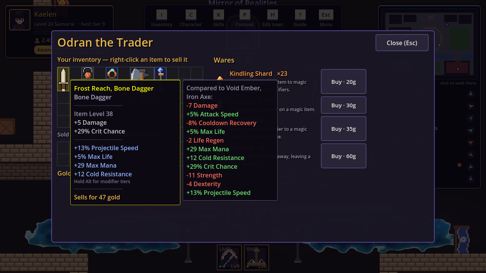
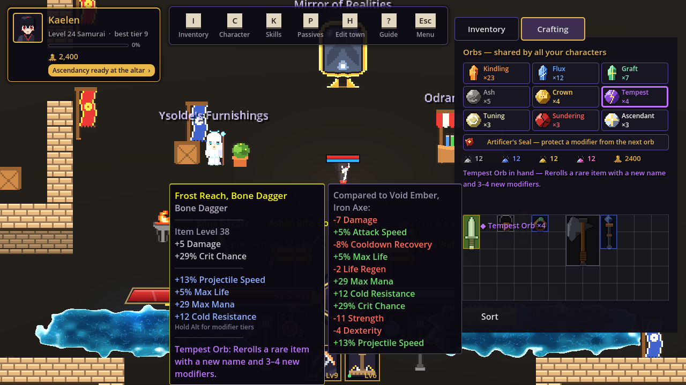
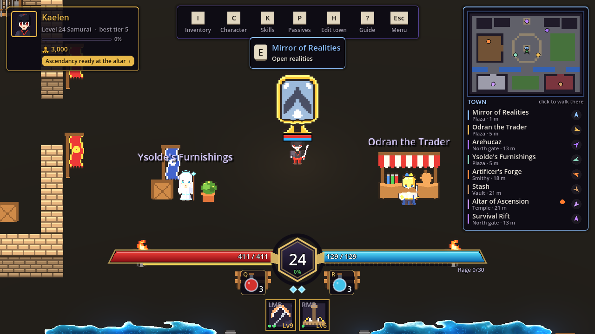
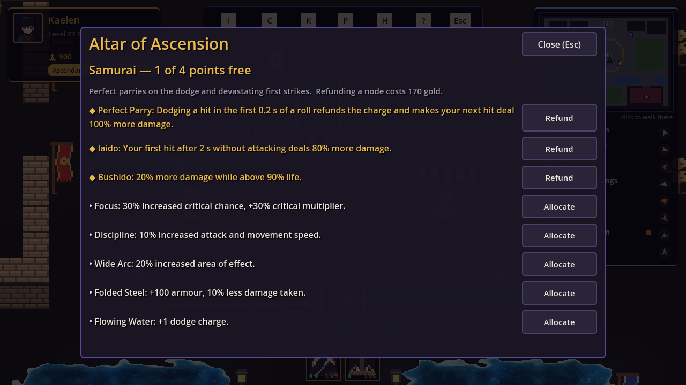
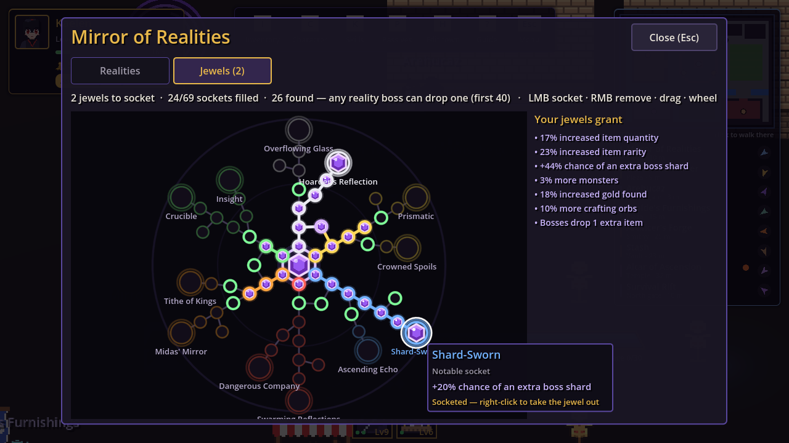
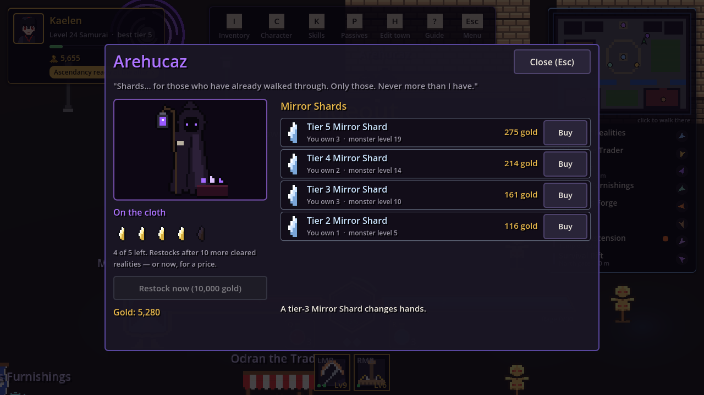
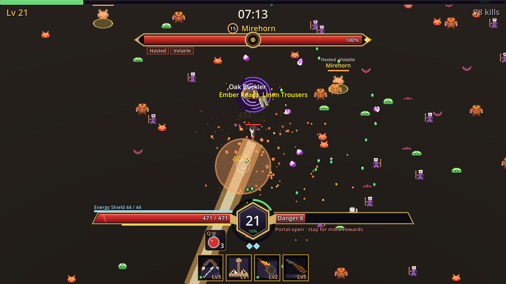
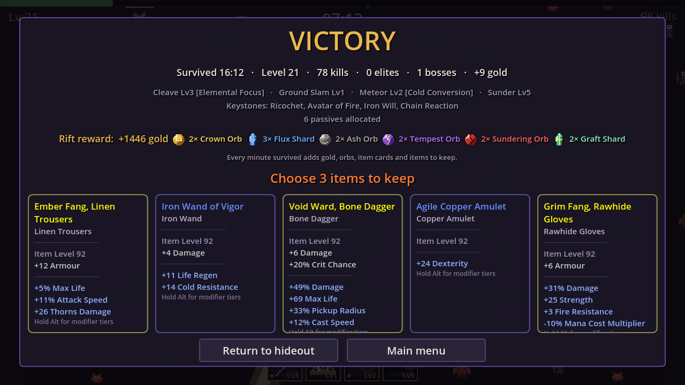

## 2026-10-18 — Built: instant orb tooltips, Odran's Skill gems, the Rift's cash-out

The three plans from the UX review are in the game (the quests are not: they come next, and the hooks are ready).

- **Orb tooltips.** `UiTheme.InstantTooltip` shows a themed tooltip on the very frame the mouse enters a control, one per canvas layer; the orbs, the Seal, the dust icons, the hideout HUD, the minimap, the stash tab, Arehucaz's Buy buttons and the reroll buttons use it, and the built-in tooltip is themed (and 0.15 s) as a safety net. Disabled buttons keep their mouse filter, so an orb you have none of explains where to get it. A headless window has no pointer, so the real-pointer proof is the capture `craft-orb-tooltip-none.png`.
- **Odran's Skill gems.** A second tab on his panel sells all 13 skills and 20 supports by character level (50 gold × level, 20 + 40 × level), with kind toggle, filter chips, "Only what I can buy", locked rows greyed, NEW tags and an ember dot on the tab. A bought gem joins the collection (K) at level 1; skills once, supports up to 6. Three new skills fill the gaps: Frost Shards, Storm Strike, Glacial Hammer (resources, catalog, class lists, icons from the art pipeline). The introduction's boss drops 70 gold, enough for any level-1 gem.
- **The altar** asks twice now ("Become a Sage: this is permanent. Click again."), the blocker from the review.
- **The Rift's cash-out.** The Colossus kill holds the director for 1.2 s and opens a panel: [1] take the reward now (gold, orbs, cards, item level, rarity, exactly what the results will pay) or [2] keep going (the endless phase, portal and "The Rift deepens"). The portal and Esc → Leave with reward open the same panel later ("Not yet" instead of Keep going). Reward tiers I to IV are today's steps; V and up guarantee Rare cards and then Ascendant Orbs. A reward panel on the HUD shows the tier and the way to the next, with a toast and a flash on a new tier. In co-op the offer is a 15 s party round: anyone staying keeps the party in, silence counts as leave (protocol 4). The bot takes the reward at the kill, so balance numbers stay comparable. Five item cards on the results screen are no longer clipped.
- **Hooks for the quests:** `GameEvents.Raised(eventId, value, key)` fires `gem_bought`, `disenchanted`, `forged`, `shard_bought`, `ascendancy_chosen`, `jewel_socketed` and `item_sold` (quests.md lists where).
- **Tests:** `TOOLTIP-*`, `GEMSHOP-*`, `ALTAR-CONFIRM`, `SKILLS-NEW-RESOURCES`, `CASHOUT-*` (solo, in the real Rift scene) and `CASHOUT-COOP-*` (two real clients). Lesson: a scene added under a test node that never pauses never pauses either; the Rift checks use a pausable holder.

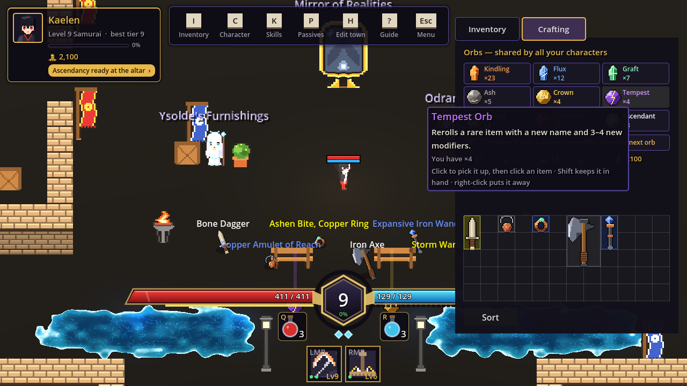
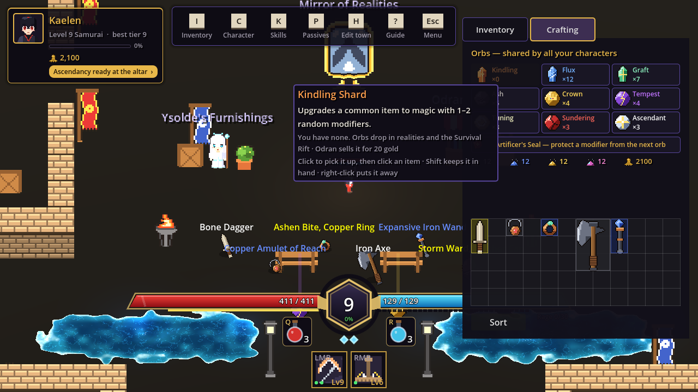

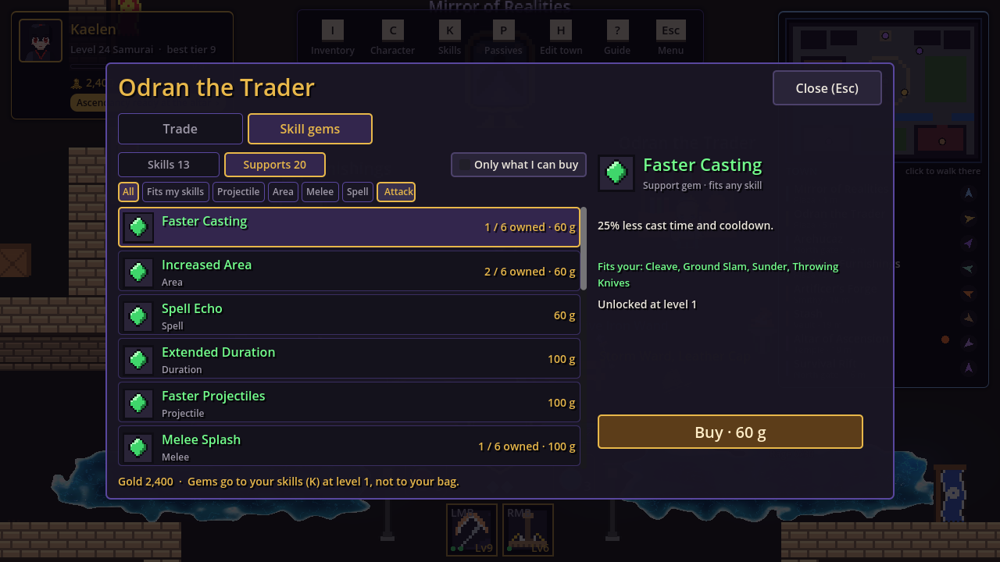
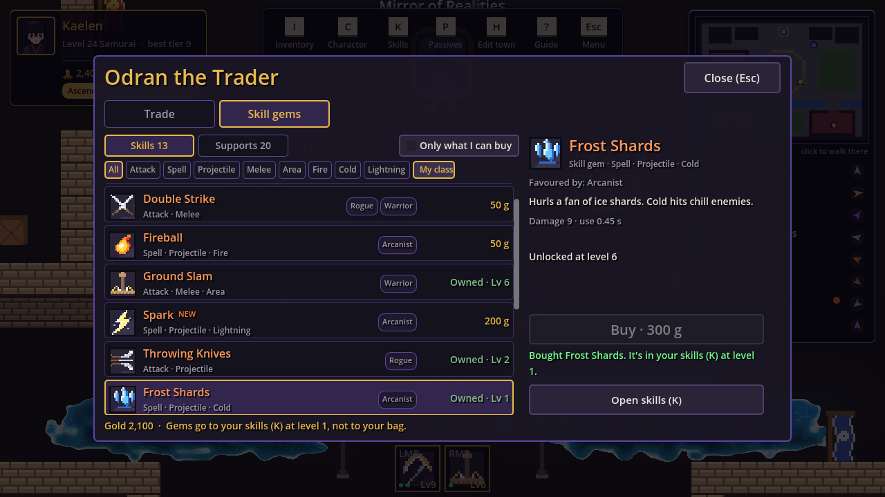

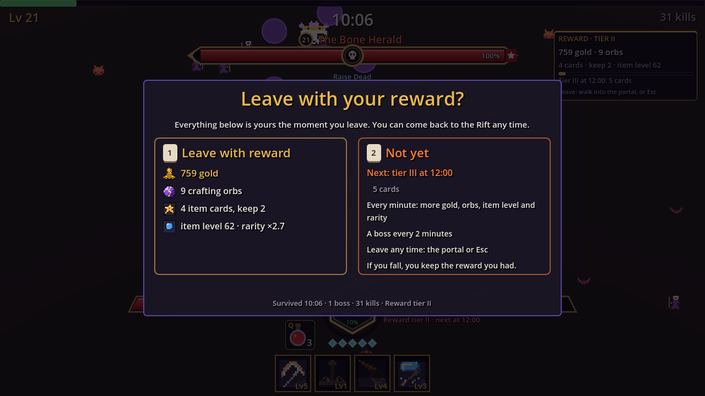
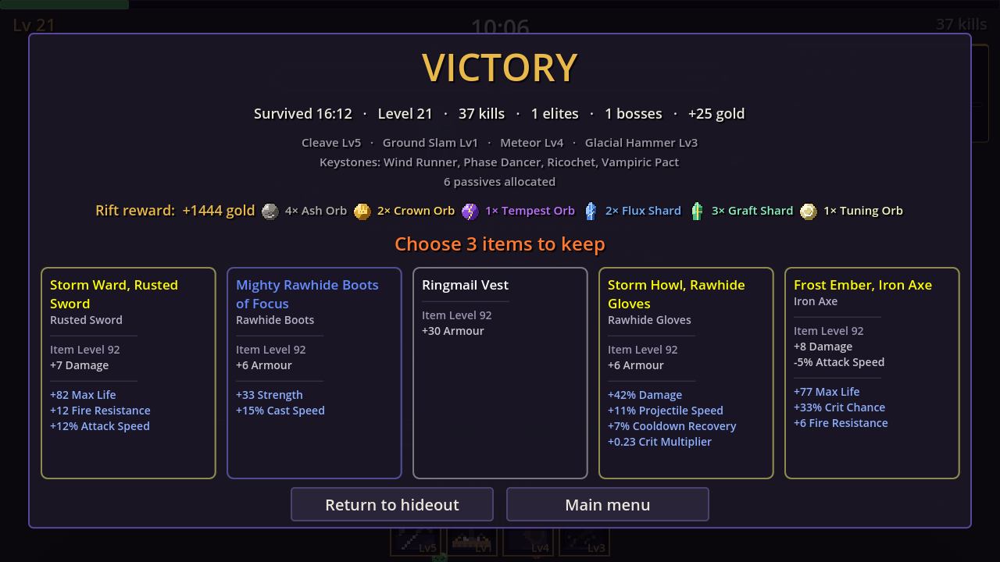
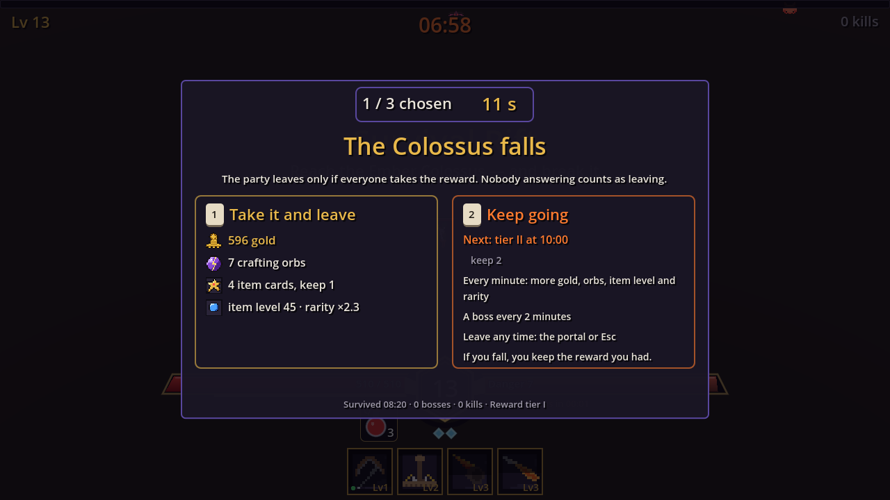

## 2026-10-18 — Built: quests and the quest log (J)

The six tutorial quests from `docs/design/quests.md` are in the game. Each teaches one station the moment it opens up: Odran's wares (after the introduction), Breaking it down and A modifier of your choosing at the Artificer's Forge (the second a visit later, the third at once), The shard dealer (a tier-2 clear), A jewel for the Mirror (the first jewel) and Choose an ascendancy (the tier-5 boss: 1,000 gold, 2 Crown, 2 Tempest, 1 Tuning).

- **How it reads in play.** A quest unlocks by itself, with a toast and a chime (`quest_new`). Its station gets a gold "!" in the world, on its directory row (the arrow turns gold), on the minimap and the big map, and on the E prompt; the tracker under the character plate lists it and the J chip carries a badge. E at the station opens the explanation first and the panel second (its primary button opens the right tab: Skill gems, Disenchant, Forge, Jewels), with a one-line quest strip under the panel's title. Doing the thing turns the strip green (`quest_done`); closing the panel opens the turn-in, and Claim pays through `Player.Wallet` and saves. J opens the log: Ready, Active, Completed, the objective as a drawn checkbox, the rewards as icons and the town map with the turn-in ringed, plus "Walk there".
- **Rules.** `QuestBook` is plain C# over two progress maps (character and account); `QuestService` feeds it the `GameEvents` the Profile autoload hears and announces what changed (save, sound, `Profile.QuestChanged`). Veterans get the quest skipped (no reward) when the save shows they already did the thing. Account quests leave a Done mark on the character that finished them, so another character never sees them listed. Saves are additive (version stays 2); the join payload carries quests and the host caps them (32 entries, 64-character ids, status 0-5, count 0-999).
- **Events added to the bus:** `boss_killed` (tier), `jewel_found`, `shard_found`, `hideout_entered`. The old "Ascendancy trial complete!" toast is gone; the quest toast replaces it.
- **Things that bit.** A class named `Quests` would have hidden the `ArpgGame.Quests` namespace, so the facade is `QuestService`. The first-visit guide opened a frame after the unlock toast and covered it for its whole six seconds: the arrival event is now queued behind the guide. A "complete" card queued while a card was showing outlived the panel it was about: cards are dropped when stale, and when the objective was met inside the station's own panel. The big map's "— New quest" suffix ran into the neighbouring badge: it is a second line above the name now.
- **Tests:** `QuestSmokeTest` (24 checks: the rules, saves, the co-op caps, then the real hideout, altar, forge, log, toast, a tier-5 boss kill, the introduction's gold and the Rift scene), `CHARACTER-QUEST-CAPS` in SecuritySmokeTest and `CHARACTER-QUESTS-JOIN` in CoopSmokeTest. Capture: `RunCapture --only=quests`.

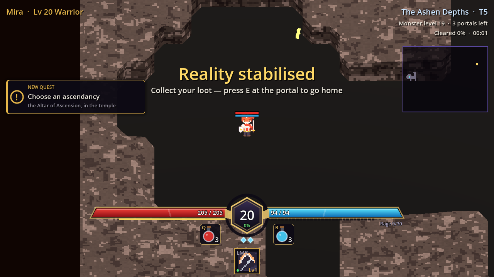
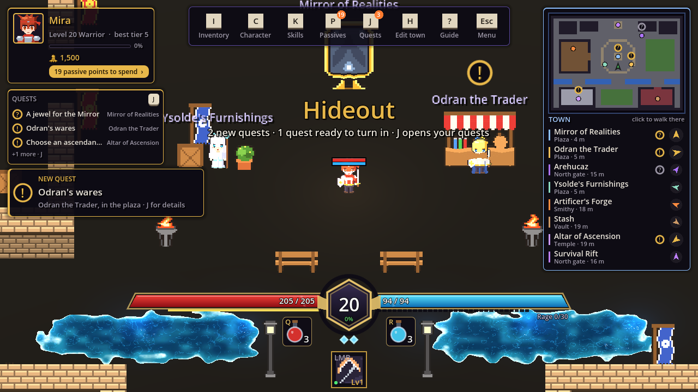
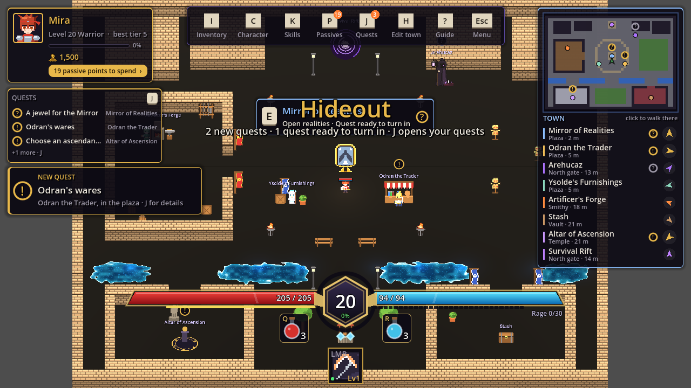
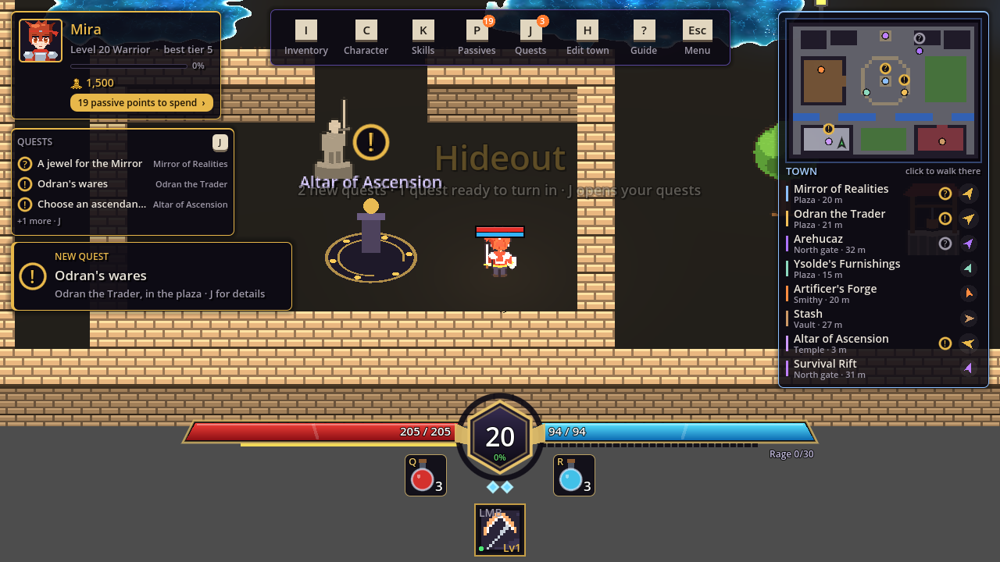
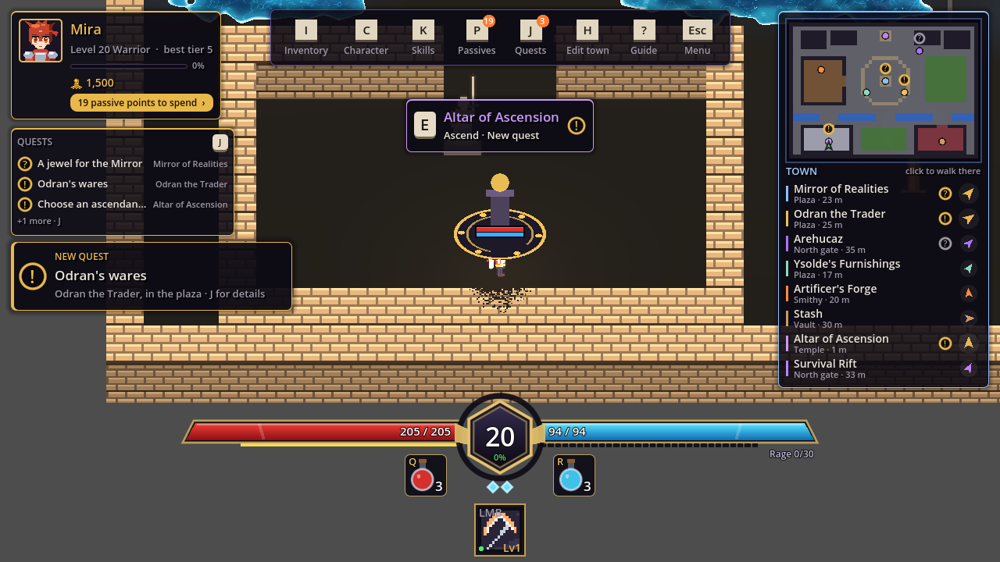
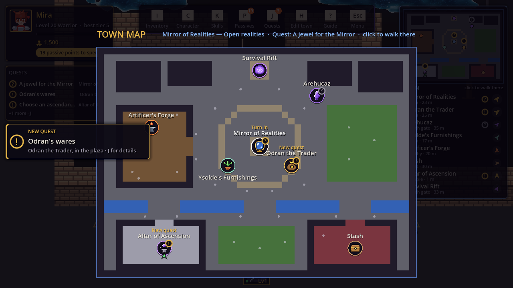
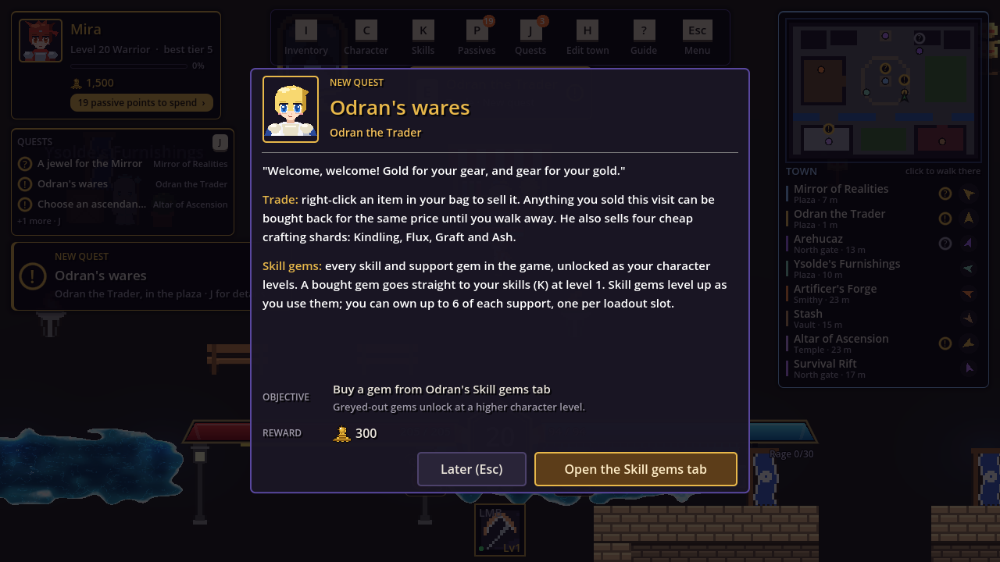
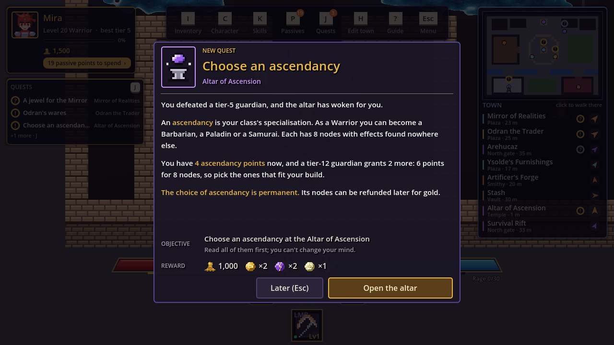
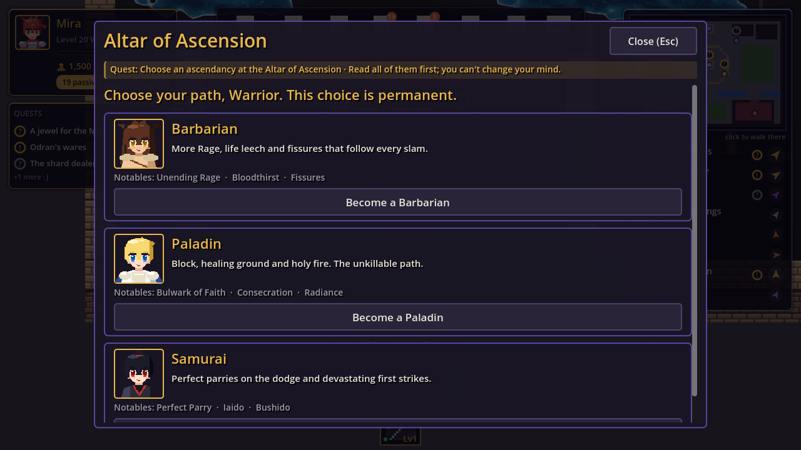
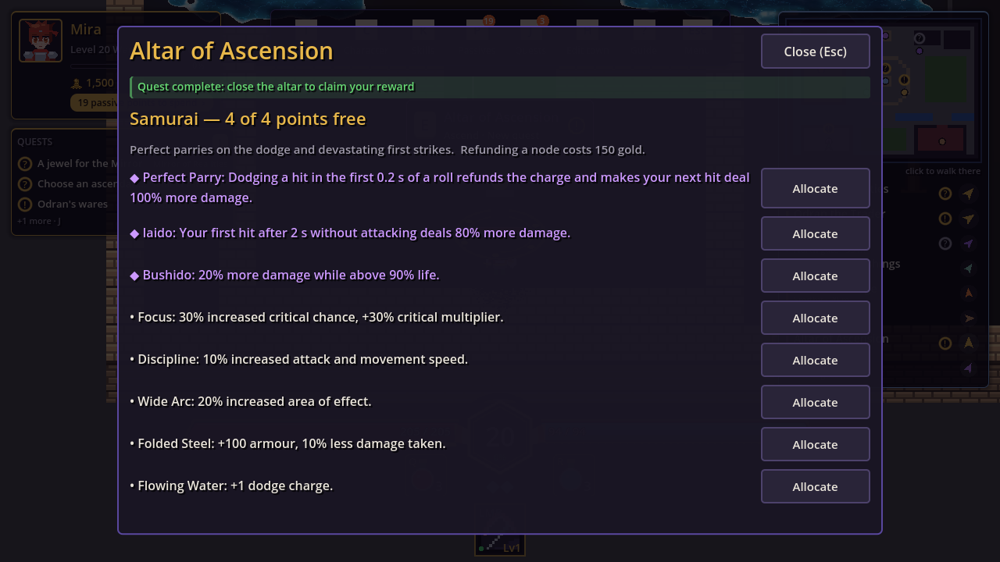

## 2026-10-18 — Co-op deaths: back up after 10 s

The owner's answers to the quest/cash-out questions:
- **Veterans:** no retroactive quest rewards.
- **Cash-out vote:** stays as built.
- **Prices:** stay as first guesses for now.
- **Deaths:** solo, death ends the run with the reward reached. In co-op, a downed player now gets back up on their own after **10 s** at half life, where they fell. An ally standing by for 3 s still revives sooner, at 40%. The run ends only when everyone is down at once, paying the reward reached.

The rule is a pure `PartyRules.StepRevive`. The snapshot's revive byte now carries whichever progress is further, so the ring fills over 10 s by itself and faster with help, with no protocol change. Tests: RiftProgressionTest `DOWNED-*` checks the rule; CoopSmokeTest `DOWNED-RESPAWNS-IN-10S` downs the host away from the clients, sees it still down at 5 s with the ring at 0.50, and back up at 50% life before 11 s.

## 2026-10-18/19 — Co-op party session: the shared hideout, rift proposals, Invite friends

The owner wanted co-op to feel like a party rather than one run: play with friends from Play, meet in the host's hideout, anyone proposes a rift and everyone gets a 30 s popup, invite friends from the hideout's pause menu, and only edit the host's town with permission. Phase A (this entry) does all of that for the Survival Rift; co-op Altered Realities ("Rift 20" = a tier-20 reality) are phase B, and the proposal already carries the kind and tier.

- **Session plumbing (protocol 5).** The session now has a phase (lobby, hideout, run, returning) and each member a place; a rift has participants, and only they get `StartRift` (it replaces `RpcStartRun`). Results → Hideout keeps the party; a client's "Leave the run" leaves the rift, not the party; the router port stays open between rifts; joining is open whenever there's room (a newcomer lands in the hideout, even mid-rift).
- **Shared hideout.** Each machine runs its own hideout with its own panels and wallet; the host's town layout and everyone's presence are shared through the `NetSession` autoload, so friends who stayed home keep seeing each other while the host runs a rift. The scary bug class here was a guest saving the host's town over their own: the hideout now keeps the town on screen and the account's own town apart, and the test uses guest saves that really write.
- **Proposals.** A pure `RiftProposal` on the host: the host declining or not answering cancels it (owner rule); otherwise it starts with whoever joined. A "yes" re-sends the character so the host builds what you bought in the hideout.
- **Invite friends** hosts in place from the hideout's pause menu (`PartyOverlay`); Stop hosting leaves the host alone in the same town and friends at the main menu with a notice.
- **Play → Solo / With friends**, with a question for new characters that haven't played the introduction (play it first, or skip it). Focus in the main and pause menus is kept by reference now; the old child-index lookups would have broken with the notice card.
- **Edit permission**: per friend, one editor at a time, the guest's whole layout checked on the host (stations kept, nothing on walls, every decoration and tile conserved).
- **Loot bonus**: +15 % item quantity and +10 % rarity per extra player, a proposal in `PartyRules`' table.

Two things that bit:
- **ENet's packet throttle** dropped 30–70 % of the guests' *unreliable* presence on loopback while ENet's own loss counter said 0: the throttle drops unreliable packets whenever round trips vary, and a game that services the socket once per frame varies a lot. Presence is a few bytes at 10 Hz, so it's reliable now. The Rift's unreliable inputs probably meet the same throttle; logged as an open question to measure.
- **Idle C# compiler servers** (several `VBCSCompiler` processes, about 1 GB each, some busy) starved the multi-process tests until guests ran at 1 fps; `run_all_tests.sh` now shuts the build server down after building.

Tests: new `HideoutCoopTest` (host + up to four guest processes, about 40 checks: hideout, presence, saves, NPCs, no-pause, edit permission, proposals, late join, run return, timeouts, host leaving, invite, stop hosting), `CoopUiSmokeTest` `MENU-*`, `SecuritySmokeTest` for the new RPCs. Needs a real test with friends: the popup and puppets at 100–200 ms ping, UPnP while hosting from the hideout, and a guest editing the host's town over the internet.

## 2026-10-19 — Co-op Altered Realities ("Rift 20" with friends)

Phase B of the party session: a party in the hideout can now open an Altered Reality of any tier together. Whoever proposes it from the Mirror pays the shard (only when it starts); the 30 s popup is the same as the Survival Rift's; the host always goes; whoever says no waits in the hideout.

- **The replication became reusable first, as a pure move.** `RiftHost`/`RiftClient` were 2,500 lines typed to the Rift. The shared part (snapshots, events, string table, capture and replay of monsters/projectiles/effects, prediction and reconciliation, instanced drops, boss tracking, load handshake, disconnects) moved into abstract `CoopHost`/`CoopClient` over a small `ICoopWorld` interface. The Rift's subclasses keep only the run's numbers, rounds, revives and director hooks. The snapshot bytes are identical: `CoopSmokeTest` passed untouched and the bench read the same 0.3 ms step.
- **Same cavern on every machine** from the host's seed; only the host spawns and simulates. The `RealityHost` goes into the tree *before* the packs spawn, because capture is driven by `SceneTree.NodeAdded`; a client that loads later gets every monster, plus which replica is the boss (a bug the test caught: the boss record went out before anyone was ready).
- **Realities cast on press.** The Rift auto-casts, so its input never carried buttons. A reality client now sends the six skill buttons it holds, and the host casts for its copy at its cursor. Found on the way: in `CastMode.Bound`, a remote copy on the host would have read the *host's* keyboard and mouse. It now reads only its command.
- **The save-safety fix.** In solo, `RealityController.OnPickup` writes shards, jewels and gems straight into the active profile. In co-op that would have put every friend's drops into the host's account. Remote pickups now only tell the owner's machine, which applies them through the same `ApplyReward` the solo path uses. Clears, ascendancy points and quest events are recorded per machine.
- **Party rules** (proposals, one table): monster life ×1.5/2/2.5, boss ×1.7/2.4/3.1, packs ×1.2/1.4/1.6, +15 %/+10 % quantity/rarity per extra player, one shared portal pool (tier's + 1 per extra), the boss arena pulls everyone in, every participant gets the kill's experience and a full loot table of their own.
- **Monsters chase the nearest player** through one multi-source flow field.

Measured (`CoopBench --mode=reality --tier=10`, four players): 16 KB/s per client exploring, 8 KB/s in the boss fight, 4 KB/s after a 143-monster wipe, replication under 0.5 ms. The phase-A question about ENet's throttle: snapshots arrive 98–100 % on loopback, inputs lose 3–10 %, which is harmless (full-state inputs, counters for presses), so nothing was changed.

Tests: new `CoopRealityTest` (host + guest process, 20 checks: same cavern hash, replicas, input and casting, shared XP, instanced loot that lands in the guest's save and not the host's, no pause, the portal pool and respawn teleport, a forged teleport refused, the boss pull-in and gate, the clear on the guest's machine, a guest leaving alone, the host closing, a collapse). 18/18 suites.

Needs a real test with friends: a reality boss fight at 100–200 ms ping (casts show after the round trip, there's no cast prediction), four players' frame time on real PCs, and a guest's drops/clears over the internet.

## 2026-10-23: hideout dummies and the quest log's Walk there

- **Dummies:** the hideout's training dummies were the same `TargetDummy.tscn` as the sandbox's (5,000 life), with a `DropSpawner` and `EquipmentDropSpawner` on `Died`, so a big enough hit killed one and it dropped gold or gear. Now `TargetDummy.Immortal` heals inside the `Damaged` handler (before `Health` checks death) and `Hideout.Dummy()` frees both spawners. No `GameEvents` kill bus exists for dummies; only `Died` could have fed one. Training Grounds dummies stay mortal. Test: `HIDEOUT-DUMMIES-IMMORTAL`.
- **Walk there:** the walk itself was fine (every quest station arrives from every start we tried). The button sat at the bottom of the detail's scroll area, 100 px below the visible part when the explanation was long, so a click hit nothing. It now lives in a fixed footer. Tests: `QUEST-LOG-CLICK-WALKS` (real mouse events; viewport pushes need `PushInput(ev, true)` in headless runs because the window is 64 px) and `QUEST-LOG-WALK-ARRIVES` (all quests).

## 2026-10-23: three co-op reports from the first game with a friend over the internet

The owner played with a friend over the internet and reported three things. Each one now has a multi-process test that failed before its fix.

- **"Can we see the other players on the minimap?"** Not before. Now allies show on the hideout's town minimap and big map, on a reality's minimap and Tab overlay, and on a new Survival Rift party minimap (co-op only, so solo play is unchanged). Each ally is a dot in their party colour, by lobby slot: blue, orange, pink, yellow. Their name tag uses the same colour. The big maps add names. A downed ally is a hollow ring. Nothing new goes on the wire: the maps read the positions snapshots and presence already carry.
- **"Allies respawn instantly."** The Rift's rule held. A new test downs a *client's* player, and the host, that client and the other client all agree it stays down for 10.0 s. What made it look instant: life kept **regenerating while dead**. With any regeneration, a downed ally's bar was full again in a second or two, and the revive then dropped them to half. A character level-up while down, or a Vitality card, also refilled life. On top of that, a downed player stood upright, only faded. Now the dead don't regenerate, and a downed player lies on the ground (the 2D sprite and its voxel body) with "DOWN" over the ring. In realities, 1.5 s for a portal is the designed rule (no downed state). Whether co-op realities should use the Rift's downed state is an open question for the owner.
- **"My friends see only squares on the ground, and the warrior's slash showed for me but not for him."** Two separate bugs. Gear the host drops for a client is rebuilt from JSON on the client, and that path never added the icon or the filtered label, so friends saw the scene's grey placeholder square. The slash was a unit bug. The host sends a swing's arc in degrees, and the client clamped it to 2π as if it were radians, so every swing on every client was at most 6.3° wide: a sliver nobody could see. The audit covered all 13 run skills. Every visual goes through one of the five captured effect nodes, and only the swing was broken. No wire change, so no protocol bump and no bandwidth change.

Tests: `CoopSmokeTest` gains `RIFT-PARTY-MAP-*`, `SKILLS-CAST-ON-HOST`, `SKILL-VISUALS-ON-CLIENT-*` and `CLIENT-DOWNED-HOLDS-*`; `CoopRealityTest` gains `REALITY-MAPS-SHOW-ALLIES` and `REALITY-CLIENT-DROPS-DRAWN-LIKE-HOST`, and checks the downed marker in `REALITY-DEATH-POOL`; `HideoutCoopTest` gains `HIDEOUT-MAP-SHOWS-ALLIES`. Still needs a real game with friends: the lying pose and the minimaps in the windowed voxel view, a warrior's swings at internet latency, and gear drops on a friend's screen.

## 2026-10-24: Vitality left a gap that Vampiric Pact could not close

- Owner's report: with the skill that stops life regeneration (Vampiric Pact) plus a max-life card, you never reach the new maximum. Root cause: Vitality added a flat +15 to current life but raised the maximum by more (its 5 % increased part scales with everything else, so about 60 on a 165 life build, 40 per card on an 800 life tree character). Normally regeneration hid the gap; without it the missing life stayed missing. Kills did heal (checked in the real Rift scene), so the heal path was fine; the card was the problem.
- Fix: `UpgradeCatalog` Vitality now heals by exactly the rise of the maximum (still not while downed, so the b2c1e7e `OwnerDead` rule holds). Documented in `docs/design/progression.md`.
- Tests (`RiftProgressionTest`): `MAX-LIFE-CARD-AT-FULL-STAYS-FULL`, `MAX-LIFE-CARD-KEEPS-MISSING-LIFE` (both failed before), `NO-REGEN-MAX-LIFE-REACHABLE`, `PACT-KILLS-REACH-MAX-LIFE` (real Rift, tree keystone plus card). No symmetric mana case: there is no mana card in the Rift.

## 2026-10-24: co-op revives (10 s alone, or an ally's 5 s channel)

Owner decision: "When a friend dies, they get back up after a 10 s delay, or an ally can revive them with a 5 s cast without moving, cancellable in case they need to dodge." Every co-op mode; solo unchanged.

- **One rule for both modes.** The Rift's old revive (stand within 70 px for 3 s, progress draining when you step away, 40 % life) lived in `RiftHost`. It moved to `CoopHost.Revives.cs`, shared by the Rift and co-op realities. The numbers and the pure rules (`StepDowned`, `ChannelBreak`) are in `PartyRules`.
- **Hold E.** A living ally within 70 px sees "Hold E to revive Ana". Holding E sends a start intent, and the host runs a 5 s channel. Moving, dodging, a pressed cast, losing control, going down, letting go or walking out of range stops it, and the progress is lost. Taking damage doesn't stop it. The Rift's automatic casts don't count, or nobody could revive there. Both ways back give 50 % life (the owner's "same fraction as the self-revive").
- **Two allies:** one reviver per downed player. A second ally is refused and their prompt says "Bob is reviving Ana". This avoids a double-speed revive and a prompt that lies.
- **Realities:** the 1.5 s respawn at the entrance is gone. A fall still spends a portal, and the fall that empties the pool still collapses the reality. A wipe had no rule before, so I chose one: 1.5 s after the last fall everyone is back at the entrance, which is the solo death rule applied to the party. Before this change, a fall after the boss was down left that player dead for good; now they get up like anywhere else.
- **Wire:** two more bytes per player per snapshot (get-up timer, whom they revive) and a `ClientRevive` client event: protocol 7. Intents are rate-limited (4/s, burst 6), and the host re-checks range and stillness every step, so a modified client can't revive from across the map or instantly.
- **UI:** the downed player's own screen counts down ("Getting up in 7 s… or wait for an ally"). The ring around a downed player shows the timer (thin, grey) and the channel (green). The reviver gets a green bar over their head. A downed ally's ring on the minimaps fills green.
- Tests: 10 new checks in `CoopSmokeTest` and `CoopRealityTest` plus 4 pure ones in `RiftProgressionTest` (see multiplayer.md -> "Deaths and revives"). The Rift's wipe ends the run, so `RunState.EndRunInterceptForTest` catches that end and the rest of the test can still play. 18/18 suites.
- Needs a real game with friends: revives at internet latency (the start arrives a trip later and the host's range has 30 px of slack), the prompt and rings in the windowed voxel view, and E next to a reality's exit portal with a downed ally lying on it (the revive wins).

## 2026-10-24: Pact + Vitality, traced on co-op clients

347d17d fixed Vitality on the host. The co-op client path was never traced, so `CoopSmokeTest` now plays it for real: a client takes Vampiric Pact, then Vitality, through two level-up rounds. The host checks the row, applies the card to its copy, and the client applies it after `PickApplied`. Then the host drops the client to 30 % and kills slimes in its name until life on kill fills it.

- **The client's own HUD was right.** It showed 502.83 / 502.83 like the host, 30 % at 30 %, and full after the kills.
- **The other client's view of that ally was wrong.** Snapshots always carried every player's maximum life, but clients discarded it and clamped the host's life to their local stat. A client never applies another player's run cards to its copy, so beta drew alpha as 151/420 (36 %) instead of 151/503 (30 %), and as full at 420. That is a stale maximum and a clamp to an old max, in the replication of current life without its max.
- Fix: `Health.SetNetState(life, dead, max)` and `ResourcePool.NetMax`. On a client, every player's pool uses the host's maximum. No wire change, so no protocol bump. New check `PACT-VITALITY-ALLY-BAR-ON-OTHER-CLIENT` failed before (max 420) and passes after. The two own-HUD checks pass either way.

## 2026-10-24: damage numbers as columns (presentation only)

The owner sent a clip of a combat MMO hitting a training scarecrow: hits stack in a column beside the target, each with a caps tag line ("BACK CRITICAL"), big hits huge with a golden streak, the skill's icon next to the number. Ours were a 20 px gold label rising from a random spot for 0.6 s, the same for everything, and in the town they drew *under* the dummies' sprites.

- **Columns.** `DamageNumberLayer` (one per scene, z 90) keeps one column per target just right of its head: newest line at the bottom, the oldest fading out at the top, 6 lines / 250 px at most. Sizes are screen pixels at any camera zoom.
- **Tags** use only what a hit already resolves: CRITICAL, and IGNITE / SHOCK / FREEZE / CHILL when the hit applied them (`Ailments.LastHitApplied`, read from a new presentation-only `Health.HitPresented` event that fires after every gameplay listener). No invented BACK or PERFECT, and no damage-type tag (the colour says it).
- **Size by importance:** crits, a big share of a boss's or rare's life, or 2.5× your recent average are 40 px slanted bold with a punch and a golden streak; the rest are compact lines. Colours by element from `UiTheme` (gold, orange, ice blue, lavender), crits orange-gold.
- **Icon:** the skill bar's icon, carried as `DamagePayload.Skill` (presentation only).
- **Who:** an ally's hits are small and dim; ignite and poison ticks sum into one small line per target; damage you take is red on the other side of your character, never in a column; a block or evasion says AVOIDED.
- **Hordes:** past 6 columns, columns hold 3 lines and trash crits lose the streak; rapid same-kind hits merge into one line with their sum; at most 24 new lines per frame and 120 alive. Self-drawn pooled lines instead of a Label scene per hit: ExplosionBench's "hit + damage number" share went from 4.1 to 0.7 ms per 60 kills (kill call 9.6 → 5.8 ms).
- **Co-op:** the client's own-hit event carries one byte of qualities and the skill's slot (protocol 8), so clients draw the same line as the host.
- **Setting:** Damage numbers is now Full / Compact / Off (the old on/off maps over).
- Tests: nine `DMGNUM-*` checks in `StatsSmokeTest`. Design: `docs/design/menus.md` -> "Damage numbers".

Needs a human playtest: readability at 1080p/1440p/ultrawide, Compact in a dense Rift, co-op at internet latency.

## 2026-10-24: log cleanup (boss slam, flushing queries, grab_focus) and no ally damage numbers

- **Boss slam `ObjectDisposedException`.** `BossEnemy.Slam`/`Lane` callbacks (`AreaBurst.Impacted`, `LineStrike.Impacted`) called `Sfx.Play(this, ...)` after the boss was freed. They now check `IsInstanceValid(this)`, `Sfx.Play`/`Music` tolerate a freed context, the phase transition no longer touches `Sprite` after a freed boss, and the ascendancy lane callback checks its caster.
- **"Can't change this state while flushing queries".** Not a toggled `Disabled`: `DropSpawner`/`EquipmentDropSpawner` added the drop's Area2D inside `Health.Died`, which fires in a projectile's overlap signal. Found by bracketing `ResolveHit` with prints. The drop is now added at the end of the frame (the position and roll are fixed first).
- **`grab_focus` outside the tree.** Deferred focus calls ran after the co-op view was rebuilt. All of them go through `UiTheme.FocusLater` (checks the control is valid and in the tree when it runs).
- **Damage numbers: allies' hits dropped** (owner decision). `DamageNumberKind.Ally` and its style are gone; `ShowHit` skips hits from a non-local player. Protocol 8's extra bytes stay (a client's own hits use them). New check `DMGNUM-ALLY-HIT-NO-LINE`.

## 2026-10-29: ComfyUI sprite pipeline, Arcanist sheet, and HD-2D with flat figures

- `tools/comfyui/spritegen.py` now drives a local ComfyUI end to end. The Arcanist's concept came from FLUX.2 Klein 4B with the owner's reference. Per-view generation (back/side, then strips) was inconsistent (hat, staff, extra hands), so the character switched to a **whole sheet in one image**: Qwen Image Edit 2511 (GGUF Q4) with svntax's `pixel_spritesheet_4walk_combat_32x48` LoRA gives 4 directions × (3 walk, 2 attack, 1 hurt) at exactly the game's 32×48. The script cuts the sheet into frames, despeckles it, locks the palette and writes an `.aseprite` file with tags. The owner cleaned it by hand in a self-built Aseprite (`characters/arcanist/arcanist_sheet.aseprite`), and `pack-sheet` turns it into SpriteFrames (idle kept still: the bob looked bad).
- Environment and effects: `tile`/`projectile` stages with Klein plus Limbicnation's pixel-art LoRA, using the game's own tiles and `fireball.png` as style references. The approved Ashen floor and a 4-frame fireball are in `env/approved`, with their recipes and seeds in `env.json`; the saved ComfyUI workflow regenerates the floor pixel for pixel. Canvas workflows live in ComfyUI's Workflows sidebar (`spritegen/`).
- **Design pivot: HD-2D with flat figures** (art-pipeline.md). Three captures of the same spot: all voxel, all 2D, and flat sprites in the voxel world. The owner chose the third. The prototype is `VoxelActor.Billboard`; the migration plan is in the doc.

## 2026-10-29: flat figures ship with the Arcanist; voxel toggle removed

- The new Arcanist sheet replaces `player`. Its voxel model and generated EasyPixel source are gone (`HAND_MADE` in `tools/art/sprites/anime.ts`), and `VoxelStage.Track` shows any figure without a `.glb` as a flat `Sprite3D` billboard. Overhead bars lift above flat figures.
- Flat figures die in a pixel burst (`View3D/DeathBurst`). The style and the monster/boss presets are kept in one place so they are easy to change.
- Settings → *Voxel graphics* removed (owner decision). Owner answers recorded in art-pipeline.md: props stay voxels (to regenerate later), monsters will face four directions.
- Gap found: the player never plays `attack`/`hurt` animations.
- Later the same day: casting now plays the attack animation (`Player.OnCastStarted`). The approved Ashen floor and 4-frame fireball are in the game; `tools/art` reads them back from PNG (`decodePng`/`pngGrid`), so its build and voxel export keep them. The Arcanist portrait is tracked in issue #35.
